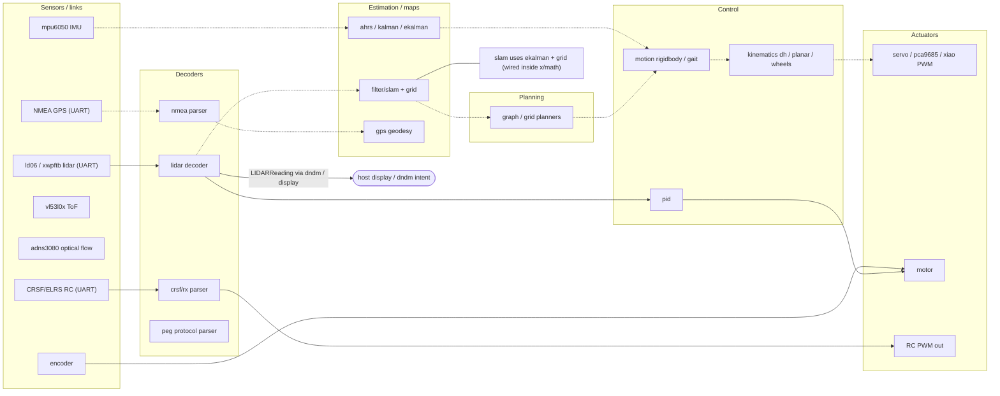
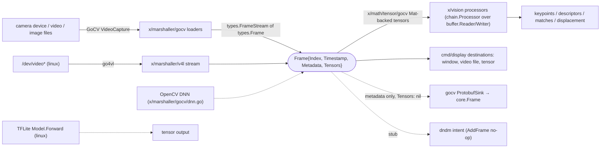

# Data flow

How data moves through the code that exists, stage by stage, and where the chain is broken. Every edge marked "wired" is an import plus a call site in the tree; "missing" means no in-tree code connects the two stages. Nothing here was run. Families: [[overview]]; messages: [[dndm-and-protobuf]].

## 1. Robot loop: sensor → decoder → estimation → control → actuator

Solid = wired in-tree; dashed = **missing** (both ends exist as libraries, nothing connects them).

| Stage | Packages | Wired consumers (reverse imports) |
|---|---|---|
| Bus/pin abstractions | `x/devices` (`I2C`, `SPI`, `Serial`, `Pin`, `PWM`; `*_linux.go`, `*_tinygo.go`, `*_stub.go`) — [[device-io]] | all device drivers |
| Sensors | `x/devices/{mpu6050,encoder,vl53l0x,lidar/vl53l0x,adns3080,as734x,cr30}` — [[sensors]]; `x/devices/lidar/{ld06,xwpftb}` — [[lidar]]; `x/devices/nmea` — [[nmea]]; `x/devices/crsf{,/rx,/tx}` — [[crsf-elrs]] | mpu6050, nmea, vl53l0x: **none**; encoder → `x/devices/motor`; lidar → `drivers/lidar`; crsf → `cmd/elrs-rx`; cr30/as734x → `cmd/cr30`, `cmd/spectrometer` |
| Decoders | lidar packet decoders (`x/devices/lidar/ld06/decoder.go`), NMEA sentences, CRSF frames, `x/math/protocol/peg` (declarative packet parser, [[peg-protocol-parser]]) | peg → `cmd/monitor` only |
| Estimation | `x/math/filter/*` — [[filters]]; `x/math/gps` — [[gps-geodesy]]; `x/math/grid` — [[grid-maps]] | `filter/slam` → `ekalman`, `grid`; `modulation/internal` → `fir`. **No device or app imports any filter** |
| Planning | `x/math/graph` (A*, Dijkstra, RRT*, …), `x/math/grid` planners — [[graph-and-planning]] | `grid`, `peg`, graph marshallers; no app |
| Control | `x/math/control/pid` — [[pid-control]]; `x/math/control/motion/*` (rigidbody, gait support) — [[motion-and-gait]]; `x/math/control/kinematics/*` — [[kinematics]] | pid → motor, both lidar decoders, motion/rigidbody; motion → `drivers/manipulator`; **kinematics → nothing** outside `x/math/control` |
| Actuators | `x/devices/{servo,pca9685,motor,xiao}` — [[actuators]] | servo + xiao → `drivers/manipulator` |

### Flows that exist end to end

1. **Lidar** ([[lidar]], [[W8-lidar]]): UART (`devio.Serial`) + motor PWM → `ld06.New(ctx, ser, motor, targetPoints, maxPoints)` (`x/devices/lidar/ld06/device.go:61`) decodes packets, regulates rotor speed with PID, assembles a scan as a `mat.Matrix` → `drivers/lidar/main.go` converts to `types.devices.LIDARReading` (`matrixToLIDARReading`) → (a) dndm intent via `IntentDestination.SetLIDARReading` on an in-process `direct` endpoint, (b) a GoCV drawing pushed as a `types.Frame` to a display (`main.go:225–262`). Firmware variant `drivers/lidar/main_rp2040.go` publishes over dndm serial (broken route, see [[dndm-and-protobuf]]). The decoder test `TestParseAndAssembleFullRotation` fails in both decoders (baseline §4).
2. **Manipulator** ([[kinematics]], [[actuators]]): `cmd/manipulator` (host) → dndm over serial → `drivers/manipulator` (XIAO SAMD21) → raw mode sets servo angles; planar/DH modes are placeholders (`drivers/manipulator/kinematics.dh.go:40–59` return "DH IK not yet implemented"; the import of `x/math/control/kinematics/joints/dh` is commented out at `:9–10`) → `ManipulatorState` back to the host. Routes: [[dndm-and-protobuf]].
3. **RC receiver** ([[crsf-elrs]]): UART 420 kBd → `crsf/rx` parser → `onChannels` → PWM per platform (ESP32 PWM is a stub, `cmd/elrs-rx/platform_esp32.go:56–59`) + battery telemetry every 500 ms (`main.go`).
4. **Motor speed loop** ([[actuators]]): `x/devices/motor` = encoder + PID + PWM (does not build on darwin/windows, F1).
5. **Serial protocol monitor**: `cmd/monitor` = serial port → PEG parser → printer (no darwin serial file, F2).

### Flows that do not exist

- IMU → AHRS/Kalman → attitude/body control (no app imports `filter/ahrs`, `mpu6050`).
- Lidar → SLAM / occupancy grid → planner → motion (all libraries; no glue; `LIDARReading` has `distances_mm`/`angles_deg` only, `proto/types/devices/sensors.proto:53–58`).
- Gait → leg IK → servo array (the [[W3-legged-ik]] goal): gait code in `x/math/control/motion/gait/*`, IK in `x/math/control/kinematics/joints/*`, servos in `x/devices/servo`; nothing connects them, and the manipulator firmware's IK hooks are placeholders.
- GPS (NMEA) → geodesy → navigation.

## 2. Camera → vision / tensor → output

- **Capture.** `x/marshaller/gocv` turns device/video/image-list/Mat sources into a `types.FrameStream` (`x/marshaller/types/types.go:45–72`, `x/marshaller/gocv/loader_device.go:177–276`, `streams.go:5`), with camera controls via `CameraController`. `x/marshaller/v4l` does the same on Linux without OpenCV (`stream.go:33–260`, `MultiStream` sync at `:265–420`). Both [[camera-io]]; neither was built or run here (OpenCV missing; V4L2 linux-only).
- **Tensors.** Frames carry `tensor.Tensor` values; for GoCV they are Mat-backed (`x/math/tensor/gocv`, clone/adopt/share handles — [[source-inventory|source inventory]]).
- **Vision.** 20 `x/vision/*` packages implement `chain.Processor[DST, SRC]` (`x/chain/interfaces.go`) over `buffer.Reader/Writer` of tensors: transforms (color, crop, affine, undistort, rectify, histogram, background, format), detectors/extractors (ORB, SIFT, AKAZE, KAZE, BRISK, FAST, GFTT via GoCV), FLANN matching, phase-correlation odometry, StereoSGBM depth. Pose-from-matches is a stub (`x/vision/odometry/pose/processor.go:110–124` returns 0; gocv v0.42.0 has no `FindEssentialMat`/`RecoverPose`, checked in the module cache) and corner matching is a stub (`x/vision/match/corners/processor.go:36`). Details: [[vision]], [[W5-feature-tensor-experiments]].
- **Outputs.** `cmd/display` destinations (window, video file, tensor → Mat) and the protobuf sink, which by policy writes metadata only (`x/marshaller/gocv/sink.go:185–210`). No path stores or streams feature tensors; the dndm destination drops frames (`cmd/display/destination/intent.go:85–98`).
- **Inference.** OpenCV DNN loading from bytes (`x/marshaller/gocv/dnn.go:13–30`), TFLite `Model.Forward` implementing the nn model interface (`x/marshaller/tflite/model.go:44–230`, linux only, [[tflite]]), and the native [[nn]] layers (conv, pooling, dense, LSTM, attention) — none connected to a camera flow in-tree.

## 3. Audio modem

`cmd/audio` ([[audio-modem-cli]]) = bits → line coding/FEC (`x/math/dsp/coding/*`, [[line-coding-and-fec]]) → modulation (`x/math/dsp/modulation/*`, [[modulation]]; MFSK, MPSK, QAM, MASK, DSSS, TC, adaptive; the chirp generator/receiver live in `cmd/audio/{gen,recv}_chirp.go`) → `x/marshaller/audio` (WAV files, miniaudio devices, [[audio-io]]) → receive → demodulate → decode. Coding and modulation stages are `chain.Processor`s over `x/buffer` bit/sample buffers ([[bit-buffer]], [[pipeline-and-chain]]). Several modulation round-trip tests fail (baseline §4). Robustness review: [[W7-filters-codecs-voice]].

## 4. Where dndm carries messages

| Link | Transport | Messages |
|---|---|---|
| host `cmd/manipulator` ↔ `drivers/manipulator` (XIAO) | dndm `remote` endpoint over serial (`network/serial` + `stream`) | `ManipulatorConfig`, `ManipulatorTarget` (host→MCU), `ManipulatorState` (MCU→host) |
| `drivers/lidar` (desktop) → in-process consumers | dndm `direct` endpoint | `types.devices.LIDARReading` (no in-tree consumer) |
| `drivers/lidar` (rp2040) → host | dndm `remote` over serial | `LIDARReading` (route invalid) |
| `cmd/display` → dndm | none in practice (flag inert, `AddFrame` no-op) | — |
| dndm → `cmd/display` | placeholder Interest source | — |

Everything else moves through Go channels (`FrameStream.C`), `x/buffer` ring buffers, or direct calls.

## TODOs

- [ ] Glue one closed loop end to end in-tree (proposal: IMU → AHRS → body attitude, or lidar → SLAM grid) with a recorded-data test, so the library families get an integration test — reverse-import scan above #p2
- [ ] Connect gait → leg IK → servo array for [[W3-legged-ik]] — `x/math/control/motion/gait/`, `x/math/control/kinematics/joints/`, `x/devices/servo/` #p2
- [ ] Replace the manipulator firmware's DH/planar placeholders with the `x/math/control/kinematics/joints/{dh,planar}` solvers — `drivers/manipulator/kinematics.dh.go:9–10,40–59` #p2
- [ ] Add a feature-tensor output path (encode tensors into `core.Frame` and record/stream them) — `x/marshaller/gocv/sink.go:185–210` #p2

## Inferred objectives (proposals)

- **Proposal:** standardise on "device → decoder → proto message on a dndm route" for every sensor, so estimation/control nodes can subscribe regardless of where they run (MCU, host, K230).
- **Proposal:** a recorded-data harness (lidar scans, IMU logs, camera frames as `core.Frame` files) to test estimation and vision offline without hardware.
