# Architecture overview

EasyRobot (`github.com/itohio/EasyRobot`, `go 1.25`, HEAD `abb5c9c`) is one Go module of ~175 k non-test lines: a float32 math core, signal/estimation/control/planning algorithms, a tensor + NN stack, marshallers for files/cameras/audio, device drivers for Linux and TinyGo boards, and a handful of CLIs and firmware mains. Package list: [[packages]]. Flows: [[data-flow]]. Messaging/schemas: [[dndm-and-protobuf]]. Targets: [[build-targets]]. Tensor/graph internals: [[source-inventory|source inventory]].

`README.md` and `DESIGN.md` are **untrusted claims**: `DESIGN.md:47–125` describes a `pkg/core`, `pkg/robot`, `pkg/vision` tree that does not exist (the code lives under `x/`), and `DESIGN.md:131–133` lists a "NATS transport" and a "Robot transport" as current; no Go file mentions NATS (`grep -rli nats --include=*.go` → none) and no packet transport package exists besides dndm (imported by `cmd/manipulator`, `drivers/lidar`, `drivers/manipulator` and the `cmd/display/destination` package) and CRSF.

## Layers

Derived from the actual import graph (families = vault module notes; how packages map to families: [[packages]]).

| Layer | Families (module notes) | Depends on | Role |
|---|---|---|---|
| L0 schemas / infra | `types/*` generated protobuf ([[dndm-and-protobuf]]); `x/crypto` | protobuf runtime, base58 | wire/config schemas; key helpers |
| L1 core | [[bit-buffer]] (`x/buffer`), [[type-conversion]] (`x/types`), [[iter-workers]] (`x/iter`, `x/workers`), [[primitive-kernels]] (`x/math/primitive/*`), [[mat-vec]] (`x/math`, `x/math/mat`, `x/math/vec`) | `chewxy/math32` | float32 vectors/matrices, BLAS-like kernels, quantised int kernels, element casts, threaded loops, ring/bit buffers |
| L2 numeric | [[tensor]] (`x/math/shape`, `x/math/tensor/*`), [[nn]], [[learn]] | L1, gorgonia | tensor API (eager + gorgonia graph), layers, training, quantisation |
| L3 algorithms | [[filters]], [[dsp-core]], [[modulation]], [[line-coding-and-fec]], [[peg-protocol-parser]], [[kinematics]], [[motion-and-gait]], [[pid-control]], [[graph-and-planning]], [[grid-maps]], [[interpolation]], [[gps-geodesy]], [[colorscience]] | L1 (mostly `mat`/`vec`), some L2 | the algorithm catalogue |
| L4 composition / IO | [[pipeline-and-chain]] (`x/chain`), [[store-and-plugin]] (only `x/crypto` remains), [[marshallers]], [[camera-io]], [[audio-io]], [[tflite]], [[vision]] | L1–L3, GoCV, malgo, go4vl, go-tflite | processor chains, (de)serialisation, capture/playback, OpenCV vision steps |
| L5 devices | [[device-io]] (`x/devices` bus/pin/serial abstractions), [[sensors]], [[actuators]], [[lidar]], [[crsf-elrs]], [[nmea]] | L1, [[pid-control]] | drivers over I2C/SPI/UART/PWM, Linux and TinyGo |
| L6 apps | [[apps]] (`cmd/*`, `drivers/*`), [[audio-modem-cli]] (`cmd/audio`), `cmd/elrs-rx` ([[crsf-elrs]]) | everything; dndm | CLIs, desktop tools, firmware mains |

## Dependency graph (families, excluding apps)

Edges are aggregated package imports (label = number of package→package import edges between the two families); 98 family edges in total incl. apps. Family-level cycles (`tensor` ↔ `iter-workers`/`type-conversion`/`primitive-kernels`) exist only because `x/math/shape` is filed under [[tensor]] while L1 packages import it.

```mermaid
flowchart TB
  subgraph L0_infra["L0 infra"]
    infra["infra"]
  end
  subgraph L0_schemas["L0 schemas"]
    types_proto["types/* (proto)"]
  end
  subgraph L1_core["L1 core"]
    bit_buffer["bit-buffer"]
    type_conversion["type-conversion"]
    iter_workers["iter-workers"]
    primitive_kernels["primitive-kernels"]
    mat_vec["mat-vec"]
  end
  subgraph L2_numeric["L2 numeric"]
    tensor["tensor"]
    nn["nn"]
    learn["learn"]
  end
  subgraph L3_algorithms["L3 algorithms"]
    filters["filters"]
    dsp_core["dsp-core"]
    modulation["modulation"]
    line_coding_and_fec["line-coding-and-fec"]
    peg_protocol_parser["peg-protocol-parser"]
    kinematics["kinematics"]
    motion_and_gait["motion-and-gait"]
    pid_control["pid-control"]
    graph_and_planning["graph-and-planning"]
    grid_maps["grid-maps"]
    interpolation["interpolation"]
    gps_geodesy["gps-geodesy"]
    colorscience["colorscience"]
  end
  subgraph L4_IO["L4 IO"]
    tflite["tflite"]
    marshallers["marshallers"]
    camera_io["camera-io"]
    audio_io["audio-io"]
    vision["vision"]
  end
  subgraph L4_composition["L4 composition"]
    pipeline_and_chain["pipeline-and-chain"]
    store_and_plugin["store-and-plugin"]
  end
  subgraph L5_devices["L5 devices"]
    device_io["device-io"]
    sensors["sensors"]
    actuators["actuators"]
    lidar["lidar"]
    crsf_elrs["crsf-elrs"]
    nmea["nmea"]
  end
  actuators -->|3| device_io
  actuators -->|1| pid_control
  actuators -->|1| sensors
  audio_io -->|1| bit_buffer
  audio_io -->|1| iter_workers
  audio_io -->|1| marshallers
  audio_io -->|2| tensor
  audio_io -->|1| type_conversion
  camera_io -->|1| bit_buffer
  camera_io -->|2| marshallers
  camera_io -->|4| tensor
  camera_io -->|2| types_proto
  colorscience -->|1| interpolation
  colorscience -->|5| mat_vec
  device_io -->|2| mat_vec
  dsp_core -->|4| mat_vec
  dsp_core -->|2| primitive_kernels
  dsp_core -->|3| tensor
  dsp_core -->|1| type_conversion
  filters -->|1| grid_maps
  filters -->|17| mat_vec
  gps_geodesy -->|2| mat_vec
  graph_and_planning -->|3| mat_vec
  grid_maps -->|1| graph_and_planning
  grid_maps -->|2| mat_vec
  interpolation -->|2| mat_vec
  iter_workers -->|3| tensor
  iter_workers -->|3| type_conversion
  kinematics -->|28| mat_vec
  learn -->|1| iter_workers
  learn -->|2| nn
  learn -->|2| tensor
  lidar -->|4| device_io
  lidar -->|7| mat_vec
  lidar -->|2| pid_control
  lidar -->|1| sensors
  line_coding_and_fec -->|17| bit_buffer
  line_coding_and_fec -->|17| pipeline_and_chain
  marshallers -->|3| graph_and_planning
  marshallers -->|4| mat_vec
  marshallers -->|1| nn
  marshallers -->|11| tensor
  marshallers -->|2| types_proto
  mat_vec -->|2| primitive_kernels
  modulation -->|9| bit_buffer
  modulation -->|7| dsp_core
  modulation -->|6| filters
  modulation -->|3| mat_vec
  modulation -->|9| pipeline_and_chain
  modulation -->|1| type_conversion
  motion_and_gait -->|1| kinematics
  motion_and_gait -->|8| mat_vec
  motion_and_gait -->|1| pid_control
  nmea -->|1| device_io
  nn -->|10| tensor
  peg_protocol_parser -->|1| graph_and_planning
  pid_control -->|2| mat_vec
  pipeline_and_chain -->|1| bit_buffer
  pipeline_and_chain -->|11| infra
  pipeline_and_chain -->|10| store_and_plugin
  primitive_kernels -->|9| bit_buffer
  primitive_kernels -->|1| iter_workers
  primitive_kernels -->|1| tensor
  sensors -->|6| device_io
  sensors -->|4| mat_vec
  store_and_plugin -->|3| infra
  tensor -->|2| iter_workers
  tensor -->|9| primitive_kernels
  tensor -->|2| type_conversion
  tflite -->|1| marshallers
  tflite -->|1| nn
  tflite -->|2| tensor
  type_conversion -->|2| tensor
  vision -->|19| bit_buffer
  vision -->|19| pipeline_and_chain
  vision -->|36| tensor
```

Reading it: almost every algorithm family depends only on [[mat-vec]]; [[modulation]], [[line-coding-and-fec]] and [[vision]] are the families built on the `x/chain` processor model + `x/buffer` readers/writers; [[tensor]] sits on [[primitive-kernels]]; [[marshallers]] is the hub that knows tensors, graphs, NN models and protobuf.

## Apps and firmware mains → families

```mermaid
flowchart LR
  cmd_audio["cmd/audio"] --> audio_io["audio-io"]
  cmd_audio["cmd/audio"] --> bit_buffer["bit-buffer"]
  cmd_audio["cmd/audio"] --> dsp_core["dsp-core"]
  cmd_audio["cmd/audio"] --> line_coding_and_fec["line-coding-and-fec"]
  cmd_audio["cmd/audio"] --> marshallers["marshallers"]
  cmd_audio["cmd/audio"] --> mat_vec["mat-vec"]
  cmd_audio["cmd/audio"] --> modulation["modulation"]
  cmd_audio["cmd/audio"] --> pipeline_and_chain["pipeline-and-chain"]
  cmd_audio["cmd/audio"] --> tensor["tensor"]
  cmd_calibrate["cmd/calibrate"] --> camera_io["camera-io"]
  cmd_calibrate["cmd/calibrate"] --> cmd_display["cmd/display"]
  cmd_calibrate["cmd/calibrate"] --> marshallers["marshallers"]
  cmd_calibrate["cmd/calibrate"] --> tensor["tensor"]
  cmd_calibrate["cmd/calibrate"] --> vision["vision"]
  cmd_cr30["cmd/cr30"] --> cmd_display["cmd/display"]
  cmd_cr30["cmd/cr30"] --> colorscience["colorscience"]
  cmd_cr30["cmd/cr30"] --> device_io["device-io"]
  cmd_cr30["cmd/cr30"] --> marshallers["marshallers"]
  cmd_cr30["cmd/cr30"] --> mat_vec["mat-vec"]
  cmd_cr30["cmd/cr30"] --> sensors["sensors"]
  cmd_cr30["cmd/cr30"] --> tensor["tensor"]
  cmd_display["cmd/display"] --> camera_io["camera-io"]
  cmd_display["cmd/display"] --> marshallers["marshallers"]
  cmd_display["cmd/display"] --> tensor["tensor"]
  cmd_display["cmd/display"] --> types_proto["types-proto"]
  cmd_elrs_rx["cmd/elrs-rx"] --> crsf_elrs["crsf-elrs"]
  cmd_manipulator["cmd/manipulator"] --> types_proto["types-proto"]
  cmd_monitor["cmd/monitor"] --> device_io["device-io"]
  cmd_monitor["cmd/monitor"] --> peg_protocol_parser["peg-protocol-parser"]
  cmd_spectrometer["cmd/spectrometer"] --> camera_io["camera-io"]
  cmd_spectrometer["cmd/spectrometer"] --> cmd_display["cmd/display"]
  cmd_spectrometer["cmd/spectrometer"] --> colorscience["colorscience"]
  cmd_spectrometer["cmd/spectrometer"] --> device_io["device-io"]
  cmd_spectrometer["cmd/spectrometer"] --> marshallers["marshallers"]
  cmd_spectrometer["cmd/spectrometer"] --> mat_vec["mat-vec"]
  cmd_spectrometer["cmd/spectrometer"] --> sensors["sensors"]
  cmd_spectrometer["cmd/spectrometer"] --> tensor["tensor"]
  cmd_spectrometer["cmd/spectrometer"] --> types_proto["types-proto"]
  drivers_lidar["drivers/lidar"] --> cmd_display["cmd/display"]
  drivers_lidar["drivers/lidar"] --> device_io["device-io"]
  drivers_lidar["drivers/lidar"] --> lidar["lidar"]
  drivers_lidar["drivers/lidar"] --> marshallers["marshallers"]
  drivers_lidar["drivers/lidar"] --> mat_vec["mat-vec"]
  drivers_lidar["drivers/lidar"] --> types_proto["types-proto"]
  drivers_manipulator["drivers/manipulator"] --> actuators["actuators"]
  drivers_manipulator["drivers/manipulator"] --> device_io["device-io"]
  drivers_manipulator["drivers/manipulator"] --> motion_and_gait["motion-and-gait"]
  drivers_manipulator["drivers/manipulator"] --> types_proto["types-proto"]
  drivers_lidar --> dndm(("dndm"))
  drivers_manipulator --> dndm
  cmd_manipulator --> dndm
  cmd_display --> dndm
```

`cmd/elrs-rx`, `drivers/manipulator` and the `rp2040` half of `drivers/lidar` are TinyGo firmware; the rest are desktop tools. Only `cmd/manipulator`, `cmd/display/destination`, `drivers/lidar` and `drivers/manipulator` import dndm; `cmd/display` registers an `--intent` flag (`cmd/display/main.go:32`) but nothing calls `NewIntentFromCobra`, so the flag is inert ([[dndm-and-protobuf]]).

## Key design patterns

1. **Options, three dialects.** Functional options `type Option func(*T)` (18 files, e.g. `x/vision/odometry/phase/processor.go` `WithSkip`); interface options `type Option interface{ Apply(*Options) }` across the marshaller family (`x/marshaller/types/types.go:15`, `camera.go:132`, `audio`, `gocv`, `v4l`); and plain `Config` structs passed by value (17 `type Config struct` under `x/`, e.g. `mpsk.Config`, which a stale test still calls with positional floats — baseline F6). A fourth dialect, untyped `x/options.Option func(cfg interface{})`, went with the deprecated pipeline in [[ER-cleanup]]. Composability cost: three ways to configure things; proposal below.
2. **Marshaller interfaces.** `types.Marshaller{Format; Marshal(w, value, opts...)}` / `types.Unmarshaller{Format; Unmarshal(r, dst, opts...)}` (`x/marshaller/types/types.go:32–41`) with `Frame{Index, Timestamp, Metadata, Tensors}` and channel-based `FrameStream` (`types.go:45–72`), and `MappedStorage`/`MappedStorageFactory` for file/mmap/memory/flash backing (`types.go:253–307`). Implementations: gob, json, yaml, csv, text, proto, graph, storage, audio, gocv, v4l, tflite ([[marshallers]], [[camera-io]], [[audio-io]], [[tflite]]).
3. **Processor chains over typed buffers.** `chain.Processor[DST, SRC]{Process(dst buffer.Writer[DST], src buffer.Reader[SRC]) int; Reset()}` (`x/chain/interfaces.go`), "dst nil → return max output size" convention; used by all 12 line-coding packages, 9 modulation packages and 19 vision packages (reverse imports of `x/chain`). The older deprecated `x/pipeline` step framework was deleted in [[ER-cleanup]].
4. **Build-tag platform split.** One interface file plus `_linux.go` / `_tinygo.go` / `_stub.go` (or `_windows.go`) implementations, e.g. `x/devices/{i2c,pin,serial,spi}*.go`, `x/devices/encoder/{linux,tinygo,stub}.go`, `x/marshaller/storage/{flash,file,mmap_segment_*}.go`; word-size splits in `x/types` (`*_i32.go` / `*_i64.go` GOARCH lists); threading split `use_mt` / `!use_mt` in `x/iter`, `x/workers`. The split is where most build breaks live (baseline F1–F4, plus the TinyGo `GOOS=linux` trap in [[build-targets]]).
5. **Protobuf as the message contract** for anything crossing a process/device boundary (`types/*`, dndm routes `Type@path`); in-process data stays Go structs/tensors. Details and inconsistencies: [[dndm-and-protobuf]].
6. **Allocation discipline is declared, not enforced.** Many processors document "preallocates … to avoid allocations in Process()" (e.g. `x/vision/odometry/phase/processor.go` header); no benchmark gates or `testing.AllocsPerRun` checks were surveyed here — see [[W2-code-optimisation]].

## TODOs

- [ ] Rewrite `DESIGN.md` against the real `x/` tree (or replace it with a pointer to this vault); remove the NATS/"robot transport" claims — `DESIGN.md:47–133` #p3
- [ ] Converge on one options dialect per layer (functional `func(*T)` for algorithms/devices; keep marshaller `Apply` options) #p3
- [ ] Add allocation tests (`testing.AllocsPerRun`) for processors that claim zero-alloc `Process()` — e.g. `x/vision/odometry/phase/processor.go` #p2

## Inferred objectives (proposals)

- **Proposal:** make the L1–L3 layers (no GoCV/malgo/cgo, no `x/devices`) the "portable core" with an explicit CI matrix (darwin/linux amd64+arm64, linux/arm, TinyGo tag-set compile) — this is the code the owner wants on ESP32/K230 ([[build-targets]]).
- **Proposal:** make dndm + protobuf the only cross-device boundary and route new device work (lidar, K230 features, ESP32 recorder) through it, deleting the placeholder `cmd/display/source/interest.go` path once a real Interest source exists ([[dndm-and-protobuf]]).
