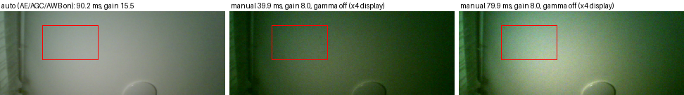

# ER-ESP32CAM C1 — exposure, gain and white-balance controls with read-back (OV3660)

**Check (from ER-CAM-steps.md):** setting manual exposure 2× doubles the mean of a flat patch (±15 %), and read-back matches what was set. **Pass.**

- Flat ceiling patch, 80×50 px. At gain 8.0 with gamma off, 39.9 ms gives Y mean 20.24 and then 20.38 (two runs); 79.9 ms gives 39.15. Ratio **1.93** (2 × 0.965).
- Two other ceiling patches give 1.875 and 1.895. All are inside ±15 %.
- The shortfall from 2.00 fits a constant pedestal of ≈ 1.3 LSB: Y = a·t + c, with c = 2·20.31 − 39.15 = 1.47 on patch 1 and 1.2 on patch 2.
- **Read-back:**
  - exposure set 40,000 µs reads 39,905 µs (347.0 lines); set 80,000 µs reads 79,925 µs (695.0 lines). The difference is quantisation to 1/16 line (7.2 µs) plus the integer line time;
  - gain set ×8.00 reads ×8.00;
  - modes read back exactly as set (`ae false agc false awb true awb_manual true gamma false`).



The manual panels are shown ×4 brighter. With gamma off the output is linear but dark and greenish; the colour matrix assumes gamma. The frames are cropped to the ceiling: the full frames show a person and stay in `_scratch`.

**To the owner's question** ("does the camera driver support exposure, sensitivity?"):
- It does now, for the OV3660: auto/manual exposure in µs, auto/manual gain (×), auto/frozen/manual white balance, and read-back of the live values, including what the auto loops chose.
- In this indoor scene the auto loops sit at **90.2 ms (the whole frame time) and gain ×15.5**: the room is dim, so the OV3660 runs at maximum exposure and high gain.
- **ISO:** the sensor has no ISO scale. ISO-equivalent = base ISO × gain, and the OV3660's base sensitivity isn't in any document I have (`#verify` with a light meter if wanted). The API therefore reports the gain multiplier, not ISO.

## 1. Controls (probe `tmp/esp32cam/grab/controls.go`; text commands `k<command>\n` on the USB console)

| Command | Registers (esp32-camera `ov3660.c` semantics) | Read-back |
|---|---|---|
| `ae 0\|1` | `0x3503` bit0 = AEC manual | `ae` |
| `exp <µs>` | AE off; `0x3500[3:0] 0x3501 0x3502[7:4]` = lines × 16, lines = µs / line time | `exp_lines_x16`, `exp_us` |
| `agc 0\|1` | `0x3503` bit1 = AGC manual | `agc` |
| `gain <×100>` | AGC off; `0x350A[1:0] 0x350B` = gain × 16 | `gain_x100` |
| `awb 1` | `0x5001` bit0 on (AWB block), `0x3406` bit0 = 0 (auto gains) | `awb`, `awb_manual` |
| `awb 0` | freeze: copy the current auto gains (`0x519F/A1/A3`) into `0x3400/02/04`, `0x3406` bit0 = 1 | `wb_x100` |
| `wb <r> <g> <b>` | manual gains, ×100 → 12-bit, 0x400 = 1.0 | `wb_x100` |
| `gma 0\|1` | `0x5000` bit5 gamma (off for linear measurements) | `gamma` |
| `get` | — | all of the above, plus `vts`, `line_ns`, `awb_status_raw` |

- **Line time** = measured VSYNC period / VTS (`0x380E/F`) = 90,045 µs / 783 = **115.0 µs**. It matches HTS 2300 / SYSCLK 20 MHz from the PLL settings (`calc_sysclk`).
- **Live values:** the exposure and gain registers hold the auto loop's current values while AE/AGC are on. The AWB gains are visible both in `0x3400–05` and in `0x519F/A1/A3`; both read e.g. 1.07/1.00/1.93 in auto.
- **Freezing** (`ae 0`, `agc 0`, `awb 0` without values) keeps the image unchanged: patch mean 152.6 auto vs 152.6–152.8 frozen.
- **Settings take effect one frame late.** The first frame after a change still shows the old setting: patch 1 reads 152.7 → 20.4, 20.25 → 39.2, 39.2 → 20.4 across the three changes. The driver API must drop one frame after a change.

## 2. Run (firmware SHA-256 `33b526f8…aa07ba0`, no-radio target)

```
C='host/camgrab/camgrab -port /dev/cu.usbmodem101 -trigger c -raw -rec=false'
$C -n 1 -pre $'kget\n'                                  → ctl ae true agc true awb true … exp_us 90160 gain_x100 1550 wb_x100 105 100 194 vts 783 line_ns 115000
$C -n 3 -pre $'kae 0\nkagc 0\nkawb 0\n'                 → … awb_manual true … exp_us 90160 gain_x100 1550 wb_x100 106 100 193
$C -n 3 -pre $'kgain 800\nkgma 0\nkexp 40000\n'         → ctl ae false agc false awb true awb_manual true gamma false exp_lines_x16 5552 exp_us 39905 gain_x100 800
$C -n 3 -pre $'kexp 80000\n'                            → exp_lines_x16 11120 exp_us 79925 gain_x100 800
$C -n 3 -pre $'kexp 40000\n'                            → exp_lines_x16 5552 exp_us 39905 gain_x100 800
```

Y-plane statistics come straight from the received YUYV (`-raw` writes `<seq>.yuv`); the last frame of each set is used.

| Patch (x0,y0,x1,y1) | auto | 39.9 ms | 79.9 ms | 39.9 ms again | ratio 79.9 / 39.9 |
|---|---|---|---|---|---|
| 1 (60,20,140,70) | 152.6 | 20.24 | 39.15 | 20.38 | **1.928** |
| 2 (230,30,300,80) | 106.6 | 9.93 | 18.72 | 10.04 | 1.875 |
| 3 (100,120,160,160) | 128.2 | 14.23 | 27.08 | 14.35 | 1.895 |

Noise σ on patch 1: 2.60 at 39.9 ms and 5.15 at 79.9 ms, which includes the ceiling's own shading gradient. The flat-patch noise analysis is C2's job.

## 3. Finding

**The first `awb 0` switched the image green.** It cleared `0x5001` bit0 (esp32-camera's `set_whitebal(0)`). That turns the AWB block off, so no gains apply at all, rather than holding the current ones. `awb 0` now keeps the block on and switches `0x3406` to manual with the frozen gains; verified by the unchanged frozen image.

## 4. API proposal for k210's `drivers/camera` sensor layer (via Leader)

```go
// package sensor — optional; a sensor implements it if it can.
type Controls interface {
	SetAutoExposure(on bool) error
	SetExposure(t time.Duration) error         // turns AE off; quantised to the sensor's line time
	SetAutoGain(on bool) error
	SetGain(milli uint32) error                // 1000 = 1×; turns AGC off
	SetAutoWhiteBalance(on bool) error         // off = freeze the current auto gains
	SetWhiteBalance(r, g, b uint32) error      // ×1000 each; turns AWB auto off
	ReadControls() (ControlState, error)       // live values, also while auto is on
}

type ControlState struct {
	AutoExposure, AutoGain, AutoWhiteBalance bool
	Exposure  time.Duration // as applied (after quantisation)
	GainMilli uint32
	WBMilli   [3]uint32 // R, G, B
	LineTime  time.Duration
}
```

- **Optional interface.** Callers check with `if c, ok := s.(sensor.Controls); ok { … }`, so a sensor without controls still builds; that matches k210's "no stub files" rule.
- **Exposure as `time.Duration`; gain and white balance as integer ×1000.** No floats on the MCU path. ISO is left out on purpose (§0).
- **Line time:** the sensor computes it from XCLK plus its own PLL/HTS table (OV3660 QVGA: 2300 / 20 MHz = 115 µs). It needs XCLK from `camera.Config`. The backend can cross-check it against the measured VSYNC period, as this probe does.
- **One-frame latency:** a set takes effect from the next frame, so `camera.Capture` after a control change should drop one frame, or the doc should say so.
- **Bus:** needs 16-bit register addresses for OV3660/OV5640 (E2 note). Both OV2640 and OV3660 use read-modify-write on the mode bits.
- **K210/OV2640 mapping** (for k210): OV2640 has the same three loops (COM8 AEC/AGC/AWB bits, AEC[15:0] in lines, gain register), so the interface fits both. The register details are k210's.

## 4b. State: clean point

C1 is complete, not paused: the check passed, the probe builds, the board runs the C1 firmware, and no work is half-done. The motion deliverable (ER-ESP32CAM-MOTION, M1) can start next. C2 needs the K210 side (k210's C1) and doesn't block it.

## 5. Files

- Evidence: `ER-ESP32CAM-C1.png` (`fa8e10c2…`).
- Raw: `tmp/esp32cam/c1/{auto,frozen,e40,e80,e40b}/` (PNG + YUV per frame; full frames include a person, not committed).
- The board is left running this firmware.

Network contacts: none.
