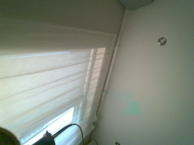

# ER-ESP32CAM E3 — a frame of the room fetched over USB-serial, pure TinyGo

**Result:** a TinyGo 0.43 firmware captures **320×240 YUV422** frames from the OV3660 through LCD_CAM + GDMA, sends them over the USB Serial/JTAG console in **camera frame format v1** ("ERIM" chunks, CRC-32, ER-K210-M0 §1a), and a host tool writes PNGs. 5 of 5 triggered frames arrived **CRC-clean** and complete (153,600 B each). The image shows the room: a window with blinds, the wall and window frame, a cable in the foreground.



`ER-ESP32CAM-E3.png` = `tmp/esp32cam/final/4.png`, SHA-256 `486d8bb0…6189e`. The orientation is as the sensor sees it (no flip or mirror set).

Note: the repo's `.gitignore:18` ignores `*.png`, so this evidence image is untracked-ignored. Committing it needs an exception (e.g. `!docs/evidence/*.png`) or `git add -f`. That's a decision for Leader, and it also affects k210's M4 PNG.

## 1. What runs

| Part | Where | What |
|---|---|---|
| Firmware | `~/src/tmp/esp32cam/grab/` (`main.go`, `lcdcam.go`, `ov3660.go`) | XCLK 20 MHz (LEDC, GPIO10); SCCB on I2C0 (GPIO39/40); OV3660 init for QVGA YUYV; LCD_CAM camera mode + GDMA RX ch0 into a 42 × 3840 B descriptor chain in internal SRAM; capture on trigger byte `c`; ERIM framing; no CPU interrupts (polling) |
| Host tool | `~/src/tmp/esp32cam/host/camgrab/` (Go, `golang.org/x/sys/unix` from the module cache) | opens the port raw with DTR/RTS cleared, sends `c` per image (resent after 3 s of silence), decodes ERIM with the v1 receiver rules (magic scan, length checks, CRC, ordering, `16 + data_len`), YUYV→RGB (BT.601), writes `<seq>.png` + `stream.bin`; `-in stream.bin` decodes offline |
| Sensor tables | transcribed from `espressif/esp32-camera` v2.1.9 (Apache-2.0): `sensor_default_regs`, `set_ae_level(0)`, `sensor_fmt_yuv422`, `set_framesize(QVGA)` incl. PLL (XCLK 20 MHz → PCLK 10 MHz) | `ov3660.go`, source cited per table |

These are probes under `_scratch` (Leader's call). They move into `drivers/camera` (`camera_esp32s3.go`, `sensor/ov3660`) once k210's interface lands. **k210's `cmd/camframe` didn't exist yet**, so the host decoder follows its v1 spec draft (ER-K210-M0 §1a). It's meant to be replaced by `camframe`, not to become a second tool.

## 2. Commands and output

```
GOTOOLCHAIN=local GOPROXY=off tinygo build -target=xiao-esp32s3 -size short -o grab.bin ./grab
   code    data     bss |   flash     ram
  27056    1212  343996 |   28268  345208          grab.bin SHA-256 4718ba15…268867
esptool --port /dev/cu.usbmodem101 write-flash 0x0 grab.bin
Wrote 28368 bytes (17443 compressed) at 0x00000000 … Hash of data verified.
host/camgrab/camgrab -port /dev/cu.usbmodem101 -n 5 -out final -timeout 60s   (log: final/camgrab.log)
grab: ov3660 init ok in 311 ms
grab: vsync pulses/300ms 3 high% 99 active-high false
grab: warmup 20 / 20 frames ok in 3610 ms
grab: ready, send 'c' for a frame
grab: capture seq 0 ok true bytes 153600 us 179860
image seq 0: 320x240 format 4 sensor 3, 153600 B in 38 chunks, fetch 5082 ms     (includes boot + warm-up)
grab: sent seq 0 in 175 ms
image seq 1: … fetch 295 ms
image seq 2: … fetch 326 ms
image seq 3: … fetch 344 ms
image seq 4: … fetch 347 ms
images 5, crc errors 0, dropped 0, lost 0, 6.58 s, 0.76 img/s, 114 KB/s
```

Timing (device clock, firmware log):

| Step | Time |
|---|---|
| Sensor frame period (VSYNC) | ≈ 90 ms (≈ 11 fps; 3 pulses / 300 ms) |
| Capture, arm → EOF | 179.86 ms every time (two frame periods, see §3) |
| Send 153,616 B in 38 chunks over USB Serial/JTAG | 175 ms (≈ 0.88 MB/s) |
| Trigger → PNG on the Mac, steady state | 295–347 ms (≈ 3 images/s) |
| Warm-up | 20/20 frames complete, 3.61 s |

Framing and CRC checked on the recording:
- `camgrab -in final/stream.bin` decodes the same 5 images; all 5 PNGs are byte-identical to the live ones.
- Flipping one byte at offset 200,000 of a copy: `images 4, crc errors 1, dropped 1, lost 1`. The damaged image is dropped, the rest decode.

## 3. Bring-up findings (observed)

1. **LCD_CAM receives only after a VSYNC that follows CAM_START.**
   - The first version armed right after a VSYNC pulse and stopped at the next pulse, polling the pin. It got **0 bytes**: descriptors untouched, buffer unchanged.
   - Running LCD_CAM + GDMA freely for 200 ms filled the chain (161,274 bytes changed, descriptors `0x40f00f00` = suc_eof + 3840 B).
   - Final scheme: arm after a pulse, set `CAM_VS_EOF_EN` so VSYNC raises GDMA `in_suc_eof`, and poll `IN_INT_RAW`. This yields exactly 153,600 B per frame in two frame periods (179.86 ms).
   - `[INFERENCE]` the camera starts at the first VSYNC after start, which is why esp32-camera fakes one by toggling the VSYNC input inversion (`ll_cam_do_vsync`). Copying that trick would halve the capture time; not done.
2. **Two candidate fixes turned out not to matter.** A boot self-test ran 3 captures for each combination of GDMA `IN_INT_ENA.in_suc_eof` and `LCD_CLOCK.CLK_EN`. All four gave 3/3 complete frames, so both were removed again.
3. **GDMA peripheral select gates memory access.** A memory-to-memory self-test with OUT `PERI_SEL` left at its reset value 0x3F failed: `OUT_DSCR_ERR`, plus a PMS DMA violation at the descriptor address. That violation only showed up after clearing `DMA_APBPERI_PMS_MONITOR_1`, whose reset value 3 keeps clearing the record. With `PERI_SEL` = 5 on both directions the copy matched 256/256. Diagnostic only; the camera path always used 5.
4. **TinyGo USB CDC RX:** `machine.Serial.ReadByte()` returns `(0, nil)` when empty, and only `Buffered()` drains the hardware FIFO into the ring. A loop that calls only `ReadByte` never sees host bytes. Fixed with `Buffered()` first.
5. VSYNC on this OV3660 setup idles high with a short low pulse (high 99 % of the time). It is routed inverted to `CAM_V_SYNC`, as in esp32-camera.
6. Memory: the frame chain is 161,280 B in `.bss` (internal SRAM, no PSRAM under TinyGo). QVGA YUV422 fits with room to spare. VGA YUV422 (614 KB) would need PSRAM or the sensor's JPEG mode.

## 4. Gaps and options (not needed for acceptance)

- **Faster capture:** fake the first VSYNC (one frame period instead of two) or keep LCD_CAM running into a ping-pong ring. ≈ 11 fps is the sensor limit at these PLL settings.
- **Larger frames:** VGA or larger needs either OV3660 JPEG (esp32-camera has `sensor_fmt_jpeg` + PLL settings; the frame format v1 already has format 5) or PSRAM support in TinyGo (not present in 0.43).
- **Colour:** the image has a faint green blotch on the right wall. `[INFERENCE]` it comes from lens shading or AWB under mixed light, not from the transport: the CRC is clean and the replay is identical. Not tuned.
- **Shared layer:** OV3660 needs 16-bit SCCB register addresses (reported in E2). k210's `sensor.Bus` is 8-bit in the M0 proposal.

## 5. State and hardware session

- Factory image restored: `write-flash 0x0 backup/flash-1.bin` → `Verification successful (digest matched)`, boot shows `Hello from Seeed Studio XIAO ESP32-S3 Sense` (`tmp/esp32cam/restore-boot-e3.log`). The board runs the factory app again.
- **The backup images had disappeared** from `tmp/esp32cam/backup/` by restore time. Only `SHA256SUMS` was left, and the directory was 0700 as Leader set it. The first restore attempt failed with `No such file or directory: 'backup/flash-1.bin'`.
  - I recreated `flash-1.bin` and `flash-2.bin` (0600) from an exact copy still held in my eval kernel's memory: the second read of the first backup pair, SHA-256 `ea18e0ff…37691`, the same value as `SHA256SUMS`. The restore used that file, verified.
  - `SHA256SUMS` is now 0600 too.
  - Update (Leader, 2026-11-09): Leader deleted the images on purpose because they held Wi-Fi credentials. Following that and the owner's new policy (no backups, no restores), I deleted the recreated `flash-1.bin`/`flash-2.bin` again and dropped the in-memory copy from my eval kernel. `backup/` now holds only `SHA256SUMS` (0600), kept as a record.
- Processes: none left running (`pgrep` clean). Throwaway run directories deleted; `final/` (5 PNGs, `stream.bin`, `camgrab.log`) kept.

## 6. Network contact (disclosed)

Read-only, all during E3 debugging:
- espressif/esp32-camera sparse clone (already disclosed in E2).
- `raw.githubusercontent.com`: esp-idf v5.3 `hal/esp32s3/include/hal/lcd_ll.h`, `memprot_ll.h` and three other v5.3 files (`esp_memprot.c`, `bootloader_esp32s3.c`, `cpu_start.c`), each piped through grep and nothing kept. Also three 404 probes for `cam_ll.h`, one of which wrote its body to `/tmp/x`; deleted straight away.
- `xiongyumail/lcd_cam` `esp32s3/lcd_cam.c` (piped, not kept).
- Two web searches; one bare-metal Ada page.
- One `api.github.com` code-search request (refused, 401).
- One `grep.app` search request (response could not be parsed).
- One attempted esp32.com forum read (blocked by a bot check).

## 7. No radio code in the images (owner: no Wi-Fi)

The `esp32s3` target sets build tag `espradio` by default (`targets/esp32s3.json`). Checked on the E3 image (`grab`) and the E2 image (`camid`):

- `tinygo build -target=xiao-esp32s3 -size full ./grab`: the package list has no `espradio`, Wi-Fi or BT package. It is `main`, `machine`, `runtime`, `device/esp`, `hash/crc32`, `encoding/binary`, `time`, `sync`, picolibc. The 172,610 B "(unknown)" bss row is TinyGo's `.iram_dummy`, the DRAM shadow reserved for IRAM (`llvm-readelf -S`: `.iram_dummy` NOBITS size 0x2a23c), not a radio buffer.
- `llvm-nm`: of 317 symbols defined in the image (non-absolute), the only radio-named one is `espradio_user_exception` (W). That is the weak default halt stub in `targets/esp32s3-interrupts.S:471–477`, linked into every esp32s3 program. The 138 other radio-named symbols (`bt_rf_coex_*`, `co_phy_*`, …) are absolute ROM addresses from the linker script (type `A`), not code in the image.
- Build without the tag: local target `tmp/esp32cam/target/xiao-esp32s3-noradio.json` (a copy of `esp32s3.json` with build tags `esp32s3 esp xiao_esp32s3`, no `espradio`, without the `--wrap=ppCheckTxConnTrafficIdle` linker flag). Results:
  - `grab-noradio.bin` is **byte-identical** to the default build and to the flashed `grab.bin` (SHA-256 `4718ba15…268867`).
  - `camid-noradio.bin` is byte-identical to `camid.bin` (`709cd9b9…75ed69`).
  - So the tag changes nothing for these programs. The local target stays available for builds that must exclude the tag.

## 8. Reference for the camera DMA (verify note, via Leader)

TinyGo's I2S driver already runs GDMA descriptor rings on the S3:
- `src/machine/machine_esp32xx_i2s.go`: `i2sDescriptor`, a ring of 3 descriptors, `nextTx`/`nextRx` refill on EOF;
- `src/machine/machine_esp32s3_i2s.go`: channel-0 register map, DMA clock/reset guarded by `PERIP_CLK_EN1_DMA_CLK_EN`, `MISC_CONF.CLK_EN`.

That is the in-tree reference for the `drivers/camera` port (E3b), and also a conflict: **I2S hard-codes GDMA channel 0, and so does this probe.** The driver should take a configurable channel (1–4) and reuse the I2S driver's guarded clock enable, so the camera and I2S can run together.
