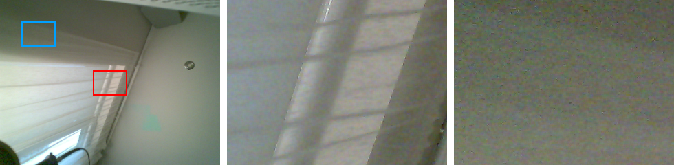

# ER-ESP32CAM E3c — scaled (full field of view) vs windowed (native crop)

**Check (set before starting):** the scaled frame shows a visibly wider field of view than the windowed one. **Pass.**

The scaled frame (left) shows the whole scene. The windowed frame (middle) is a native-resolution 320×240 crop from the sensor centre: a few blind slats and the window frame, magnified. Measured, the windowed frame occupies 50×37 px of the scaled frame, so the scaled field of view is 6.4× wider and 6.4× taller (§3).



Left: scaled. The red box marks where the centre window was found (§3); the blue box marks where the (200,200) window should fall. Middle: windowed, centre (x0 864, y0 648). Right: windowed at (200,200), the bare ceiling/wall near the top-left of the scene, as the blue box predicts. Single frames: `ER-ESP32CAM-E3c-scaled.png`, `ER-ESP32CAM-E3c-windowed.png` (re-saved as RGB by the composition script; originals listed in §4).

**On the owner's "looks cropped":** the scaled mode, the same registers as the E3 frame, already covers the full 2048×1536 active array (§3). The narrow view comes from the OV3660 module's optics: a 1/5" sensor with this lens. It is not a window. `[INFERENCE]` from the third-party camera notes cited in E0, which also say the OV3660 has a narrower FOV than the OV2640 on this board. A wider view needs a different lens or sensor module, not register changes.

## 1. Fresh frames (part 1, current firmware)

The E3 firmware (`grab.bin` SHA-256 `4718ba15…268867`) was reflashed and fetched 3 frames, CRC-clean 3/3, 153,600 B each:
- `tmp/esp32cam/fresh/0.png` (`54860331…`)
- `tmp/esp32cam/fresh/1.png` (`a83d9589…`)
- `tmp/esp32cam/fresh/2.png` (`2121fb9f…`)

The view is the window with blinds, the wall with a fixture, and the ceiling edge at the top. The paths went to Leader as a tell before this report.

## 2. The two modes (probe `grab`, `tmp/esp32cam/grab/`)

Commands on the USB console:
- `s`: scaled + one frame;
- `w`: windowed + one frame;
- `o<x>,<y>;`: window offset in array pixels, clamped to the array, applied on the next `w`;
- `c`: one frame in the current mode.

A mode switch writes the registers, waits 1.5 s for AE/AWB, drops 3 frames, then captures. Firmware SHA-256 `02221fff…b979c3`, built with the no-radio target (`target/xiao-esp32s3-noradio.json`). Common to both modes: YUV422 YUYV (`0x501F`=0x00, `0x4300`=0x30), PLL `0x303A..0x303D` = 00 08 11 02, `0x3824`=04, `0x460C`=22 (XCLK 20 MHz → PCLK 10 MHz).

| Register | Scaled (esp32-camera QVGA) | Windowed (centre) |
|---|---|---|
| X/Y_ADDR_ST `0x3800..3803` | 0, 0 | 864, 648 (x0, y0; centre = (2080−352)/2, (1548−252)/2) |
| X/Y_ADDR_END `0x3804..3807` | 2079, 1547 (full array) | x0+351, y0+251 (352×252 array window) |
| X/Y_OUTPUT_SIZE `0x3808..380B` | 320 × 240 | 320 × 240 |
| X/Y_TOTAL `0x380C..380F` | 2300 × 783 (binning: 1564/2+1) | 2300 × 1564 |
| X/Y_OFFSET `0x3810..3813` | 8, 2 | 16, 6 |
| ISP_CONTROL_01 `0x5001` | 0xA3 (scale enable, bit 5) | 0x83 (scale off) |
| TIMING_TC_REG20/21 `0x3820/3821` | 0x01 / 0x01 (binning) | 0x40 / 0x00 (no binning) |
| `0x4514` / `0x4520` | 0xAA / 0x0B | 0x88 / 0xB0 |
| X/Y_INCREMENT `0x3814/3815` | 0x31 / 0x31 (2× subsample) | 0x11 / 0x11 (1:1) |
| Frame period, capture time | ≈ 90 ms, 179.86 ms | ≈ 180 ms, 359.49 ms (VTS doubled) |

Windowed values follow esp32-camera's non-binning branch of `set_framesize`/`set_image_options`. The scaled values are unchanged from E3.

```
host/camgrab/camgrab -port /dev/cu.usbmodem101 -n 1 -trigger s -out e3c/scaled
grab: mode scaled (binning 2x2 + ISP scale, full array 2080x1548)
grab: capture seq 0 ok true bytes 153600 us 179860
images 1, crc errors 0, dropped 0, lost 0
host/camgrab/camgrab -port /dev/cu.usbmodem101 -n 1 -trigger w -out e3c/windowed
grab: mode windowed x0 864 y0 648 array window 352 x 252
grab: capture seq 2 ok true bytes 153600 us 359490
images 1, crc errors 0, dropped 0, lost 0
host/camgrab/camgrab -port /dev/cu.usbmodem101 -n 1 -pre 'o200,200;' -trigger w -out e3c/windowed-tl
grab: mode windowed x0 200 y0 200 array window 352 x 252
grab: capture seq 3 ok true bytes 153600 us 359491
images 1, crc errors 0, dropped 0, lost 0
```

Seq 1 was not fetched. The host re-sends its trigger after 3 s of silence, and the scaled run's mode switch takes about that long, so the device produced one extra scaled frame after the host had exited. Harmless; the windowed run starts at seq 2.

## 3. Field-of-view measurement

The windowed centre frame was searched for inside the scaled frame: greyscale, normalised cross-correlation, template downscaled by 0.08–0.45 in steps of 0.005 (eval script, numpy + PIL). Best match: **NCC 0.993 at scale 0.155, position (135, 102), 50×37 px**. If the scaled frame covers the full 2048-px-wide array, the scale is 320/2048 = 0.156 and the crop (native x 880–1199, y 654–893) lands at (135, 101). Measured and predicted agree, so the scaled mode is the full active array, scaled 6.4×.

## 4. Files

- Evidence: `ER-ESP32CAM-E3c.png` (composite, `a3bba9e4…`), `ER-ESP32CAM-E3c-scaled.png`, `ER-ESP32CAM-E3c-windowed.png`.
- Originals:
  - `tmp/esp32cam/e3c/scaled/0.png` (`38f8c1bd…`);
  - `e3c/windowed/2.png` (`42729974…`);
  - `e3c/windowed-tl/3.png` (`eb6261d4…`);
  - each folder has its `stream.bin`.
- `.gitignore`: added `!docs/evidence/*.png` after `*.png` (line 22). `git check-ignore -v docs/evidence/ER-ESP32CAM-E3.png` → matched by the negation, so not ignored; other PNGs stay ignored.
- Board: left running the E3c firmware (owner rule: no restores).

Network contacts: none.
