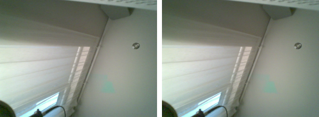

# ER-ESP32CAM E4 — continuous capture into a two-buffer GDMA ring

**Check (set before starting):** 100 consecutive frames, 0 drops, fps logged. **Pass, 3 runs of 3:** 100/100 complete frames each, 0 bad, 0 missed VSYNCs, **11.10 fps**. That is the sensor's own frame rate at these settings: one frame per VSYNC period, with no extra period as in single-shot E3.



## 1. Design (probe `tmp/esp32cam/grab/lcdcam.go` `buildRing`/`ringRun`, `main.go` `ringTest`)

- **Ring:** 80 GDMA RX descriptors of 3840 B (6 lines each). Descriptors 0–39 cover buffer A (`frameBuf[0:153600]`), 40–79 cover buffer B (`frameBuf[153600:307200]`). The last descriptor links to the first.
  - Two QVGA YUV422 frames = 307,200 B in internal SRAM `.bss`.
  - Heap left 85,392 B (`_heap_start` 0x3FCD6980, `_heap_end` 0x3FCEB710).
- **Running:** LCD_CAM + GDMA channel 0 are armed once, right after a VSYNC pulse as in E3, and never stopped during the run. `CAM_VS_EOF_EN` makes each VSYNC close the frame (GDMA `in_suc_eof`).
- **Per frame:** the CPU polls `IN_INT_RAW.in_suc_eof` and clears it. It reads `IN_SUC_EOF_DES_ADDR` to find the frame's last descriptor, then sums the descriptor `length` fields from the frame's first descriptor.
  - **Good frame:** exactly 40 descriptors, 153,600 B, starting at descriptor 0 or 40, i.e. the frame fills exactly one buffer.
  - **Bad frame:** anything else; its first occurrence is logged.
- **Drops:** the same loop counts VSYNC pulse starts on the pin between the first and the last EOF. A lost frame shows up as more VSYNC pulses than EOFs − 1.
- **No CPU copy on the capture path:** GDMA writes each frame straight into its buffer and nothing copies it there. Sending is not zero-copy: after the run, the last two good frames are sent over USB in ERIM v1 from their DMA buffers (`sendFrame(frameBuf[b*153600:…])`), and `sendFrame` stages each ≤ 4 KB chunk into a payload buffer, behind the 16 B meta on the first chunk, before computing the CRC. *Corrected after verify (`verification/ER-CAM-BATCH-2.md`): the first version said "the frame data are never copied".*
- **Commands:** `r` runs 100 frames. Earlier commands are kept: `c`, `s`, `w`, `o<x>,<y>;` (E3c).

## 2. Commands and output

Firmware SHA-256 `cab47eec…6230d3`, no-radio target (`target/xiao-esp32s3-noradio.json`), code 31,015 B.

```
esptool --port /dev/cu.usbmodem101 write-flash 0x0 grab.bin       … Hash of data verified.
host/camgrab/camgrab -port /dev/cu.usbmodem101 -n 2 -pre r -trigger '' -out e4/run1   (log: e4/run1/camgrab.log)
grab: warmup 20 / 20 frames ok in 3611 ms
grab: ring frames 100 bad 0 eofs 100 vsyncs 99 missed 0 span_us 8914453 fps_x100 1110
image seq 0: 320x240 format 4 sensor 3, 153600 B in 38 chunks …  wrote e4/run1/0.png   (buffer A)
image seq 1: 320x240 format 4 sensor 3, 153600 B in 38 chunks …  wrote e4/run1/1.png   (buffer B)
images 2, crc errors 0, dropped 0, lost 0
run 2: grab: ring frames 100 bad 0 eofs 100 vsyncs 99 missed 0 span_us 8914455 fps_x100 1110
run 3: grab: ring frames 100 bad 0 eofs 100 vsyncs 99 missed 0 span_us 8914453 fps_x100 1110
```

- **fps:** 99 frame intervals in 8.914 s = 11.10 fps, i.e. 90.05 ms per frame, the VSYNC period seen since E3. The three runs differ by 2 µs over 8.9 s.
- **Drops:** 99 VSYNC pulse starts between the first and last of 100 EOFs, so 0 missed.

## 3. Limits and what's next

- The ring is stopped before sending. Streaming while capturing is E5. USB sends 153.6 KB in 175 ms (E3), longer than the 90 ms frame period, so E5 must hold a buffer while it is sent and let the DMA skip it. That needs a third buffer (no internal SRAM left: 85 KB heap) or a deliberate skip of every other frame (≈ 5.5 fps). Or a smaller format: Y8 QVGA is 76.8 KB per frame.
- Polling only; no CPU interrupt. A missed EOF would show as bad or missed in the counters; none occurred.
- Same register path as E3; GDMA channel 0 is still hard-coded (E3 §8 note for the driver move).
- The board is left running this firmware (owner rule).

## 4. Files

- Evidence: `ER-ESP32CAM-E4.png` (composite of buffers A and B, `0ec84004…`).
- Originals: `tmp/esp32cam/e4/run{1,2,3}/` (PNGs, `stream.bin`, `camgrab.log`).

Network contacts: none.
