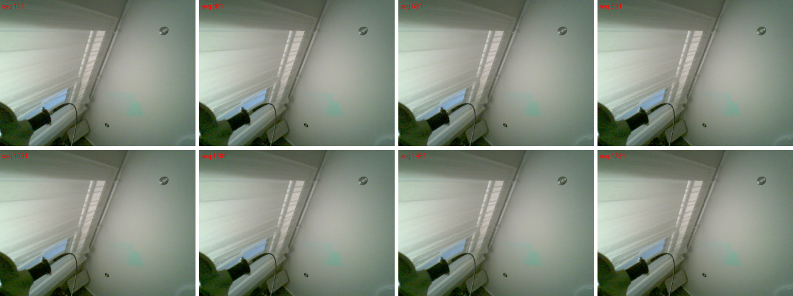

# ER-ESP32CAM E5 — 5 minutes of continuous QVGA colour streaming over USB-serial

**Check (set before starting):** 5 min continuous to the host viewer, 0 CRC errors, fps and skipped-frame counts logged, and something the owner can watch. **Pass.**

| | Value |
|---|---|
| Duration (host) | 300.11 s |
| Images received | **1,625**, all 320×240 YUYV, 153,600 B |
| CRC errors / dropped / lost (host, ERIM v1 rules) | **0 / 0 / 0** |
| Host rate | 5.41 images/s, 812 KB/s |
| Device: sent / captured / bad | 1,626 / 1,627 / 0 |
| Device: skipped sensor frames | 1,626, exactly one per sent frame, by design (Leader's choice) |
| Device fps | 5.43 (`fps_x100 543` over 299.3 s); half the sensor's 11.10 fps |
| Watchable output | `tmp/esp32cam/e5/run/e5-stream.mp4`: H.264, 320×240, 1,625 frames, 300.9 s at 5.4 fps, 2.4 MB. Also every 50th frame as PNG (33 files) |



## 1. Design (probe `tmp/esp32cam/grab/`: `main.go` `stream`, `lcdcam.go` `buildChains`/`armBuffer`/`waitBuffer`)

- **The bottleneck is USB.** A 153.6 KB frame takes ≈ 175 ms on the USB Serial/JTAG link (E3), about two 90 ms sensor periods. So the DMA must not run continuously into a buffer that is being sent. The E4 ring would overwrite it.
- **Two buffers (A, B), each with its own 41-descriptor chain:** 40 nodes for the frame plus one slack node into a 3,840 B scratch area. The chain ends after the slack node.
- **Loop:**
  1. arm a one-frame capture into one buffer;
  2. send the previous frame from the other buffer (no copy on the capture path; `sendFrame` stages each ≤ 4 KB chunk into its payload buffer for the meta and CRC, as noted in E4 §1);
  3. wait for the capture's EOF; swap.
- LCD_CAM starts at the next VSYNC after arming, so the capture covers exactly the frame after the one in flight. The send takes the remaining period, so one sensor frame is skipped per sent frame.
- **Frame check:** GDMA's `IN_SUC_EOF_DES_ADDR` must point at node 39, and nodes 0–39 must hold 153,600 B. Otherwise the capture counts as `bad` and the frame isn't sent.
- **Skipped count:** from the spacing of consecutive EOFs divided by the measured VSYNC period (90,044 µs).
- **Host:** `camgrab -pre v -trigger '' -post x` streams passively until `-dur`, then sends `x` to stop the device. It decodes and CRC-checks every image, writes every Nth PNG (`-every 50`) and pipes the raw YUYV into `ffmpeg … -c:v libx264` (`-mp4`). ffmpeg is the existing `/opt/homebrew/bin/ffmpeg`; nothing was installed.

## 2. Commands and output

Firmware SHA-256 `d568d2f5…53ec3e` (no-radio target).

```
host/camgrab/camgrab -port /dev/cu.usbmodem101 -n 1000000 -dur 300s -timeout 330s -pre v -trigger '' -post x \
  -every 50 -rec=false -mp4 e5/run/e5-stream.mp4 -mp4fps 5.4 -out e5/run        (log: e5/run/camgrab.log)
grab: stream start, vsync period us 90044
grab: stream sent 100 captured 100 bad 0 skipped 99 ms 18572 fps_x100 538
grab: stream sent 500 captured 500 bad 0 skipped 499 ms 92158 fps_x100 542
grab: stream sent 1000 captured 1000 bad 0 skipped 999 ms 184141 fps_x100 543
grab: stream sent 1600 captured 1600 bad 0 skipped 1599 ms 294535 fps_x100 543
grab: stream end sent 1626 captured 1627 bad 0 skipped 1626 ms 299319 fps_x100 543
images 1625, crc errors 0, dropped 0, lost 0, 300.11 s, 5.41 img/s, 812 KB/s
ffprobe e5-stream.mp4: h264 320x240, nb_frames=1625, duration=300.93 s, 2,424,956 B
```

The device sent 1,626 and the host counted 1,625: the last frame was in flight when the host stopped. Image seq numbers continue from earlier sessions on the same boot (131…1731); `lost` counts gaps inside the run (0).

## 3. Findings during the step

1. **First smoke runs showed 38–51 "bad" captures out of ~80**, sized 157,440 B = 41 full nodes. The cause was the check, not the camera. When the send outlasts the capture, the next frame's first lines spill into the slack node before the CPU stops the channel. The frame in nodes 0–39 is fine; the old check counted the slack node too.
   - Fix: validate up to the EOF descriptor, as E4 does.
   - After the fix: 0 bad in 132 + 1,627 captures.
2. **Arming right after the previous EOF** (`v`) gives 5.4 fps. Arming after waiting for a VSYNC pulse end (`V`, the E3/E4 way) gave only 3.7 fps (2 skipped per frame, 30 s smoke, 0 bad): the pulse that ends the frame is usually over before the CPU gets there. Both modes remain, and `v` is the default.
3. **0 bad captures with arbitrary-time arming** means LCD_CAM waits for a VSYNC before it records, consistent with E3 §3. A mid-frame start would show up as a short frame.

## 4. Limits

- The 5.4 fps ceiling comes from USB Serial/JTAG at ≈ 0.88 MB/s, near full-speed bulk. More fps needs sensor JPEG (E8) or a smaller payload. PSRAM buffers (E6/E7) would let capture run at 11 fps, but the link still carries only ~5.7 QVGA YUV frames/s.
- The MP4 (2.4 MB) stays in `_scratch` and is not committed. The evidence holds the contact sheet; the MP4 can go into the repo if Leader wants it.
- The board is left running this firmware.

## 5. Files

- Evidence: `ER-ESP32CAM-E5.png` (contact sheet of seq 131, 381, 581, 831, 1031, 1281, 1481, 1731; `4f137a80…`).
- Run: `tmp/esp32cam/e5/run/` (`camgrab.log`, `e5-stream.mp4`, 33 PNGs). Smoke runs: `tmp/esp32cam/e5/smoke/`.

Network contacts: none.
