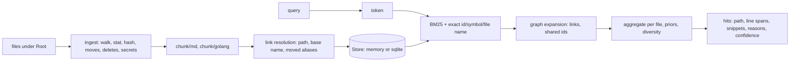

# Knowledge engine (`x/knowledge`)

**Purpose:** a local starting-point finder for "where is X" questions over a tree of Markdown and Go files. It ingests the files, indexes them lexically (BM25) and as a link graph, and returns ranked files with line spans and reasons. A consuming service exposes it as a `find` request/reply service, agent tool and CLI ([[ER-036-find-service|ER-036]]). Design: [[2026-11-09-knowledge-engine|knowledge-engine design note]]. This module is the design's first slice.

**Packages:** its own Go module `github.com/itohio/EasyRobot/x/knowledge` (go 1.26; only dependency `modernc.org/sqlite` v1.61.0, pure Go, from the module cache). A consumer does not inherit gocv/tflite/dndm. About 8.0 k lines of code (bench fixture excluded) and 4.1 k lines of tests.

## Public API

- `knowledge`: types (Doc, Chunk, Edge, NodeID helpers, Filter, Query, Hit, Result) and interfaces (Catalog, LexicalIndex, GraphStore, Writer, Store, Chunker, Ingestor, Retriever; VectorStore and Embedder declared, not implemented).
- `token.Tokens/Query/IDs`: the one tokenizer. Keeps ids (`ER-017`) and dotted/snake/kebab identifiers whole, also emits their parts, splits camelCase, and lightly stems prose.
- `memory.New()`, `sqlite.Open(path)`: both full `knowledge.Store`s, checked by the shared contract suite `storetest.Run`.
- `ingest.New(store, ingest.Source{Root, Scope, Exclude, Weights}).Sync(ctx)`: incremental, crash-safe per document.
- `retrieve.New(store, opts...).Find(ctx, knowledge.Query{Text, K, Filter, Near, Explain})`.
- `bench`: question sets, recall@k/MRR harness, a ripgrep-style baseline and a synthetic fixture.

## Algorithms

<!-- vault:algorithms h=f56d515d3b10 -->

No algorithm notes belong to this module.

<!-- /vault:algorithms -->

## Components

The engine's parts are catalogued here rather than as separate algorithm notes (its own module, its own tests).

| Component | Where | Status |
|---|---|---|
| Identifier-aware tokenizer | `token/token.go` | tested |
| Markdown heading chunker, frontmatter, wikilinks/links, tags, id mentions | `chunk/md/md.go` | tested |
| Go declaration chunker (go/parser), Defines/Imports edges | `chunk/golang/golang.go` | tested |
| BM25F in memory (k1 1.2, b 0.75, field weights 3/3/2/1) | `store/memory/memory.go` | tested |
| SQLite FTS5 `bm25()` over pre-tokenized fields, edges table | `store/sqlite/sqlite.go` | tested |
| Incremental ingest: stat→hash, move by hash, delete cascade, re-resolution | `ingest/ingest.go` | tested |
| Link resolution: path, `.md`, dir index, moved aliases, base-name fallback (weight 0.5) | `ingest/resolve.go` | tested |
| Secret file/chunk filter | `ingest/secret.go`, `ingest/walk.go` | tested |
| Hybrid retrieval: relative BM25 + exact bonus, graph expansion with hub damping, relative recency, status/supersedes priors, folder diversity | `retrieve/*.go` | tested |

## Build targets and dependencies

CGo-free and host-only (servers, CLIs). Not meant for TinyGo or MCUs: it uses maps, reflection through `database/sql`, goroutines and float64.

## Tests and evidence

`go test -race ./...` green across 10 packages (2026-11-09). The memory store scores exactly like SQLite FTS5, so the two stores rank identically. Fixture rows measured 2026-11-15.

| Corpus | Retriever | R@1 | R@8 | MRR | p95 |
|---|---|---|---|---|---|
| Fixture (28 questions) | engine (memory = sqlite) | 0.714 | 0.964 | 0.805 | 0.5 ms |
| Fixture (28 questions) | grep baseline | 0.500 | 0.964 | 0.668 | 0.2 ms |
| A frozen 7,899-document real notes corpus (30 questions) | engine (memory = sqlite) | 0.600 | 0.867 | 0.686 | 29 ms memory / 113 ms sqlite |
| A frozen 7,899-document real notes corpus (30 questions) | grep baseline | 0.100 | 0.533 | 0.223 | 156 ms |

Per-question fixture ranks: `go test -v -run TestEngineOnFixture ./bench/`; fixture design: `x/knowledge/bench/testdata/README.md`.

## API notes (ease of use, composability)

- One call each to ingest and to retrieve; the store is the only shared object. Swapping memory for sqlite changes one line.
- Reasons are plain strings (`exact id ER-017`, `linked from P`, `terms: a, b`), so a caller can see why a file was suggested.
- Underscore props (`_missing`, `_fuzzy`, `_moved_from`, `_stale`) are ingest bookkeeping. Callers should hide them.

## TODOs

Algorithm defects are tracked in the algorithm notes (table above) and rolled up in [[todo]]; this list holds module-level items only.

- [ ] Cross-link questions rank the asking note above its target (fixture cross-link R@1 = 0); hub notes collect summed graph boosts — `retrieve/graph.go` #p2
- [ ] Vocabulary-mismatch paraphrases need the optional vector layer (fixture f12) — embeddings experiment, design §7 #p2
- [ ] Re-resolution re-chunks every doc with missing or fuzzy links after any add/move/delete; index missing targets instead ([[ER-034-watcher-crash-test|ER-034]]) — `ingest/ingest.go` #p3
- [ ] Non-md/go files (py, c, ts, proto) are not indexed yet — [[ER-035-chunkers|ER-035]] #p2
- [ ] SQLite FTS5 scores every matching row before the limit; fine at 5 k docs, revisit at 10× — `store/sqlite/sqlite.go` #p3
- [ ] Secret-line regexes take ~40 % of ingest CPU (pprof on the frozen corpus); prefilter lines with cheap substring checks before the regexes — `ingest/secret.go` #p3
- [ ] Over-stemming from the iterated stemmer (`string`→`str`, `embed`→`emb`, `based`→`bas`) trades precision for plural/singular agreement; revisit with a dictionary-free Porter-style condition if precision suffers — `token/token.go` #p3

## Inferred objectives (proposals)

- **Proposal:** expose the engine to a consuming service next ([[ER-036-find-service|ER-036]]) before tuning further. Real user queries are the better benchmark (design "unknown knowns").
