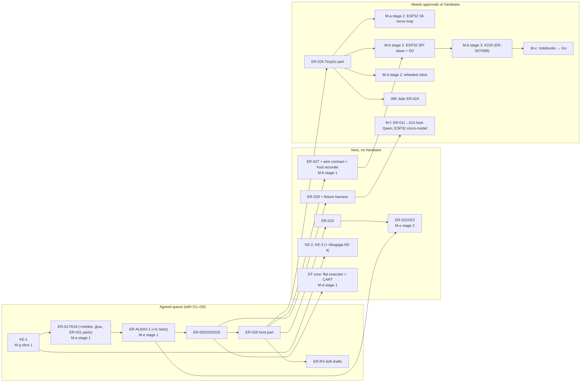

# Roadmap — from the catalog to the owner's demos

[Index](../index.md) · ER-R2 report (evidence: `~/src/docs/evidence/ER-R2.md`, outside the repo) · [TODO roll-up](../todo.md) · [Ticket index](../tickets/index.md) · [Known/unknown map](known-unknown.md)

This replaces the 2026-11-08 (R1) roadmap, which planned only the tensor/LLM track; its staging survives inside M-f (§7). Writing it authorises nothing: no build, flash, download, hardware run or deletion. Source and test edits for roster tickets are approved under the owner's autonomy instruction; everything listed under "Needs" and in §6 is not.

**Owner's end goals** (objective O-005, verbatim excerpts): "The end goal - a hexapod robot or a quadruper robot inverse kinematics with strides, gaits and timing." · "k230 chip that has a camera(m5stack kamera module) does modern embedded model feature extraction(no fully connected network - just the last feature tensor) then streams it to esp32 board via spi and that board does the recording" · "run yolo, run BoW style of place recognition and most importantly - teach a small network to do visual odometry … one can learn depth map too" · "plug some wheels to it, add a camera and it would avoid obstacles via camera!" · "need more robust encoders/decoderes, especially ones over voice!" · "i wish my nn framework would run a simple llm - e.g. loaded from qwen .5B … would be a huge deal for an article! especially if it would run on esp32 and do some face recognition" · "we'd need ingestion and retrieval in easyrobot so that abugaga can more effectively find files".

**Inputs:** the ER-R2 catalog (report: `~/src/docs/evidence/ER-R2.md`, IK review: `~/src/docs/evidence/ER-R2-ik-review.md`, both outside the repo; workstreams [W1](../workstreams/W1-knowledge-vault.md)–[W9](../workstreams/W9-go-nn-framework.md), [todo.md](../todo.md)); the knowledge-engine design ([ideation](../research/ideation/2026-11-09-knowledge-engine.md)); Leader's accepted decisions (roster `decisions.md`, "EasyRobot ER-R2" and "Knowledge engine") and the owner questions Leader holds; roster tasks KE-1 and ER-AUDIO-1.

## 1. Milestones at a glance

| | Milestone | Workstream | First demo (no hardware) | Device demo | Size (all stages) | Long pole |
|---|---|---|---|---|---|---|
| **M-g** | Knowledge engine serving Abugaga | W10 | KE-1 recall@k vs ripgrep | — (host only) | L | none; Abugaga integration is KE-4 |
| **M-a** | Hexapod / quadruped walking with strides, gaits, timing | W3 | host simulation of a hexapod tripod gait | 18 servos at 50 Hz from an ESP32 | XL | frame, servos and flashing approval |
| **M-e** | Robust voice modem | W7 | BER-vs-Eb/N0 curve on a channel model | speaker→mic (or the chosen channel) loop | L | owner's choice of "voice" channel |
| **M-f** | Go-native inference article | W9, W2 | eager fixtures; Qwen-0.5B decode on the host matching a reference | micro-LLM or face embedding on ESP32-S3 | XL | model download approval; TinyGo approval; tensor correctness first |
| **M-b** | K230 feature stream → SPI → ESP32 recorder | W4 | synthetic feature frames through framing, recorder and reader | K230 + camera → SPI → ESP32 → SD | XL | K230 board/SDK facts; TinyGo SPI slave support |
| **M-d** | Wheeled ESP32 camera obstacle avoider with decision trees | W6 | CART trained on logged features, flat executor on the host | wheeled robot avoiding obstacles | L | robot hardware; driving logs |
| **M-c** | Feature-tensor experiments (YOLO head, BoW, unsupervised VO/depth) | W5 | notebook experiments on recorded features | trained heads running from the stream | XL | owner's notebooks; M-b recordings |

Cross-cutting tracks that several demos need: build green (ER-026), filters (ER-019), marshallers (ER-027), devices (ER-025), lidar (W8, ER-024), code-optimisation skills (W2, ER-R3).

**Sizes** are product's guesses, not estimates from velocity (there is none yet; every existing ticket says "unestimated"). Unit: one easyrobot implementation round including verify. **S** ≈ 1 round, **M** ≈ 2–3, **L** ≈ 4–6, **XL** ≥ 7 or unknown until a probe answers a feasibility question. Owner bench time and approval waits are not included.

## 2. Sequence

### 2.1 The agreed order, and where it should change

Agreed (Leader, from ER-R2 and the knowledge-engine decisions): **KE-1 → ER-017/018 → ER-AUDIO-1 → ER-002/020/028 → ER-026 → ER-R3**. ER-001 is done; ER-002, ER-017, ER-018 and ER-026 stage 1 are ready ([ticket index](../tickets/index.md)).

| # | Change | Why | Recommendation |
|---|---|---|---|
| O1 | **Widen ER-018** to include the stride/foothold generator with body→leg transforms (IK review §6, evidence: `~/src/docs/evidence/ER-R2-ik-review.md`, outside the repo) and the gait → leg IK → servo glue | ER-018 as first scoped named only joint helpers, the phase scheduler and the swing curve. Without strides and glue, M-a's host demo can't be accepted | Landed: ER-018 scope items 4–5 |
| O2 | **Pull two ER-021 items into the ER-017/018 window**: homogeneous helpers that return zero rotation ([homogeneous transforms](../algorithms/homogeneous-transforms.md)) and the unpivoted 4×4 inverse ([matrix inverse and LU](../algorithms/matrix-inverse-and-lu.md)) | Body→leg transforms depend on them (inferred); the rest of ER-021 (quaternion, QR) can wait | Landed: ER-018 scope item 7 |
| O3 | **Add the stale `tc` test port to ER-AUDIO-1** ([SMPTE LTC timecode](../algorithms/smpte-ltc-timecode.md); baseline finding F6) | Only `x/math/dsp/modulation/tc` fails to build (`demodulator_test.go:19`, old `mpsk.NewModulator` signature), which turns the `x/math/dsp/modulation/...` gate red; the other modulation packages and ER-AUDIO-1's own packages still build and test | Add as ER-AUDIO-1's first step, so the wildcard gate is green again |
| O4 | **Put ER-022/023 straight after ER-AUDIO-1**, not later | Same files and tests (chain, framer, CRC, RS). ER-AUDIO-1 is channel-independent; ER-022's acquisition work needs the owner's channel choice | ER-AUDIO-1 now; ER-022/023 as soon as the channel is chosen |
| O5 | **Follow ER-002/020/028 with ER-029 and the reference-fixture harness** | ER-R2 decision 9 freezes *new* NN layers until a reference-fixture harness exists; ER-029 fixes existing layers, and M-f and M-c both need correct layers | Add as the next step after ER-002/020/028 |
| O6 | **Split ER-026** into a host part (amd64-only asm fallbacks, encoder stub, int-size build tags, `!tinygo` tags) and a TinyGo part (the first `tinygo build`, which needs install/run approval) | The host part needs no approval. Red packages make every later round's gate noisier. The TinyGo part opens every device stage | Keep the host part where agreed (or earlier if gates suffer); start the TinyGo part as soon as the owner approves TinyGo |
| O7 | **Add ER-027 and ER-019 to the queue** after ER-026 | ER-027 (proto INT8/UINT8 dropped) gates M-b's host stage. ER-019 holds wrong-result bugs with wide reach (Kalman/EKF `P` aliasing, Mahony sign) plus the PLL/AGC fixes M-e needs | ER-019's PLL/AGC part before ER-022; ER-027 before any M-b work |
| O8 | **Ask the owner for inputs now**, not when each milestone starts | The long poles of M-b, M-c, M-e, M-a stage 2 and W8 are owner inputs and approvals, not code (§6) | Leader sends the §6 list in one batch |
| O9 | **Decouple M-d from M-b** | The owner asks for "wheels … a camera"; M-d can start with an ESP32 camera or lidar sector minima as features, and adopt K230 features later | M-d stage 1 doesn't wait for M-b |

Keeping KE-1 first is right: it is independent of every other milestone and pays off for the whole roster at once.

### 2.2 Proposed order

**Demo checkpoints** in the order they can land: M-g KE-1 table → M-a host tripod simulation → M-e BER curve on a channel model → M-f eager fixtures pass (the "trusted reference") → M-b synthetic recorder round trip → M-d host-trained tree. Every device demo comes after the owner's TinyGo approval and the relevant hardware.

## 3. Milestones

### M-g — Knowledge engine serving Abugaga (W10)

- **Outcome:** Abugaga peers ask `x/knowledge` for ranked starting files with reasons and line spans instead of grepping; owner: "they'd just ask the engine and it would give me plausible starting points".
- **State:** design only ([knowledge-engine design](../research/ideation/2026-11-09-knowledge-engine.md)); no code; no todo.md items (the roll-up has no `x/knowledge` note).
- **Stages** (design §9):
  1. **KE-1**: interfaces; native in-memory lexical (BM25 with an identifier tokenizer), graph and flat vector stores; Markdown chunker (frontmatter, wikilinks, links, ids); hybrid retrieval with graph expansion and file aggregation; bench harness with a synthetic fixture and a ripgrep baseline. Own module `x/knowledge`. Housekeeping (Leader's decision 12): keep the tidy `go.mod` change and commit it with the first gated EasyRobot round.
  2. **KE-2**: pure-Go SQLite store (FTS5, edges, catalog, embedding cache), incremental ingest with moves and deletions, fsnotify.
  3. **KE-3**: Go chunker (symbols, imports graph); text chunker for py/c/ts/proto.
  4. **KE-4** (Abugaga ticket): `abg.svc.find` in `abu serve`, `roster_find`, `abu find`.
  5. **KE-5**: embeddings experiment, workspace LSA (no network) vs one approved static-model download; adopt only on the design's ≥ 5-point rule.
- **Acceptance:** KE-1 — a recall@k table for the 20 seed questions vs ripgrep, all offline. KE-2 — incremental and rename timings; a crash-mid-ingest test (kill, re-sync, consistent). KE-4 — a peer finds `keys.go` from seed question 1 in one call.
- **Dependencies:** none on other milestones. Known unknown: whether the nested module can reuse `fp32` without requiring the root module, and whether Abugaga builds against it with `GOPROXY=off` (a KE-1 probe).
- **Needs:** no hardware. Owner approval only for an embedding-model download (KE-5) and the Neo4j driver (network; only on demonstrated need). Owner decision 6 (git history and scratch folders in scope) stays open.
- **Size:** KE-1 M; KE-2 M; KE-3 S; KE-5 M. Total **L**.

### M-a — Hexapod / quadruped walking (W3)

- **Outcome:** a hexapod (then a quadruped) walks with strides, gaits and timing, driven by EasyRobot's IK.
- **State:** FK and the Jacobian are correct; IK converges 100 % from a warm start but 37–81 % cold, fails above 3 joints, and the analytic leg IK is silently wrong behind the yaw axis; gait scheduling, strides, body transforms, stability margin and servo timing don't exist ([W3](../workstreams/W3-legged-ik.md), IK review: `~/src/docs/evidence/ER-R2-ik-review.md`, outside the repo).
- **Stages:**
  1. **Host simulation (no hardware).** ER-017 (analytic leg IK with typed errors and angle wrap; damped, step-limited, limit-aware solver for longer chains) and ER-018 widened per O1/O2 (joint/leg helpers and servo map, phase scheduler with tripod/wave/ripple and walk/trot presets, swing curve, strides and body→leg transforms, glue to a servo array).
  2. **ESP32 servo loop.** Allocation-free 50 Hz loop for 18 joints: scheduler → footholds → swing curves → analytic IK → servo map → PCA9685, on an FPU-equipped ESP32; per-tick cost measured on the device. Needs ER-025 (PCA9685 register order, `ServoArray.Stop` deadlock) and the ER-026 TinyGo part.
  3. **Quadruped walk, then trot**, with the support polygon / stability margin (ER-037); gait selection exposed to M-d's trees (owner: "maybe decision trees could be used for legged robot gaits?").
- **Acceptance:** stage 1 — the IK review's tests, now in ER-017's and ER-018's acceptance: tripod has exactly 3 stance legs with phase offsets {0, ½}, wave ≥ 5, trot uses diagonal pairs (ER-018 scheduler); stance feet stay fixed in the world (< 1 mm drift per cycle, ER-018 strides); every foot reachable and every joint inside its limits over a full cycle; leg IK returns a typed error instead of a wrong pose; nominal-seed convergence ≥ 95 % within 100 iterations (ER-017). Stage 2 — `testing.AllocsPerRun` = 0 for one tick on the host; a measured tick time on the board under 20 ms; the owner's video of a tripod walk. Stage 3 — a quadruped walk with static margin > 0 throughout the cycle.
- **Dependencies:** ER-017, ER-018 (with O1/O2 folded in), then ER-025 and ER-026 stage 2 (TinyGo) for stage 2; ER-037 for stage 3.
- **Needs:** owner — which robot first (hexapod or quadruped, frame, servo model and count, leg geometry), the ESP32 board, a PCA9685 or equivalent; approval of the exact flashing scope; bench time for calibration and the walk. Ideation questions (scheduler vs CPG, swing curve for slow servos, servo zero auto-calibration) can run alongside stage 1.
- **Size:** stage 1 **M–L**; stage 2 **L**; stage 3 **M**.

### M-e — Robust voice modem (W7)

- **Outcome:** a byte link over a voice channel that survives real audio, with measured BER instead of "SNR within ±8 dB".
- **State:** the CLI encoder chain panics (`chain.Adapter` nil buffer); modems other than MFSK fail or are flaky; RS corrects nothing and CRC is non-standard; the ≈ 25–30 dB gap to theory comes from acquisition/sync and test design, not symbol decisions ([W7](../workstreams/W7-filters-codecs-voice.md)); UX-4 rated the codec/modem composition "rework".
- **Stages:**
  1. **ER-AUDIO-1** (+O3): composition and framing blockers found by UX-4, failing tests first, WAV files only; proposes (doesn't build) the simpler common path and a voice-channel test plan.
  2. **ER-022 + ER-023** (+ER-019's PLL/AGC): BER-vs-Eb/N0 harness with a channel model (Gaussian noise, fractional delay, level, ppm, band-pass, echo); shared synchroniser; phase-continuous NCO; framer with a standard CRC; real FEC (in-repo GF(256) RS with erasures, accepted) and an interleaver; voice-band profile (500–3000 Hz).
  3. **Real channel**: the same harness over the owner's chosen channel.
- **Acceptance:** stage 1 — each ER-AUDIO-1 item has a test that failed first; `gen-fsk` → `recv-fsk` round-trips "Hello" on a clean WAV. Stage 2 — the W7 target: BER < 1e-4 at Eb/N0 ≈ 10 dB with 4/8-FSK + chirp preamble + CRC-16 + interleaved FEC on the channel model; every modem change ships a BER curve. Stage 3 — the same target on the real loop.
- **Dependencies:** ER-AUDIO-1 → ER-022/023; ER-019 PLL/AGC. ER-023's CRC also serves M-b's SPI framing.
- **Needs:** owner — **which "voice" channel** (speaker→mic, phone codec or radio; held decision ER-R2 #4); whether to delete the wireline placeholders (held #5b). Stage 3 needs an approved audio device setup.
- **Size:** stage 1 **M**; stage 2 **L**; stage 3 **S–M**.

### M-f — Go-native inference article (W9, W2)

- **Outcome:** an article-grade demo of EasyRobot's own Go tensor/NN code running a small LLM natively (Qwen 0.5B on the host or K230 Linux) and a micro-model on the ESP32-S3 (a micro-LLM or face embedding), with reproducible numbers. Per accepted ER-R2 decision 9, Qwen 0.5B does not target the ESP32: at int4 it is ≈ 0.28 GB, about 35× the 8 MB PSRAM (33× against 8 MiB; ER-R2 gives 31×, which fits ≈ 0.25 GB).
- **State:** eager tests pass, but views ignore offsets, `NewAs` aliases, norm gradients and GPT layers are wrong; no loader, tokenizer, RoPE, GQA or KV cache; nothing for face recognition; eager MatMul 1.3 GFLOP/s vs Gorgonia's 17 at 512 ([W9](../workstreams/W9-go-nn-framework.md), [W2](../workstreams/W2-code-optimisation.md)).
- **Stages:**
  1. **Trusted reference:** ER-002, ER-020 (views, `NewAs`), ER-029 (attention, embedding, LSTM, BatchNorm2D, Conv1D gradient, `Sequential.Parameters`), the reference-fixture harness; eager becomes the reference.
  2. **Host LLM:** ER-011 (select and pin a local model and an external CPU reference) → ER-012 (operator map) → ER-013 (attention/KV fixture) → ER-014 (bounded native decode). W2's Exp7 GEMM port and a GEMV M=1 fast path for decode speed.
  3. **ESP32-S3:** TinyGo build probe of `fp32` then `eager`; float32 API; allocation-free workspace; int8 GEMM/GEMV with scale/zero-point (ER-004); ER-005/006 for one Xtensa kernel; a 1–5 M-parameter LM or a MobileFaceNet-class int8 face embedding.
  4. **Article:** methods, numbers with cold/warm runs, copies and allocations (ER-015), and what failed.
- **Acceptance:** stage 1 — fixture tests for every fixed layer against reference values; the Dense numerical gradient check passes. Stage 2 — per-layer and logit comparison with the reference within a declared tolerance for one bounded prompt; tokens/s and memory recorded. Stage 3 — zero allocations per inference after init on the host; on the board, a measured inference time and memory for the chosen micro-model. Stage 4 — every number in the article reproduces from a committed command.
- **Dependencies:** ER-002/020/029 → ER-011…014; ER-026 (asm fallbacks, int-size tags) before any TinyGo build; ER-004/005/006 for the device; ER-007/008 if K230 is used.
- **Needs:** owner — approval of the model download for ER-011 (Qwen 0.5B or similar); TinyGo install/run approval; the exact Xtensa chip (ESP32-S3 assumed); the board; for K230, the same facts as M-b.
- **Size:** stage 1 **L**; stage 2 **XL**; stage 3 **XL**; stage 4 **S**.

### M-b — K230 feature stream → SPI → ESP32 recorder (W4)

- **Outcome:** the K230 runs an embedded backbone without the fully connected head, streams the last feature tensor over SPI to an ESP32, and the ESP32 records it.
- **State:** no K230 or M5Stack camera code; SPI is master-only and the TinyGo SPI file is empty; no SPI slave, DMA, SD or FAT; proto marshalling drops INT8/INT16 and panics on UINT8; the only ESP32 target (`cmd/elrs-rx`) can't build under TinyGo as tagged ([W4](../workstreams/W4-k230-feature-stream.md)).
- **Stages:**
  1. **Host recorder (no hardware):** ER-027 (INT8/INT16/UINT8/FP16 round trip); the feature-frame wire contract (`core.Frame` + `types.math.Tensor` with `data_bytes`, scale, zero-point, layout; accepted ER-R2 decision 8, including the `easyrobot.*` proto rename); SPI framing (sync word, length, sequence, CRC, ready/IRQ handshake); a host recorder and reader over synthetic tensors.
  2. **ESP32 receiver:** the ER-026 TinyGo part (`cmd/elrs-rx` as the first ESP32 build); an SPI slave interface; an append-only SD recorder; length-prefixed raw frames, no protobuf decode on the MCU.
  3. **K230 producer:** ER-007 (board, OS image, SDK/nncase, runtime) → ER-008 (one int8 backbone subgraph) → stream at the agreed rate.
- **Acceptance:** stage 1 — synthetic frames survive framing → recorder → reader bit-exact, including dropped and corrupted frames detected by CRC and sequence. Stage 2 — at the W4 budget (7×7×1280 int8 at 10 fps = 5.02 Mbit/s) the ESP32 records for 10 minutes with zero lost frames, or the measured ceiling is reported. Stage 3 — the K230 streams real camera features at the agreed rate, and the recording replays on the host.
- **Dependencies:** ER-027, ER-023 (CRC), ER-026 TinyGo part, ER-004 and ER-007/008; new tickets for the SPI slave, framing, wire contract and SD recorder (none exist). The SPI link as a dndm link type waits for dndm's link-context work.
- **Needs:** owner — K230 board model, OS image, SDK/nncase versions and the camera module; approval of the K230 SDK download and of flashing both boards; TinyGo approval; an SD card.
- **Size:** stage 1 **M**; stage 2 **L** (TinyGo SPI slave support is unknown); stage 3 **XL** (runtime choice unknown).

### M-d — Wheeled ESP32 camera obstacle avoider with decision trees (W6)

- **Outcome:** a wheeled ESP32 robot avoids obstacles from camera input with a decision-tree policy it learned ("plug some wheels to it, add a camera and it would avoid obstacles via camera!").
- **State:** closure-based trees evaluate; `Balance` swaps branches; there is no tree learning, no plain-data tree, no MCU executor and no dataset logging ([W6](../workstreams/W6-decision-trees.md)).
- **Stages** (accepted ER-R2 decision 10: data-driven trees, learned offline from driving logs first):
  1. **Tree core on the host:** ER-028 (`Balance`, call the node op once); a plain-data flat-array executor with zero allocations; a host CART trainer with a golden test on a small public dataset; serialisation to a flash blob.
  2. **Robot and logs:** an ESP32 episode logger (features, operator action, outcome at 10–20 Hz) while the owner drives by RC or phone; camera features from an ESP32 camera at low resolution, lidar sector minima, or K230 features once M-b exists (O9); train on the host, flash the flat tree.
  3. **On-device learning** (optional): a Hoeffding tree with bounded memory, prototyped on recorded logs first.
- **Acceptance:** stage 1 — the trainer matches the golden dataset's known accuracy; the flat executor gives the same decisions as `VectorDecisionTree` on the same splits, with zero allocations. Stage 2 — obstacle-avoidance success rate over N runs on the owner's course (N and course defined with the owner), compared with a fixed-rule baseline.
- **Dependencies:** ER-028; ER-026 TinyGo part; ER-025 (encoder units) and the wheel-kinematics fixes (differential "wheel rates" are linear speeds); new tickets for the executor, trainer, serialisation, logger and an ESP32 camera capture driver (none exist).
- **Needs:** owner — the wheeled chassis, ESP32 (camera) board and RC/phone control; driving sessions; flashing approval.
- **Size:** stage 1 **M**; stage 2 **L**; stage 3 **M**.

### M-c — Feature-tensor experiments (W5)

- **Outcome:** small networks trained on the K230 feature tensor: a YOLO head, BoW-style place recognition, and unsupervised visual odometry and depth with feature extraction as the teacher.
- **State:** the vision baselines are broken or stubs; relative pose is unimplemented; no NMS, warp/upsample, depthwise layer or dataset reader; training correctness is unproven (Dense gradient check fails); the owner's notebooks aren't in the repo ([W5](../workstreams/W5-feature-tensor-experiments.md)).
- **Stages** (accepted ER-R2 decision 9: train in Python notebooks first):
  1. **Notebooks:** the owner's notebooks uploaded; experiments run on M-b recordings (or a public dataset passed through the same backbone until recordings exist); one frozen backbone shared by all three heads.
  2. **Go inference of the trained heads:** ER-029 and ER-020 fixes; DepthwiseConv2D and NHWC↔NCHW import; detection decode + NMS; bilinear warp / upsample; a dataset reader over `core.Frame` recordings; pure-Go relative pose (8/5-point + RANSAC); ER-030 per the accepted hybrid vision decision.
  3. **On the stream:** the heads run from the live feature stream.
- **Acceptance:** stage 1 — per experiment, a metric agreed with the owner (detection mAP, place-recognition recall@1, VO trajectory error against wheel odometry or lidar as weak ground truth). Stage 2 — Go outputs match the notebook's outputs within tolerance on the same inputs.
- **Dependencies:** M-b (backbone choice and recordings), ER-020/029/030; new tickets for the missing layers, reader and pose.
- **Needs:** owner — **the notebooks**; the backbone choice (shared with M-b); an OpenCV install only if the hybrid vision path is used on the host (approval).
- **Size:** each experiment **L** in notebooks; VO/depth **XL**; the Go port **L**.

### Cross-cutting tracks

| Track | Scope | Gates | Needs | Size |
|---|---|---|---|---|
| **ER-026 build green** | host part: amd64-only asm fallbacks, encoder stub signature, int-size build tags, `!tinygo` tags on desktop files, darwin serial, vet failures; TinyGo part: first `tinygo build` (`cmd/elrs-rx` for an ESP32 board, no flashing), CI/Makefile matrix | every device stage (M-a 2, M-b 2, M-d 2, M-f 3, W8) | TinyGo install/run approval; held decision #13 (remove the committed 9.3 MB ELF and the `go:generate tinygo flash` line) | M |
| **ER-019 filters** | Kalman/EKF `P` aliasing, Mahony sign, IIR/FIR coefficients, PLL wrap, AGC | M-e (PLL/AGC), W8 SLAM, any AHRS | — | M |
| **ER-027 marshallers** | proto INT8/INT16/UINT8, json/yaml integer panics, graph marshaller node data | M-b stage 1 | — | S |
| **ER-025 devices** | encoder units, PCA9685 registers, `ServoArray.Stop` deadlock, NMEA, serial busy-spin | M-a 2, M-d 2, W8 | — | M |
| **W8 lidar (ER-024)** | identify the module; fix LD06 (or XWPFTB); RP2040 firmware compiles; lidar → SLAM adapter | M-d (sector minima), M-c (weak ground truth) | owner: **label photo and a 5 s raw capture** (held #6); hardware scope approval | M (decoder), L (SLAM) |
| **W2 skills (ER-R3)** | `go-kernel-optimisation` skill draft; Exp7 GEMM port; GEMV fast path; reruns on ESP32-S3/K230 | M-f numbers | board access for reruns | M |
| **Deprecated cluster** | `x/pipeline`, plugin, store, options, logger, `internal/concurrency`; `use_mt` variants | none of the demos | held #11 (delete once dndm covers transport) | S |

## 4. Ticket map

| Ticket | State ([ticket index](../tickets/index.md), 2026-11-09) | Milestone(s) | Note |
|---|---|---|---|
| KE-1 (roster task) | review | M-g | first in the queue |
| ER-AUDIO-1 (roster task) | todo | M-e | + `tc` test port (O3) |
| ER-001 | done | all | darwin/arm64 host baseline |
| ER-002 | ready | M-f, M-d, M-c | with ER-020/028 |
| ER-003 | backlog | M-f | operator/dtype map |
| ER-004 | blocked | M-f, M-b | device/quantisation contract |
| ER-005 → ER-006 | backlog / blocked | M-f stage 3 | Xtensa target, one kernel |
| ER-007 → ER-008 | backlog / blocked | M-b stage 3, M-f | K230 |
| ER-009 → ER-010 | backlog / blocked | none of the demos | K510; park unless the owner names it |
| ER-011 → ER-014 | backlog / blocked | M-f stage 2 | host LLM; ER-011 needs model download approval |
| ER-015 | blocked | M-f stage 4 | measured comparison for the article |
| ER-016 | blocked | none of the demos | serialisation/resume; backlog |
| ER-017 | ready | M-a | |
| ER-018 | ready | M-a | widened per O1/O2 |
| ER-019 | backlog | M-e, W8, cross-cutting | O7 |
| ER-020 | backlog | M-f, M-c | with ER-002 |
| ER-021 | backlog | M-a | two items moved to ER-018 (O2), the rest later |
| ER-022 | blocked | M-e | after ER-AUDIO-1 (O4); owner channel choice; framer and voice-band profile folded in |
| ER-023 | backlog | M-e, M-b (CRC) | after ER-AUDIO-1 (O4) |
| ER-024 | blocked | W8 → M-d, M-c | after the owner identifies the lidar |
| ER-025 | backlog | M-a 2, M-d 2, W8 | |
| ER-026 | ready (stage 1) / blocked (stage 2) | all device stages | split per O6 |
| ER-027 | backlog | M-b | O7 |
| ER-028 | backlog | M-d (and M-f via ER-002) | with ER-002 |
| ER-029 | backlog | M-f, M-c | right after ER-002/020/028 (O5) |
| ER-030 | backlog | M-c | hybrid vision accepted |
| ER-031 | backlog | M-b | SPI framing, slave interface, host recorder |
| ER-032 → ER-033 | backlog | M-d | plain-data tree and flat executor; CART trainer and episode logger (O9) |
| ER-034, ER-035, ER-036 | backlog | M-g | KE-2, KE-3, KE-4 (ER-036 owner babyai) |
| ER-037 | backlog | M-a stage 3 | body pose, static stability |
| ER-038 | backlog | M-d | path-tracking signs, steer4 geometry |
| ER-039 | backlog | none of the demos | manipulator integration |

**Gating work with no ticket yet** (proposed scopes; Leader assigns numbers): M-b feature-frame wire contract (`core.Frame` + tensor) and the ESP32 SD recorder beyond ER-031's host recorder ([W4](../workstreams/W4-k230-feature-stream.md)); M-c DepthwiseConv2D and NHWC import, warp/upsample, NMS, dataset reader, relative pose ([W5](../workstreams/W5-feature-tensor-experiments.md)); M-d ESP32 camera capture driver ([W6](../workstreams/W6-decision-trees.md)); M-f float32 API, allocation-free workspace, GEMV fast path, int8 GEMM, decoder blocks ([W9](../workstreams/W9-go-nn-framework.md)); M-g KE-5 (until the model download is approved). The TinyGo build probe is ER-026 stage 2.

## 5. TODO map

[todo.md](../todo.md) is generated by `make docs` from the TODO lines in the vault notes: p1 items grouped by ticket tag (`#ER-0xx`), untagged p1 items by module note. Cite tickets and note names, never its line numbers. On 2026-11-09 it held 1165 open items after dedupe (p1 312, p2 549, p3 304); the p1 counts below are from that run and change with every regeneration. Gap work (new code rather than defects) has tickets but no TODO lines.

| Milestone | Defect tickets (p1 TODO lines) | Gap tickets (new work) | Notes |
|---|---|---|---|
| M-a walking | ER-017 (3), ER-018 (6), ER-021 (8), ER-025 (13; PCA9685, `ServoArray.Stop` for stage 2) | ER-018 items 1, 2, 4, 5 (helpers, scheduler, strides, glue); ER-037 | DH n > 3 and robust DH (ER-017) matter more for the manipulator (ER-039, 1) than for legs |
| M-b recorder | ER-027 (10), ER-023 (21; CRC), ER-026 (12; int-size tags, first ESP32 build in stage 2) | ER-031 | K230 facts are an owner input (§6) |
| M-c experiments | ER-020 (38), ER-029 (21), ER-030 (12) | none yet (see "Gating work" in §4) | |
| M-d avoider | ER-028 (17; decision-tree `Balance`), ER-038 (3), ER-025 (encoder units) | ER-032, ER-033 | |
| M-e modem | ER-AUDIO-1 (roster task: `chain.Adapter`, `tc` tests), ER-019 (17; PLL, AGC), ER-022 (54), ER-023 (21) | ER-022 (framer, voice-band profile) | chirp, FFT, windows and line codes only if the chosen design uses them |
| M-f inference | ER-020 (38), ER-029 (21), ER-026 (12) | none yet (see §4) | ER-002/003/011–015 carry the R1 staging (§7) |
| M-g knowledge | none (no vault note for `x/knowledge`) | KE-1, ER-034, ER-035, ER-036 | |
| Cross-cutting | ER-024 (9; lidar, after the owner's capture), ER-019 (Kalman/EKF `P` for W8/AHRS), ER-026 | — | untagged p1 (67) stays backlog by module note: [colorscience](../modules/colorscience.md) 15, [sensors](../modules/sensors.md) 15, [crsf-elrs](../modules/crsf-elrs.md) 14, [filters](../modules/filters.md) 6, [interpolation](../modules/interpolation.md) 4, [camera-io](../modules/camera-io.md) 3, [gps-geodesy](../modules/gps-geodesy.md) 2, [grid-maps](../modules/grid-maps.md) 2, [tflite](../modules/tflite.md) 2, [apps](../modules/apps.md), [learn](../modules/learn.md), [pipeline-and-chain](../modules/pipeline-and-chain.md), [store-and-plugin](../modules/store-and-plugin.md) 1 each |

## 6. What needs the owner

**Inputs and choices** (ask now, O8):
1. **Which robot first for M-a:** hexapod or quadruped, frame, servo model and count, leg geometry, the ESP32 board. Recommend: a hexapod tripod first (statically stable, matches the W3 plan).
2. **Voice channel for M-e** (held ER-R2 #4): speaker→mic, phone codec or radio. Recommend: speaker→mic first, FSK with BER-vs-Eb/N0 tests, as easyrobot recommends.
3. **K230 facts for M-b/M-f:** board model, OS image, SDK/nncase versions, camera module.
4. **Notebooks for M-c:** upload the unsupervised VO/depth notebooks.
5. **Lidar identity** (held #6): a label photo and a 5 s raw capture.
6. **M-d hardware:** the wheeled chassis, ESP32 camera board and RC/phone control.
7. **Which demo the article leads with** (M-f): host Qwen-0.5B in native Go, or the ESP32 micro-model. Recommend: lead with the host Qwen decode (reachable without hardware), with the ESP32 face embedding as the second act.

**Approvals** (none granted by this roadmap): TinyGo install and runs (opens every device stage); flashing each board, exact scope each time (roster rule 3); the K230 SDK/nncase download; the ER-011 model download; any embedding-model download (KE-5); the Neo4j driver (network, only on need); OpenCV only for the hybrid vision host path; held deletions #5b (wireline placeholders), #11 (deprecated cluster) and #13 (committed ELF and the flash `go:generate` line).

## 7. Kept from the R1 roadmap

- **Evidence before acceleration** (M-f's spine): pin the reference (ER-001 ✓, ER-003) → trusted CPU semantics (ER-002, ER-016) → device/quantisation contract (ER-004) → one target kernel or subgraph at a time (ER-005→006 Xtensa, ER-007→008 K230, ER-009→010 K510 independently) → small LLM CPU reference (ER-011) → native graph coverage (ER-012→013→014) → measured comparison (ER-015). Target branches proceed independently and don't authorise three speculative backends.
- **Smallest useful LLM proof:** pick a local model and produce an external CPU reference (ER-011); trace a tiny fixture through EasyRobot's real graph (ER-012/013); compare intermediates and logits; only then compose a native decode (ER-014). An external runtime is the comparator, never "native EasyRobot execution".
- **Stop/revise points:** dependencies don't reproduce → resolve before claiming a baseline; backend coverage fails → implement a named missing primitive or document another path, never swallow a panic; a target can't support the kernel or layout → keep the negative result; offload loses overall → keep CPU and the measured costs; a model exceeds memory or latency → shrink the model or context with a new manifest, no cloud or opaque fallback. The same rule applies to every milestone: a stage that fails its acceptance keeps its evidence and stops until a new choice is made.
- **Constraints:** demos use synthetic or recorded local inputs and bounded context until a stage says otherwise; real actuation, firmware, remote inference and roster integration are separate, approved steps.

## 8. Next

**Proposed — owner to approve.** Ranked from the no-hardware demo checkpoints in §2.2; none needs hardware, TinyGo or a download. easyrobot copies this list to the top of the [index](../index.md).

| # | Step | Tickets | Checkpoint (no hardware) |
|---|---|---|---|
| 1 | Knowledge engine v1, with the `go.mod` tidy committed in the first gated round | KE-1 | M-g: the KE-1 bench table (hybrid retrieval vs the ripgrep baseline on the synthetic fixture) |
| 2 | Leg IK and gait scheduling, with strides, body→leg transforms and gait→IK→servo glue (O1) and the two ER-021 fixes (O2) | ER-017, ER-018 | M-a: a host tripod simulation that walks with stance feet fixed in the world |
| 3 | Voice-modem composition fixes, starting with the `tc` test port (O3); then the BER harness, synchroniser, framer and FEC | ER-AUDIO-1, then ER-022, ER-023 (with ER-019's PLL/AGC) | M-e: a BER-vs-Eb/N0 curve on the channel model; tuning acquisition for a real channel waits on the owner's channel choice |
| 4 | Trusted reference: eager views and `NewAs` aliasing, the graph fixes (cycle checks, detached handles, decision-tree `Balance`), existing-layer fixes and the reference-fixture harness; ER-026's host part alongside if gates get noisy | ER-002, ER-020, ER-028, then ER-029 (O5) | M-f: eager fixtures pass, so eager is the reference |
| 5 | Decision trees on the host: plain-data tree, flat executor, CART trainer and episode logger (no M-b dependency, O9) | ER-032, ER-033, after ER-028's `Balance` fix | M-d: a tree trained on the host that classifies a recorded or synthetic obstacle set |

The sixth checkpoint, M-b's synthetic recorder round trip, follows these: it needs ER-027 and ER-031.
