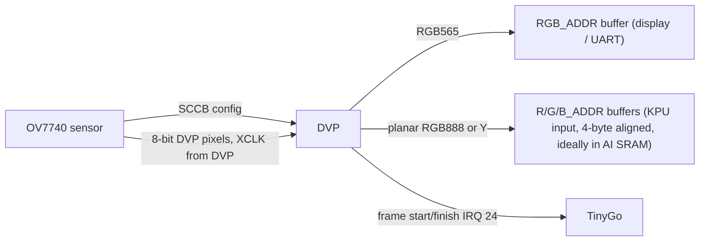

# K210 (M5Stack UnitV AI camera): camera interface and NN core in TinyGo

**Requirement:** the module is the M5Stack AI camera (UnitV), so its pinout and connections can be looked up; work splits into two workstreams — camera interface and NN core — built iteratively.

It links to [[W9-go-nn-framework]], [[W4-k230-feature-stream]], [[W5-feature-tensor-experiments]], [[2026-11-09-on-device-learning]] and [[2026-11-09-k230-spi-w4]].

**Status:** research plus a build-only smoke. **No flashing, and the board was not touched** (not even its serial port).

**Labels:** observed (read or run this session), reported (a page says so), inferred, `#verify`.

**Network (read-only):** 4 searches, 4 page reads.
- `docs.m5stack.com` (UnitV-OV7740)
- `raw.githubusercontent.com` (kendryte-doc-datasheet `en/003.md`)
- `wiki.sipeed.com` (K210 model deployment)
- `github.com` (loboris/ktool README, via API)

No downloads.

## Verdict

1. **The board is an M5Stack UnitV** (the "AI camera" unit; FTDI "M5Stack Intf").
   - Its pins are fixed: WS2812 LED on **G8**, buttons **G19 (A) / G18 (B)**, Grove HY2.0 on **G34/G35**, 16 MB flash, TF slot.
   - The **sensor depends on the variant** (OV7740 on U078-C; OV2640 and M12 variants exist), so read the label or probe the sensor ID (M3).
2. **TinyGo 0.43's `maixbit` target builds for it today.** blink 1,936 B and UART hello 1,856 B, with no errors (observed).
   - It has GPIO/GPIOHS, FPIOA, UARTHS, SPI0/1 controller, I²C and pin interrupts.
   - It has **no DVP, DMA or KPU driver**, though the **register structs for DVP, DMAC and KPU exist** in `device/kendryte`. It runs **one hart only**.
   - `maixbit`'s LED pins don't match UnitV (it uses discrete RGB on D12–D14), so add a small **`unitv` board file**.
3. **Camera:** the K210's DVP has its **own SCCB controller** and writes frames straight to memory: a display RGB565 buffer and **planar RGB888 or Y-only** buffers for AI (registers `SCCB_CFG/CTL`, `RGB_ADDR`, `R/G/B_ADDR`, observed). A TinyGo camera driver is register work, no DMA needed. First frame: 160×120 Y over UART.
4. **NN core: hybrid.**
   - The **KPU runs the backbone** through **kmodel v3** (nncase v0.1.0-rc5, the most hardware-accelerated format), driven by a **pure-Go kmodel runner**. That means porting the C runtime's register writes to `KPU.LAYER_ARGUMENT_FIFO`; nncase stays a host-side compiler.
   - **TinyGo int8 kernels on the RV64 cores** run heads and post-processing. They are the first real target for EasyRobot's embedded kernel layer (ER-research-1 decision 4).
   - Native-only inference is viable for tiny nets: roughly 55 M int8 MAC/s per hart (inferred from the generated loop: 7 instructions per MAC at 390 MHz).

## 1. Board facts

| Item | Value | Evidence |
|---|---|---|
| Product | M5Stack **UnitV** (K210 AI camera unit); variants UnitV-OV7740 (SKU U078-C), UnitV-OV2640, UnitV M12 (OV7740) | reported, docs.m5stack.com, shop listings (search) |
| SoC | Kendryte K210: dual-core RV64IMAFDC (RV64GC) **400 MHz** nominal, double-precision FPU per core, 32 KiB I$ + 32 KiB D$ per core, PLIC/CLINT | reported, K210 datasheet `003.md`; M5 page |
| SRAM | **8 MiB = 6 MiB general (0x8000_0000–0x805F_FFFF) + 2 MiB AI SRAM (0x8060_0000–0x807F_FFFF)**; uncached aliases at 0x4000_0000; AI SRAM usable by the CPU only when the KPU is idle and PLL1 is on | reported, datasheet |
| KPU | conv + BN + activation + pooling in one unit; **1×1 and 3×3 kernels**; any activation; real-time model size **5–5.9 MiB** (datasheet) / **5.5–5.9 MiB** (M5); marketing 0.8 TOPS (M5) / "1 TOPS@INT8" (Sipeed) | reported, datasheet `003.md` ("5MiB to 5.9MiB"); M5 UnitV page ("5.5MiB-5.9MiB"); Sipeed |
| KPU constraints (nncase) | input ≤ 320×240, output ≥ 4×4, 1–1024 channels; Conv2D/DepthwiseConv2D 1×1/3×3, stride 1/2, symmetric "same" padding; MaxPool/AvgPool 2×2/4×4; no PReLU; feature maps in the 2 MB AI RAM, weights in general RAM | reported, Sipeed (quoting nncase FAQ) |
| DVP | max 640×480; YUV422/RGB565 input; outputs **RGB565 for display** and **RGB888 or the Y of YUV422 for the KPU**; start/finish interrupts; SCCB configuration | reported, datasheet |
| Flash | **16 MB** | reported, M5 |
| LED, buttons, Grove | **WS2812 on G8**; **Button A G19, Button B G18**; **HY2.0-4P (I²C/UART/IO) on G34, G35** | reported, M5 PinMap |
| Camera (U078-C) | **OV7740**, 0.3 MP (656×488 array), SCCB, DVP 8-bit, VGA/QVGA, RAW RGB/YUV out, 6–27 MHz XCLK | reported, M5 |
| USB | FTDI USB-serial ("M5Stack Intf" on `/dev/cu.usbserial-6D52BBCC47`, FTDI 0403:6001 per decisions.md); UARTHS on IO4 (RX)/IO5 (TX), the ISP pins | reported (decisions.md); pins inferred from TinyGo `maixbit` defaults and K210 ISP convention, `#verify` against UnitV's MaixPy board config |
| Camera DVP pins | the usual K210 boards use dedicated DVP pins IO40–IO47 (SCCB SDA/SCL, RST, VSYNC, PWDN, HREF, XCLK, PCLK) | `#verify` against M5's MaixPy board config for UnitV |
| Current firmware | most likely M5's MaixPy / V-Function firmware (factory) | `#verify`: read the boot banner at 115200 once the owner allows touching the port |

**Boot and flash** (reported, ktool README):
- The host resets the K210 into the **ROM ISP** by holding **IO16 low** while toggling reset; on FTDI boards that is DTR/RTS.
- kflash/ktool then load a 2nd-stage ISP into SRAM and write the SPI flash.
- `kflash.py` writes 64 KB chunks at 64 KB-aligned addresses and **can't read**.
- **ktool** (enhanced kflash) **can read flash to a file** (`-R -a 0 -L 0x1000000 backup.bin`), writes at any 4K-aligned address, and loads to SRAM at high baud.
- TinyGo's `maixbit` flash command is `kflash -p {port} --noansi --verbose {bin}` (observed, target JSON).

**Firmware backup (before the first flash):**
1. Create a uv venv with `ktool` (kflash via a uv venv is approved; ktool is the same family, `#verify` that its PyPI/GitHub install is acceptable).
2. `ktool -p /dev/cu.usbserial-6D52BBCC47 -b 1500000 -R -a 0 -L 0x1000000 unitv-factory-16M.bin`.
3. Read it twice and compare the SHA-256 values.
4. Restore with `ktool -a 0 --nosha unitv-factory-16M.bin` (raw image, since the dump already contains the prefixed firmware, `#verify`).

## 2. TinyGo 0.43 on K210 (observed in `$(tinygo env TINYGOROOT)/src`)

| Area | State | Where |
|---|---|---|
| Targets | `k210` (riscv64, `+64bit,+a,+c,+d,+f,+m`, code model medium) and `maixbit` (inherits k210, `maixbit.ld`, `kflash` flasher) | `targets/k210.json`, `targets/maixbit.json` |
| Memory | linker: **RAM 6 MB at 0x8000_0000** for code, data, bss and heap; **stack 2 KB**; AI SRAM not mapped | `targets/maixbit.ld` |
| Clock | `CPUFrequency()` returns **390 MHz** (fixed) | `machine/machine_k210.go:15-17` |
| Harts | **one hart**: "Only use one hart for the moment"; hart ≠ 0 aborts | `runtime/runtime_k210.go:22-25` |
| GPIO | GPIO (8) + GPIOHS (32) via FPIOA; `Pin.Configure/Set/Get`, `SetFPIOAFunction`, pin-change interrupts | `machine_k210.go:55-190` |
| UART | **UARTHS only** (`UART0`), RX interrupt into a ring buffer; UART1–3 not wired | `machine_k210.go:343-403` |
| SPI | SPI0/SPI1 controller (`Configure`, `Transfer`); SPI2 is peripheral-mode, SPI3 flash | `machine_k210.go:405-505` |
| I²C | I2C0–2 controller (`Tx`, `SetBaudRate`); maixbit default pins **D34/D35**, which happen to be UnitV's Grove pins | `machine_k210.go:507-661`; `board_maixbit.go` |
| DVP, DMAC, KPU, SYSCTL, FFT, AES | **register structs only** (SVD-generated): `DVP_Type` with `SCCB_CFG/CTL`, `R/G/B_ADDR`, `RGB_ADDR`, `AXI`, `STS`; `KPU_Type` with `LAYER_ARGUMENT_FIFO`, `INTERRUPT_*`, `FIFO_DATA_OUT`, `EIGHT_BIT_MODE`; IRQ numbers `IRQ_DVP` 24, `IRQ_KPU` 25 | `device/kendryte/k210.go:94-97, 378-456, 3937-3946, 7455-7466` |
| Board pins | `maixbit`: LED = D13 (red), D12 green, D14 blue; UART D4/D5; SPI0 D26–D28; I2C D34/D35 | `board_maixbit.go` |
| Float codegen | **hardware FPU used** (`flw`, `fmul.s`, `fadd.s`) although the ELF reports a soft-float ABI (the calling convention only) | observed, `llvm-objdump` of the smoke's `dotF32` |

**Gaps for this project:**
- a `unitv` board file (WS2812 G8, buttons, Grove, camera pins);
- a WS2812 driver at 390 MHz;
- DVP and SCCB driver;
- DMAC (optional: DVP writes memory itself);
- KPU runner;
- second hart (runtime change);
- AI SRAM mapping;
- a bigger stack for kernels (raise `_stack_size` in a custom linker script).

## 3. Camera workstream

**Data path** (reported datasheet; register names observed in TinyGo's device package):

**Steps:**
1. **Power and clock:** enable the DVP clock in SYSCTL. Set XCLK (24 MHz, `#verify` OV7740 range 6–27 MHz). Drive sensor PWDN/RESET (pins `#verify`).
2. **SCCB:** use the DVP's built-in SCCB master (`SCCB_CFG` for speed and byte count, `SCCB_CTL` start). Read the **sensor ID**: OV7740 PID/VER 0x77/0x42, OV2640 0x26/0x42 (from memory, `#verify`).
3. **Sensor init:** write the register table. Port it from M5's MaixPy `ov7740.c` (about 200 writes; licence `#verify`, MIT or Apache expected). Select **QVGA YUV422** or RGB565.
4. **DVP config:** frame size, output modes (display RGB565 and/or AI), buffer addresses, interrupt on finish. One frame at 320×240 is 153,600 B RGB565 or 230,400 B planar RGB888.
5. **UART out:** the smallest useful frame is **160×120 Y (19.2 KB)**.
   - At 115200 baud: ≈ 1.7 s/frame. At 921600: ≈ 0.21 s. At 2 Mbaud: ≈ 0.1 s.
   - FTDI FT231X/FT232R top out around 3 Mbaud (`#verify` chip).
   - **Framing:** reuse the W4 chunk header (magic, seq, len, CRC-32). A host Go tool writes PNGs.

**Smallest TinyGo step** (milestone M4): `cam.Init(cam.QQVGA, cam.Y)`, then `cam.Capture(buf)` (wait for the finish IRQ), then `uart.Write(frameHeader); uart.Write(buf)`. That needs only SYSCTL, the DVP, SCCB and UARTHS register code; no DMA.

## 4. NN core workstream

### 4a. Native TinyGo inference on the RV64 cores

- **Observed codegen** (smoke `dot/`, `llvm-objdump`):
  - the int8 dot loop is **7 instructions per MAC** (`lb, lb, addi, mul, addw, addi, bnez`);
  - fp32 is 8 instructions per element (`flw ×2, fmul.s, fadd.s` + pointer/loop);
  - bounds checks are removed for fixed arrays, there is no unrolling, and no fused multiply-add.
- **Expected speed** (inferred, assuming about 1 instruction per cycle on an in-order core at 390 MHz, `#verify` on the board):

| Kernel | MAC/s per hart | With 4× unrolling and two accumulators |
|---|---|---|
| int8 | ~55 M | ~110 M |
| fp32 | ~50 M | ~100 M |

  Both harts would double this once TinyGo runs hart 1 (a runtime change).
- **What fits:**

| Model | Cost | Time on one hart (inferred) |
|---|---|---|
| MobileNetV1-0.25 @128 | ≈ 14 M MAC | ≈ 0.1–0.2 s |
| MobileNetV2-1.0 @224 | ≈ 300 M MAC | 3–5 s |

  So natively: **heads, small classifiers, post-processing, decision trees**. The KPU is for backbones.
- **Memory:** 6 MB minus code and frame buffers leaves ≈ 4–5 MB for int8 weights and activations.
- **EasyRobot link:** the eager tensor stack is too heavy for TinyGo (W9: `any` storage, float64 API, testify leak). Use the **flat int8/float32 kernel layer** (ER-research-1 decisions 4 and 6, `x/math/primitive/qi8`): the same Go code benchmarks on the host and on the K210.

### 4b. KPU via nncase-compiled kmodels

| kmodel | nncase | Notes |
|---|---|---|
| **v3** | **v0.1.0-rc5** | "less code, less memory, efficient, but fewer operators"; strict KPU layer rules (e.g. explicit ZeroPadding before stride-2 convs) (reported, Sipeed) |
| v4 | v0.2.0-beta4 | more operators, many in **software**, more memory (reported, Sipeed) |
| v5+ | nncase 1.x and later | K210 support in 1.x `#verify`; 2.x targets K230 |

**A pure-Go kmodel runner is feasible** (inferred):
- The v3 format is a header, a layer list, and per-layer KPU argument blocks (12 × 64-bit words) plus weights. Its structure is documented by the community (neucrack, "K210 kmodel 模型储存数据结构", search result).
- The C runtime (kendryte-standalone-sdk `kpu.c`) does this:
  1. writes each layer's argument words into **`KPU.LAYER_ARGUMENT_FIFO`**;
  2. places input in AI SRAM;
  3. waits for `INTERRUPT_STATUS` CALC_DONE;
  4. reads outputs from AI SRAM (or `FIFO_DATA_OUT`);
  5. runs the non-KPU layers (quantise/dequantise, global pooling, FC, softmax) on the CPU.
- TinyGo already has the register struct (§2). A port is mostly data-structure parsing plus register writes: about 1–2 weeks (inferred), validated against nncase's simulator outputs on the host.
- nncase itself runs **only on the host** as the model compiler (install/download needs approval; whether macOS builds exist for v0.1.0-rc5 is `#verify`, otherwise use a Linux container).

### 4c. Recommended: hybrid

- **KPU** runs the convolutional **backbone** (kmodel v3). The output is the **last feature map** (≥ 4×4). This revives W4/W5's "feature tensor out" at K210 scale: K210 → USB UART (host) or Grove UART (ESP32), with bulk recording on the TF card. UnitV's Grove port has only 2 signals, so there is no SPI link (budget in [[2026-11-09-on-device-learning]] §2.2).
- **TinyGo** runs heads, post-processing and on-device learning bits (Hoeffding trees, small dense heads: [[2026-11-09-on-device-learning]] Part 3).
- The **native path** gives a fallback and a benchmark for every KPU layer (correctness: same int8 math in Go on the host).

## 5. Iterative plan

| # | Milestone | Acceptance | Needs |
|---|---|---|---|
| **M0** | Build smoke (done) + a `unitv` board file and target JSON (inherits `k210`, own linker script with 16 KB stack, pins: WS2812 G8, buttons G19/G18, Grove G34/G35, UARTHS G4/G5) | `tinygo build -target=./unitv.json` of blink and hello succeeds; sizes recorded | none |
| **M1** | Backup + UART hello on the board | 16 MB factory dump read twice with equal SHA-256; hello at 115200 every second; **factory firmware restored** from the dump and boots | flashing (approved), ktool in a uv venv |
| **M2** | LED and buttons | WS2812 cycles red→green→blue (bit-banged at 390 MHz, or via SPI-encoded bits); button A/B presses print over UART | M1 |
| **M3** | Camera identity | DVP clock + SCCB read prints the sensor PID/VER (e.g. "OV7740 77 42") | M1; pins `#verify` |
| **M4** | One frame over UART | 160×120 Y (then QVGA RGB565) captured, sent framed with CRC at ≥ 921600 baud; the host tool writes a recognisable PNG; fps logged | M3 + sensor table |
| **M5** | Native int8 conv benchmark | 3×3 conv 32→32 on 40×30 int8, plus dot and GEMV kernels: **MAC/s on one hart**; outputs bit-identical to the host Go reference | M1 + qi8 kernels |
| **M6** | KPU kmodel run (Go runner) | a tiny kmodel v3 (e.g. MobileNetV1-0.25 or a 3-layer test net from nncase v0.1.0-rc5) runs; output within quantisation tolerance of nncase's simulator; ms/frame logged | nncase host install (approval); runner port |
| **M7** | Feature tensor out | camera → KPU backbone → last feature map streamed (W4 chunk framing) over USB UART, then over Grove UART (G34/G35) to an ESP32; sustained fps, CRC-clean for 10 min | M4 + M6 |
| M8 (opt.) | Second hart | the TinyGo runtime starts hart 1 for compute; conv benchmark ≈ 2× | runtime patch (upstreamable) |

## 6. Build smoke (observed)

**Setup:**
- outside the repo (`go.mod` module `k210smoke`; programs `blink/`, `hello/`, `dot/`);
- `GOTOOLCHAIN=local GOPROXY=off /opt/homebrew/bin/tinygo build -target=maixbit -size=short`;
- TinyGo 0.43.0 (go1.27.2, LLVM 22.1.4).

| Program | code | data | bss | Result |
|---|---|---|---|---|
| `blink` (toggles `machine.LED` = D13; **not UnitV's LED**, see M0) | 1,936 B | 0 | 208 B | built, no errors |
| `hello` (UARTHS 115200, a line per second) | 1,856 B | 0 | 208 B | built, no errors |
| `dot` (int8 and fp32 dot products, for codegen inspection) | 2,032 B | 0 | 2,768 B | built; disassembly in §4a |

**Not run:** nothing was flashed, and the board's serial port wasn't opened.

## Knowledge map

| Quadrant | Item | Next step, owner |
|---|---|---|
| Known knowns | UnitV pin map (LED G8, buttons G19/G18, Grove G34/G35), 16 MB flash, K210 memory map and KPU limits (reported); TinyGo K210 peripheral coverage, register structs, single hart, FPU codegen, smoke sizes (observed) | — |
| Known unknowns | Which sensor this unit has (OV7740 / OV2640 / other) | owner label photo, or M3 |
| Known unknowns | UnitV camera control pins (PWDN, RESET, XCLK) and UARTHS pins | from M5's MaixPy board config |
| Known unknowns | The factory firmware's identity and boot banner | M1 |
| Known unknowns | Real MAC/s per hart; KPU ms per layer | M5, M6 |
| Known unknowns | nncase v0.1.0-rc5 availability on macOS | at M6 (download approval) |
| Unknown knowns | Whether the owner wants MaixPy kept as a fallback image (restore after every test) or replaced | owner |
| Unknown unknowns | KPU behaviour under TinyGo's interrupt setup (PLIC priorities, single hart) | M6 |

## Owner decisions

| # | Decision | Recommendation |
|---|---|---|
| 1 | Confirm the variant: send a label photo (UnitV-OV7740 is the likely U078-C), or let M3 probe the sensor ID | Probe in M3; a photo saves a step |
| 2 | Use **ktool** (kflash-compatible, can **read** flash) in a local uv venv to back up all 16 MB before the first flash, and restore the factory image after tests | Yes |
| 3 | NN core = **hybrid**: KPU backbone via **kmodel v3** with a **pure-Go runner** (nncase only on the host as the compiler; its install needs approval at M6), TinyGo int8 kernels for heads and post-processing | Yes |
| 4 | Add a **`unitv` board target in EasyRobot** (board file + target JSON + linker script with a 16 KB stack) rather than patching TinyGo; upstream it later | Yes |
| 5 | Second hart and DMA only when a milestone needs them (M8; DVP needs no DMA) | Yes |
