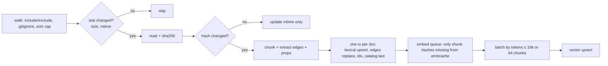

# Knowledge engine: ingestion and hybrid retrieval in EasyRobot

Workstream W10. EasyRobot implements it as the `x/knowledge` module ([[knowledge-engine]]) and the follow-up tickets in §9.

**Recommendations, not decisions.** No code was run for this note. Commands were read-only: `find`, `grep`, `ls` of the Go module cache, and file reads. No network.

**Labels:**
- **observed:** I read the file or ran the read-only command;
- **reported:** another note says so;
- **inferred:** my reasoning;
- `#verify`: a guess.

**Requirement:** reuse some ideas of an earlier memory service, but solve batching, graphing and retrieval. EasyRobot should provide these algorithms as abstractions over vector and graph interfaces, with connectors to neo4j and/or pgsql and/or a native graph implementation. The engine is a **local starting-point finder** over a tree of Markdown and Go files: a user or a consuming service asks "where is X" and gets plausible starting files, with line spans and reasons, to narrow down from.

**Constraints a consuming service places on the design** (reported):
- Vectors are optional and derived, never required. Queries and embeddings must preserve scope/tenant permissions; no cross-scope nearest-neighbour leak.
- Knowledge and lookup are an optional backend of the service, not part of its core.

## Verdict

1. **Lexical + graph first; vectors are an optional, derived layer.** In a notes-and-code tree most "where is X" questions share words, identifiers or links with the right file. BM25 with identifier-aware tokens, fused with link-graph expansion, should find most starting points with no model at all (inferred; the benchmark in §8 decides). It also satisfies the rule that vectors are never required.
2. **The target corpus is small, so there's no ANN index.**
   - The corpus the engine was sized for holds about 5,100 Markdown and Go files totalling 37 MB, with about 10,100 links between notes (observed, §2).
   - That is roughly 25–40 k chunks. Exact (flat) vector search over 40 k × 384 floats is about 15 M multiply-adds per query, a few ms in Go (inferred).
   - HNSW stays behind the `VectorStore` interface until a corpus is 10× larger.
3. **One pure-Go file holds the whole persistent index.** `modernc.org/sqlite` v1.61.0 is already in the module cache, CGo-free, compiled with FTS5 (BM25) and bundling **sqlite-vec v0.1.9** (observed). One SQLite file can hold lexical, vector and graph data (edges plus recursive CTEs) with transactions. An in-memory store serves tests. PostgreSQL (pgx v5.11.0 is cached, observed) and Neo4j (driver **not** cached, so it needs network approval) come later.
4. **A consuming service uses it as a library** inside one long-running process and exposes it as one request/reply `find` service. The transport identifies the caller, so the service can filter by scope. A CLI and an agent tool call the same service.
5. **Embeddings without network:** none are installed on the development host (observed, §7).
   - Zero-network option: vectors trained on the corpus itself (LSA).
   - One-download options: static model2vec-style vectors (pure Go at query time), or a transformer embedding model through an existing MLX setup.
   - The benchmark picks; the owner approves any download.
   - Cloud embeddings are off by default, because they send corpus text to a provider.

## 1. What to reuse from the existing memory service

Source: the memory service's `internal/memory/**`, `pkg/embeddings/**`, `proto/memory.proto` (observed, 1,313 lines including generated code).

| Memory-service piece | What it does (observed) | Keep / drop | Why |
|---|---|---|---|
| `types.Store{Lookup(emb, threshold, limit); Commit(emb, text, tag)}` (`internal/memory/types/types.go`) | the whole interface: one vector per text | **Drop the shape, keep the idea of a narrow store interface** | No ids, no source path, no deletion, no update, no model id. `tag` is accepted and then discarded (`mem/store.go` `Commit` never stores it). A file index needs provenance, upsert, delete-by-source and versioning |
| Brute-force scan with `L2Similarity = 1/(1+‖a−b‖)`, full sort (`mem/store.go` `Lookup`, `pkg/embeddings/similarity.go`) | exact search | **Keep exact search**, drop the metric | Exact search is right at this scale (§2). Use cosine on normalised vectors (dot product); `fp32.Dot` / `NormalizeVec` already exist in EasyRobot (reported). Use a top-k heap, not a full sort |
| Upper cutoff "skip if score > 0.85" | drops near-identical memories | **Drop** | For retrieval, the closest match is the answer |
| **Ignore embeddings** (`tobeignored.txt`, `CalculateIgnoreScore` > 0.64 skips commit and lookup) | filters generic, content-free text | **Keep the idea**: a boilerplate filter | Generalise it into a down-weight for chunks that look like templates, licence headers or generated code, decided at ingest |
| Duplicate suppression (> 0.99 between results) | avoids repeated hits | **Keep, as diversity (MMR)** at the file level | — |
| `similarEmbeddings` / `exceptEmbeddings` in `RecallRequest` (`proto/memory.proto`) | positive and negative examples; **unused** in `recall.go` | **Keep the idea** as `near` / `not` query fields (§6) | "more like this file, not like that one" is a natural narrowing step |
| `similarity_cutoff`, `max_count` with clamps | caller-tunable limits | **Keep** as `k` and `minScore`, with server caps | — |
| SQLite through `mattn/go-sqlite3` (CGo); load everything at start, save on exit (`mem/repo.go`, `service.go` `Save`) | persistence | **Drop** | CGo, whole-RAM, and data lost on crash. Use a transactional per-document write in pure-Go SQLite (§3.3) |
| Embeddings by NATS request to an OpenAI service (`commit.go`, `recall.go`) | remote embedder | **Drop** as the default | Network, cost, privacy. The embedder becomes an optional interface (§7) |
| NATS service with proto request/response | service boundary | **Keep the pattern**: one request/reply service with proto messages | It matches EasyRobot's proto contracts (reported, `docs/architecture/dndm-and-protobuf.md`) |

**Why batching, graphing and retrieval need rethinking:**
- **Batching:** the memory service embeds one request's inputs, then holds everything in RAM until exit. A file index must re-ingest incrementally (only changed files), embed in token-bounded batches, survive crashes mid-run, and never re-embed unchanged text (an embedding cache keyed by content hash).
- **Graphing:** the memory service has no graph. In a notes tree the most reliable relevance signal is explicit structure: about 5.6 k wikilinks and about 4.5 k Markdown links in the sized corpus (observed, §2), frontmatter ids (`ER-017`), and Go imports.
- **Retrieval:** the memory service returns raw fragments by vector distance. Callers need **ranked files with reasons and line spans**, small enough for a context window, and a way to narrow down.

## 2. Scale of the target corpus (sizing facts)

Measured on the multi-repository notes-and-code tree the engine was sized for, excluding `.git`, `node_modules`, `.venv`, `_quarantine` and `_tmp` (observed, 2026-11-09):

| Measure | Value |
|---|---|
| Markdown files | 3,096 (largest folder: 748; EasyRobot: 485) |
| Go files | 2,049 |
| Other code | 494 `.py`, 372 `.c`, 605 `.h`, 279 `.cpp`, 105 `.ts`, 73 `.proto` |
| Markdown + Go bytes | 37.2 MB |
| Wikilinks `[[…]]` | 5,580 |
| Markdown links to `.md` | 4,535 |
| Git repositories at top level | 13 |

**Derived estimates** (inferred):
- 25–40 k chunks at 200–800 tokens each.
- Vectors: 384-dim float32 for 40 k chunks is 61 MB (int8: 15 MB).
- Exact search costs about 15 M multiply-adds per query.
- FTS5 index: 30–60 % of the text size `#verify`.

Files also **move**: notes are still cited elsewhere by their old folder after a move (observed), so ingest must treat a rename as cheap.

## 3. Architecture in EasyRobot

### 3.1 Where it lives

- **Package root `x/knowledge`**, at L3/L4 next to `x/math/graph` and `x/marshaller/storage` (reported, `docs/architecture/overview.md`).
- **Style:** CGo-free; interface-first; backends as packages the caller imports (opt-in by import, as with the tensor backends); functional options `func(*T)`, the style the overview proposes to standardise on (reported).
- Build tags only for heavy or benchmark tests (`knowledge_bench`), as with EasyRobot's `mnist_test`.

```text
x/knowledge/                 types and interfaces (Doc, Chunk, Node, Edge, Query, Hit), Engine (compose)
x/knowledge/chunk/md         Markdown chunker: headings, frontmatter, wikilinks, md links, tags
x/knowledge/chunk/golang     Go chunker: go/parser; package, decls, doc comments, imports
x/knowledge/chunk/text       fallback: line windows with a top-level-definition regex (py, c, ts, proto)
x/knowledge/lex              pure-Go BM25 (in-memory) + identifier tokenizer
x/knowledge/graph            pure-Go typed adjacency store (in-memory)
x/knowledge/vec              flat exact vector store (in-memory, top-k heap, fp32.Dot)
x/knowledge/store/sqlite     persistent: FTS5 + sqlite-vec + edges/CTE + catalog, one file (modernc.org/sqlite)
x/knowledge/store/postgres   later: tsvector + pgvector + recursive CTE (Apache AGE optional) (pgx v5)
x/knowledge/store/neo4j      later: graph only (driver needs network approval)
x/knowledge/embed/...        optional embedders (§7)
x/knowledge/ingest           walker, change detection, batching pipeline
x/knowledge/retrieve         hybrid retriever: candidates, fusion, graph expansion, aggregation, reasons
x/knowledge/bench            recall@k harness + question sets
```

**Module boundary:** recommend **`x/knowledge` as its own Go module** (`github.com/itohio/EasyRobot/x/knowledge`, owner decision 2).
- EasyRobot's root module requires gocv, go-tflite, malgo, gorgonia and dndm through `replace ../dndm` (reported, `go.mod`).
- A consuming service usually has a small module graph (a transport, auth and a CLI library).
- A nested module keeps the consumer's module graph small. `GOPROXY=off` builds then need only the engine's own dependencies, all already cached (`modernc.org/sqlite` v1.61.0 and its `modernc.org/libc` family, observed).
- The cost: EasyRobot's first nested module, and the engine can't import root packages such as `x/math/primitive/fp32` without requiring the root module. Copy the two kernels it needs (`Dot`, normalise) or depend on the root module and accept its graph. That is the trade-off behind decision 2.

**The native graph is not `x/math/graph.GenericGraph`.**
- The vault records defects in it: `AddNode` stores a copy, `DeleteNode` is O(V·E), and it doesn't implement `Accessor` (reported, `docs/modules/graph-and-planning.md`).
- The engine needs typed edges, bulk upsert and delete-by-source.
- Recommend a small dedicated adjacency store with a per-source edge index. Fixing `GenericGraph` is EasyRobot's call, but the engine should not wait on it.

### 3.2 Data model

```go
// IDs are content-derived where possible, so renames and re-ingest are cheap.
type DocID   string   // scope + "/" + relative path, e.g. "x/math/nn/layers/gpt_attention.go"
type ChunkID [16]byte // first 16 bytes of sha256(DocID, ord, text)
type NodeID  string   // "doc:<DocID>" | "sym:<pkg>.<Name>" | "id:ER-017" | "tag:kalman" | "pkg:<importpath>" | "missing:<target>"

type Doc struct {
	ID       DocID
	Scope    string            // top-level project or folder ("EasyRobot", "dndm", "docs", …)
	Path     string            // absolute, for reading
	Kind     string            // md | go | py | c | ts | proto | text
	Size     int64
	MTime    time.Time
	Hash     [32]byte          // sha256 of content
	Props    map[string]string // frontmatter: id, type, status, owner, tags, created, updated; go: package
	Weight   float32           // 1.0; lower for generated code, templates, boilerplate
}

type Chunk struct {
	ID      ChunkID
	Doc     DocID
	Ord     int
	Heading []string // breadcrumb: ["Kalman filter", "3. Update", "3.2 Covariance"]
	Symbol  string   // Go: "layers.GPTAttention"; empty for prose
	Lines   [2]int   // 1-based inclusive span in the file
	Text    string   // what is indexed (breadcrumb prepended, §4.2)
	Hash    [32]byte // sha256(Text): the embedding-cache key
	Tokens  int
}

type EdgeKind uint8 // LinksTo, Mentions (id), Tagged, Imports, Defines, Contains (doc→chunk), SameDir
type Edge struct {
	From, To NodeID
	Kind     EdgeKind
	Weight   float32
	Source   DocID // the document that asserted the edge: delete-by-source on re-ingest
}
```

### 3.3 Interfaces

```go
// Catalog tracks what is indexed: the basis of incremental ingest and deletions.
type Catalog interface {
	Get(ctx context.Context, id DocID) (Doc, bool, error)
	List(ctx context.Context, scope string) iter.Seq2[Doc, error]
	Put(ctx context.Context, d Doc, chunks []ChunkID) error // last step of a doc's ingest
	Delete(ctx context.Context, id DocID) error
	Generation(ctx context.Context) (uint64, error) // bumps on every committed change
}

type LexicalIndex interface {
	Upsert(ctx context.Context, doc DocID, chunks []Chunk) error // replaces all chunks of doc
	DeleteDoc(ctx context.Context, doc DocID) error
	Search(ctx context.Context, q LexQuery, k int, f Filter) ([]Hit, error)
}

type VectorStore interface {
	Upsert(ctx context.Context, model ModelID, recs []VecRecord) error // VecRecord{Chunk ChunkID; Doc DocID; Vec []float32}
	DeleteDoc(ctx context.Context, doc DocID) error
	Search(ctx context.Context, model ModelID, q []float32, k int, f Filter) ([]Hit, error)
	Models(ctx context.Context) ([]ModelInfo, error) // which models have vectors, with counts
}

type GraphStore interface {
	UpsertEdges(ctx context.Context, source DocID, edges []Edge) error // replaces all edges asserted by source
	DeleteSource(ctx context.Context, source DocID) error
	Neighbors(ctx context.Context, from []NodeID, kinds []EdgeKind, dir Direction, limit int) ([]Edge, error)
	Resolve(ctx context.Context, n NodeID) (DocID, bool, error) // id:ER-017 → the doc whose frontmatter id is ER-017
}

type Embedder interface {
	Model() ModelInfo // {ID, Dim, MaxTokens, Normalized}
	Embed(ctx context.Context, purpose Purpose, texts []string) ([][]float32, error) // Purpose: Query | Document
}

type Chunker interface {
	Accepts(path string, head []byte) bool
	Chunk(d Doc, src []byte) (chunks []Chunk, edges []Edge, props map[string]string, err error)
}

type Reranker interface { // optional; heuristic by default (§5.6)
	Rerank(ctx context.Context, q Query, cands []Candidate) ([]Candidate, error)
}

type Ingestor interface {
	Sync(ctx context.Context, src Source) (Report, error) // Report: added, changed, moved, deleted, skipped, errors, duration
}

type Retriever interface {
	Find(ctx context.Context, q Query) (Result, error)
}
```

**Composition:** `knowledge.New(opts ...Option)` with `WithCatalog`, `WithLexical`, `WithVectors`, `WithGraph`, `WithEmbedder`, `WithChunkers` and `WithReranker`.
- A backend may implement several interfaces. `store/sqlite.Open(path)` returns one value that is a `Catalog`, a `LexicalIndex`, a `VectorStore` and a `GraphStore`, so one transaction per document covers all four.
- The engine checks capabilities at build time: no `VectorStore` or no `Embedder` means the lexical and graph paths only, with no error.

### 3.4 Connectors

| Connector | Lexical | Vector | Graph | Persistence | Deps | When |
|---|---|---|---|---|---|---|
| **native memory** (`lex`, `vec`, `graph`) | pure-Go BM25 | flat exact, top-k heap | typed adjacency | none (rebuilt from files) | none | slice 1, tests |
| **native SQLite** (`store/sqlite`) | FTS5 `bm25()` with column weights | sqlite-vec `vec0` (exact), or a BLOB column scanned in Go | `edges` table + `WITH RECURSIVE` | one file, WAL, transactions | `modernc.org/sqlite` v1.61.0 + `/vec` (cached, CGo-free, observed) | slice 2: the default for a consuming service |
| **PostgreSQL** | `tsvector` / `ts_rank_cd`, or `pg_trgm` | `pgvector` (HNSW or IVFFlat) | recursive CTE; Apache AGE (openCypher) optional | server | `jackc/pgx/v5` v5.11.0 (cached, observed); the server and its extensions are owner installs | later: multi-tenant deployment, many writers |
| **Neo4j** | full-text index (Lucene) | vector index (5.x) `#verify` | native | server | `neo4j-go-driver` (**not cached**, so network approval) | later, only if graph queries outgrow CTEs |

**SQLite schema sketch** (slice 2):

```sql
CREATE TABLE docs   (id TEXT PRIMARY KEY, scope TEXT, path TEXT, kind TEXT, size INT, mtime INT, hash BLOB, props JSON, weight REAL);
CREATE TABLE chunks (id BLOB PRIMARY KEY, doc TEXT REFERENCES docs ON DELETE CASCADE, ord INT, heading TEXT, symbol TEXT, l0 INT, l1 INT, hash BLOB, tokens INT);
CREATE VIRTUAL TABLE chunks_fts USING fts5(heading, symbol, path, body, content='', tokenize='unicode61 remove_diacritics 2');
CREATE TABLE edges  (src TEXT, dst TEXT, kind INT, weight REAL, source TEXT, PRIMARY KEY (src, dst, kind, source));
CREATE INDEX edges_dst ON edges(dst); CREATE INDEX edges_source ON edges(source);
CREATE TABLE ids    (node TEXT PRIMARY KEY, doc TEXT);                       -- id:ER-017 → doc
CREATE TABLE embcache (model TEXT, hash BLOB, vec BLOB, PRIMARY KEY (model, hash)); -- survives renames and re-chunking
CREATE VIRTUAL TABLE vec_<model> USING vec0(chunk BLOB PRIMARY KEY, embedding float[384]);
```

The tokenizer must keep identifiers (`ER-017`, `GPTAttention`, `rpc.svc.find`). Feed FTS5 pre-split tokens from the identifier tokenizer (§5.1) rather than relying on `unicode61` alone `#verify`.

## 4. Ingestion

### 4.1 Pipeline and batching



- **Change detection in two stages:** `stat` first (size, mtime). Only when those differ, read and hash. Unchanged hash → touch the mtime and do nothing else. This handles `git checkout` and touch storms (inferred).
- **Renames and moves:**
  - after the walk, docs missing from the walk are matched to new docs with the same hash, then re-keyed: catalog, chunks and edges `source`;
  - the embedding cache is keyed by `(model, chunk hash)`, so moved text never re-embeds;
  - edges pointing at the old path become `missing:` nodes until re-resolved; links are re-resolved for docs whose link targets changed.
- **Deletions:** a doc absent from the walk and not matched as a move is deleted (cascade: chunks, FTS rows, vectors, edges by `source`). Nodes that other docs still link to stay as `missing:<target>` nodes, which doubles as a broken-link report (later).
- **Crash safety:** one transaction per document, with the catalog row written last. A crash mid-run means the next sync sees the old hash and redoes that document.
  - Embeddings run after the lexical commit, asynchronously. A doc is searchable lexically at once and gains vectors when its batch finishes.
  - `Result.index` reports `vectorsPending` so callers know (§6).
- **Batching:** bounded channels between stages (walk → read/hash → chunk → write). Worker count = `GOMAXPROCS` for read and chunk, one writer (SQLite single-writer). Embedding batches are sized by tokens, not documents.
- **Triggers:**
  - `fsnotify` (v1.9.0 cached, observed) with a 2 s debounce, plus a full stat walk every 10 min and at start (cheap: ~5 k stats);
  - an `index rebuild` command drops and re-ingests everything.
- **Model change:** vectors are stored per `ModelID`. A new embedder fills `vec_<model>` lazily from `embcache` misses. Queries use one model at a time, and old models are dropped by command.

### 4.2 What gets ingested

| Source | Chunks | Props | Edges |
|---|---|---|---|
| **Markdown** (tickets, plans, ADRs, research, vault notes) | one per heading section, 200–800 tokens: small sections merged into the parent, long ones split at paragraph boundaries | frontmatter: `id`, `type`, `status`, `owner`, `tags`, `aliases`, `created`, `updated` | `LinksTo` (wikilinks, Markdown links, resolved against the vault and relative paths; anchors kept); `Mentions` (ids in text that match a known `id:` such as `ER-017`, `RV-007`, `D13`); `Tagged`; `SameDir` (weak) |
| **Go** | one per top-level declaration (func, method, type, const/var block) with its doc comment; one file-header chunk (package doc, imports); functions over 800 tokens split at blank lines | `package`, `generated` (`// Code generated … DO NOT EDIT.` → weight 0.2) | `Defines` (doc → `sym:`), `Imports` (`pkg:` → `pkg:`), `Contains` |
| **Other code** (py, c/h, cpp, ts, proto) | line windows (60 lines, 10 overlap) aligned to top-level definitions found by a per-language regex. `.proto`: one chunk per `message`/`service` | — | `Defines` for regex-found names |
| **Git history** (phase 2, read-only) | none | per-file `lastCommit` time and the subjects of the last N commits (`git log --name-only`), as a recency prior and extra lexical terms | — |

**Breadcrumb in every chunk:** the indexed text starts with `path › H1 › H2` (or `package.Symbol`). Keyword and vector search then see where a section sits. This is a cheap form of "contextual chunk headers" (inferred).

**Never ingested:**
- `.git`, `node_modules`, `.venv`, `_quarantine`, `_tmp`, binaries, files over 1 MB;
- `.env*`, `*.creds`, `*.nk`, keystore files, the consuming service's own credential store;
- any chunk that matches a secret pattern (NATS seed prefixes `SU…`/`SA…`/`SO…`, JWT-shaped strings, `BEGIN … PRIVATE KEY`) is dropped and counted in the report.

In a multi-tenant deployment the scope filter becomes a tenant boundary (§6.3).

## 5. Retrieval

### 5.1 Query understanding (no model)

- **Identifier tokenizer**, used for both ingest and query:
  - splits camelCase and PascalCase, snake_case, kebab-case and dotted names (`GPTAttention` → `gpt`, `attention`, plus `gptattention`; `rpc.svc.find` → `rpc`, `svc`, `find`, plus the whole);
  - keeps ids whole (`ER-017`, `RV-007`);
  - light English stemming for prose tokens only.
- **Exact signals:**
  - tokens that match a known `id:` node, a Go symbol, or a path segment get a direct lookup (no BM25);
  - a query like "ER-017" or "GPTAttention" returns that doc first.
- **Filters** come from tool arguments, never parsed from prose: `in` (path prefix), `kind`, `scope`, `status`, `since`.

### 5.2 Candidates (in parallel)

1. **BM25** over chunks with field weights: heading ×3, symbol ×3, path ×2, body ×1 (FTS5 `bm25(chunks_fts, 3, 3, 2, 1)` in SQLite). Top 100.
2. **Exact:** id, symbol and path-segment hits. Top 20.
3. **Vector kNN** (only if an embedder and vectors exist). Top 100.

### 5.3 Fusion

**Reciprocal rank fusion** (`score = Σ 1/(60 + rank)` across lists). It needs no score calibration between BM25 and cosine, and it degrades gracefully when the vector list is missing (inferred; standard practice).

### 5.4 Graph expansion

- From the top 20 fused chunks' documents, follow 1 hop of `LinksTo` (both directions), `Mentions`, `Imports` and `Defines`, capped at 10 neighbours per seed.
- A neighbour gains `β · seedScore / log2(2 + degree(neighbour))`, so hub notes such as `index.md` don't flood the results. β starts at 0.3, tuned on the benchmark.
- Each added or boosted document records its reason: `linked from field-test-2026-09.md`, `imports rover/imu`, `defines safety.Limiter`.

### 5.5 Aggregate to files

- File score = best chunk + 0.3 × second best + graph boost, multiplied by the doc `Weight` and by priors:
  - recency: mtime or `lastCommit`, half-life 30 days, at most ×1.2;
  - status: `done` tasks and `superseded` notes ×0.8.
- **Diversity:** MMR at the file level, so no more than 3 results come from one folder unless the query was scoped there.

### 5.6 Rerank

- Default: none beyond §5.5.
- A cross-encoder needs a model (§7), and an LLM rerank costs tokens and network. Both stay behind the `Reranker` interface for later.

### 5.7 Budget

- Default 8 files; each with up to 3 sections (heading, line span, a 160-character snippet, reasons).
- Total about 1–1.5 k tokens. `k` is capped at 30.

## 6. Query contract for a consuming service

### 6.1 Messages (proto, EasyRobot style)

```proto
message FindRequest {
  string query          = 1;   // free text, ids, symbols
  uint32 k              = 2;   // default 8, max 30
  repeated string in    = 3;   // path prefixes ("docs/modules", "x/math")
  repeated string kinds = 4;   // md | go | py | …
  repeated string near  = 5;   // paths: "more like / linked to these files" (graph + vector neighbourhood)
  repeated string not   = 6;   // paths to exclude, with their near-duplicates
  string since          = 7;   // RFC 3339; recency filter
  bool explain          = 8;   // include per-signal scores
  string cursor         = 9;   // next page of the same query
}
message Section { string heading = 1; uint32 line_start = 2; uint32 line_end = 3; string snippet = 4; repeated string why = 5; }
message Hit     { string path = 1; float score = 2; string kind = 3; string title = 4; repeated Section sections = 5; repeated string why = 6; }
message FindResponse {
  repeated Hit hits = 1;
  string confidence = 2;            // high | medium | low  (top-score margin and coverage of query terms)
  repeated string try_terms = 3;    // when low: nearby vocabulary terms and known ids
  uint64 generation = 4; uint32 docs = 5; uint32 stale_docs = 6; uint32 vectors_pending = 7;
  string cursor = 8;
}
```

**Example reply as a caller sees it** (rendered by the tool; illustrative, on the synthetic bench fixture, line spans elided):

```text
find "how does the rover avoid tipping on steep slopes"   (8 files · confidence medium · index 2 min old)
1. rover/docs/field-test-2026-09.md  Field test — terms: tipping, steep, slopes
2. …
3. rover/docs/attitude-limiter.md  Attitude limiter — linked from field-test-2026-09.md
…
Next: read a span (read path:lines), or narrow: find(query, in="rover/safety"), find(near="rover/docs/attitude-limiter.md").
```

### 6.2 How a caller narrows down

1. Read the top span (`read path:lines`).
2. If it is close but not it, run `find(near=<that file>)` (linked, importing or similar files) or `in=<folder>`.
3. Use `grep` inside the returned folders for exact strings.
4. If `confidence: low`, the reply lists `try_terms`; the caller re-asks with those or falls back to `grep`.

The engine is a starting-point finder, not an answer engine. Snippets are untrusted file content: the tool labels them as data.

### 6.3 Integration into a consuming service

| Option | Shape | Verdict |
|---|---|---|
| **Library inside the service's long-running process, exposed as one request/reply `find` service** | one writer (the process owns the index and watches files); clients call through the transport; a CLI calls the service, or opens the index read-only if it isn't running | **Recommended** |
| Library in every client | each client opens the SQLite file read-only | rejected: N watchers or a stale index, and no single place for scope rules |
| Separate knowledge process or binary | its own process and credentials | later, if the engine needs a GPU host or a multi-tenant deployment; same proto contract |

- **Scopes:** the transport identifies the caller (for example a caller id in the request subject). The service filters results to scopes that caller may see, from its configuration (default: the whole tree for a local single-user setup).
  - Locally every caller runs as the same OS user and can read every file anyway, so here the filter is about relevance, not secrecy (inferred).
  - In a multi-tenant deployment it becomes the "no cross-scope nearest-neighbour leak" boundary: filters apply **inside** the candidate queries (SQL `WHERE scope IN …`), never after top-k (reported constraint).
- **Index location:** one SQLite file in the service's state directory. It is derived and rebuildable, and it stays out of the indexed tree and git.
- **Surfaces:**
  - **Agent tool:** `find(query, k?, in?, kind?, near?, not?, since?)`, which renders as in §6.1.
  - **CLI:**
    ```text
    find "<query>" [--in <path>]... [--kind md|go] [--near <file>] [-k 8] [--json] [--why]
    index status                     docs · chunks · last sync · stale · vectors pending · size
    index rebuild [--scope <s>]
    ```
  - **Authorisation:** a `find` request is a read-only query open to every authenticated client, in the same class as the service's other read-only queries.

## 7. Embeddings without host installs or network

**What exists on the development host** (observed, 2026-11-09):
- No embedding model weights anywhere (HF cache: an audio classifier and CLAP audio/text only; no Ollama, LM Studio or oMLX).
- No `ollama`, `llama-server` or `lms`.
- `mlx-lm` 0.32.2 inside one project virtualenv, with one **chat** model: `mlx-community/Qwen3-0.6B-4bit`, 337 MB.
- The coding-agent tooling has embedding plumbing (an OpenAI-compatible `/v1/embeddings` gateway, a local bge/e5 runtime via fastembed + onnxruntime), but its seeded embedding models are cloud models, and the local runtime has never run here.
- EasyRobot's NN stack can't run a transformer encoder today: no tokenizer and no weight loader, `GPTAttention.Forward` panics, and there are no residual blocks (reported, `docs/modules/nn.md`, W9).

| Option | Install / network | Quality on paraphrase (inferred) | Cost | Verdict |
|---|---|---|---|---|
| **A. Lexical + graph only** | none | weak where the question shares no words with the file; strong on ids, symbols and links | none | **v1 default** (slice 1) |
| **B. Corpus-trained LSA** (TF-IDF → randomized truncated SVD, rank 256, with gonum; v0.17.0 cached, observed) | **none** | modest: captures the corpus's co-occurrence ("lease" ≈ "grant" ≈ "expiry") but no outside knowledge | minutes to train on ~40 k chunks `#verify`; query = sparse × dense projection, ~1 ms | **v1.5 experiment**: the only zero-network semantic option |
| **C. Static model2vec-style vectors** (a distilled token-embedding table, mean-pooled; pure-Go inference: tokenizer + lookup) | one download of ~30–60 MB weights (owner approval) | better than B on general paraphrase, below transformer encoders `#verify` | microseconds per chunk; no runtime deps | **v1.5 experiment** if the owner approves one download |
| **D. Transformer embedder via MLX** (e.g. a small Qwen3 or bge embedding model behind a loopback server) | model download (owner approval); uses the existing venv, no host install | best local quality | a Python child process; GPU via MLX; full ingest of 40 k chunks in minutes `#verify` | **later**, if C falls short |
| E. Mean-pooled hidden states of the cached Qwen3-0.6B chat model | none | poor: decoder chat models without contrastive training make weak sentence embeddings (inferred, `#verify` on the benchmark) | heavy | **reject**, unless the benchmark surprises |
| F. Pure-Go transformer on EasyRobot NN (W9) | weights download | as D | large engineering (W9 gap list) | **after W9**; the engine's `Embedder` interface is ready for it |
| G. Cloud embeddings through a provider gateway (`text-embedding-3-small`, `qwen3-embedding-8b`) | network + provider account | high | money; **sends corpus text out** | **off by default**; owner opt-in per scope only |

**Rule:** an option is adopted only if it lifts recall@8 on the paraphrase questions by ≥ 5 points over A without hurting identifier questions (§8).

## 8. Evaluation

**Benchmark format** (`x/knowledge/bench/testdata/fixture-questions.json`; a live question set uses the same shape):

```json
[
  {"id": "f01", "q": "RV-007", "type": "identifier",
   "expect_any": ["rover/tickets/RV-007-odometry-slip.md"]},
  {"id": "f14", "q": "how does the rover avoid tipping on steep slopes", "type": "cross-link",
   "expect_any": ["rover/docs/attitude-limiter.md", "rover/safety/limiter.go"]}
]
```

`type` is one of identifier | paraphrase | cross-link | recency | code.

**Metrics:**
- recall@1, recall@8 and MRR, per question type;
- query latency p50/p95;
- full ingest time;
- incremental ingest time (1 file changed; 1 file renamed);
- index size;
- `stale_docs` after a burst of 50 edits.

**Baseline: plain keyword search.** A ripgrep ranker: files ranked by the count of distinct query terms matched, ties by match count. The engine must beat it on every question type to justify itself.

**Starting targets** (`#verify`, set after the first run):
- lexical + graph: recall@8 ≥ 0.85 (identifier) and ≥ 0.6 (paraphrase);
- query p95 < 150 ms;
- incremental single-file ingest < 1 s;
- full lexical ingest of ~5 k files < 60 s on the development Mac.

**Synthetic fixture** (`x/knowledge/bench/testdata/`, described in its `README.md`): a fake multi-project notes tree — a robot firmware project `rover/`, a multi-tenant HTTP service `atlas/`, and team notes `notes/` (goals `G-001…G-003`, tasks, decisions, two meeting notes) — with 51 Markdown notes, 10 Go files and 28 questions with known answers, spread over the five types. It is built to exercise each retrieval signal:
- **identifier:** frontmatter ids (`RV-007`, `AT-003`, `G-002`, `T-004`) and Go symbols (`TokenBucket`, `EncodeFrame`) that other notes only mention;
- **paraphrase:** questions that share few words with the answer ("compass direction creep" for gyro yaw drift);
- **cross-link:** a vocabulary-mismatch pair — only the field-test note uses the question's words and links the attitude limiter, the answer (f14) — plus answers reachable only through a ticket's link or a moved path;
- **recency:** same-topic pairs with different `updated` dates and `supersedes:`, the older one sorting first by path so a path tie-break never helps by accident;
- **code:** functions in the toy Go packages, with import edges between them.

**Measured on the fixture** (k = 8; memory and SQLite stores rank identically):

| Type | n | engine R@1 | engine R@8 | engine MRR | grep R@1 | grep R@8 | grep MRR |
|---|---|---|---|---|---|---|---|
| identifier | 7 | 1.000 | 1.000 | 1.000 | 0.714 | 1.000 | 0.857 |
| paraphrase | 6 | 0.667 | 0.833 | 0.750 | 0.500 | 1.000 | 0.667 |
| cross-link | 5 | 0.000 | 1.000 | 0.308 | 0.000 | 0.800 | 0.192 |
| recency | 4 | 0.750 | 1.000 | 0.875 | 0.000 | 1.000 | 0.438 |
| code | 6 | 1.000 | 1.000 | 1.000 | 1.000 | 1.000 | 1.000 |
| all | 28 | 0.714 | 0.964 | 0.805 | 0.500 | 0.964 | 0.668 |

The engine answers the vocabulary-mismatch question f14 (rank 3) that grep misses; it misses f12 (a paraphrase with no shared terms), which is what the vector options B–D are for. Cross-link R@1 is 0: the note that carries the question's words ranks above the linked target. `bench/engine_test.go` and `bench/fixture_test.go` pin these numbers as floors.

**Privacy of the fixture:** only the synthetic fixture is committed. A benchmark on a real corpus runs locally and stores only the scores; report tables carry question ids and scores, never question text, paths or snippets.

## 9. Slices

| Slice | Content | Done when |
|---|---|---|
| **1** (implemented, [[knowledge-engine]]) | interfaces (§3.3); memory and SQLite stores; Markdown and Go chunkers with frontmatter, wikilinks, links, ids, symbols and imports; identifier tokenizer; incremental ingest; BM25 + exact + fusion + graph expansion + file aggregation + reasons; bench harness, synthetic fixture, ripgrep baseline | recall@k table vs ripgrep; all offline |
| 2 ([[ER-034-watcher-crash-test\|ER-034]]) | fsnotify watcher; crash-mid-ingest test; missing-target index; remaining SQLite pieces (embcache; `vec0` table created only when an embedder is set) | incremental and rename timings; crash-mid-ingest test (kill, re-sync, consistent) |
| 3 ([[ER-035-chunkers\|ER-035]]) | text chunkers for py/c/ts/proto | golden chunk tests; no bench regression |
| 4 ([[ER-036-find-service\|ER-036]]) | expose `find` to a consuming service: request/reply service, agent tool, CLI, `index status`/`rebuild` | a caller finds the answer file of a known question in one call |
| 5 | embeddings experiment: B (LSA, zero network) vs C (static, one approved download) | adopt or reject by the ≥ 5-point rule |
| 6 / 7 | PostgreSQL connector (multi-tenant deployment); Neo4j only on demonstrated need (network approval for the driver) | same contract tests as SQLite |

**Contract tests shared by every connector:**
- upsert/replace per doc;
- delete-by-source;
- move;
- filter-before-top-k (scope);
- k and score caps;
- generation increments.

## Knowledge map

| Quadrant | Item | Next step, owner |
|---|---|---|
| Known knowns | Target corpus size and link counts (§2); `modernc.org/sqlite` v1.61.0 with FTS5 and sqlite-vec, `pgx` v5.11.0, `fsnotify` v1.9.0 and `gonum` v0.17.0 cached; no Neo4j driver cached; no embedding weights on the host; EasyRobot NN can't run an encoder (all observed or reported) | — |
| Known unknowns | Whether FTS5 with pre-split identifier tokens ranks code identifiers well enough, or a custom pure-Go BM25 must stay | slice 2 benchmark |
| Known unknowns | Whether `x/knowledge` as a nested module can reuse `fp32` without requiring the root module, and whether an external consumer builds against it with `GOPROXY=off` | a build probe ([[ER-036-find-service\|ER-036]]) |
| Known unknowns | LSA training time and quality on ~40 k chunks | slice 5 |
| Unknown knowns | Users' real questions: a fixture is a guess at what people ask | Collect 20 real "where is…" moments (verbatim query + the file the user ended at) from the consuming service's logs to extend the live question set |
| Unknown knowns | Whether git history and scratch folders should be searchable | owner (decision 6) |
| Unknown unknowns | How much link-graph expansion helps versus hurts on hub-heavy vaults (EasyRobot's `index.md`, ~180 algorithm notes) | benchmark with β = 0 vs tuned |

## Owner decisions

| # | Decision | Recommendation |
|---|---|---|
| 1 | v1 is lexical + link graph with no embeddings; vectors are an optional, derived layer behind the same interfaces | Yes |
| 2 | Put the engine in EasyRobot as **its own Go module** `x/knowledge` (keeps gocv, tflite and dndm out of a consumer's module graph); connectors with server dependencies as separate packages | Yes; or the root module if you prefer one `go.mod`, and accept its dependency graph in every consumer |
| 3 | The persistent native store is **pure-Go SQLite** (`modernc.org/sqlite` with FTS5 + sqlite-vec + recursive CTEs, cached); PostgreSQL for a multi-tenant deployment; Neo4j only on demonstrated need (driver download needs approval) | Yes |
| 4 | A consuming service embeds the engine in one long-running process and exposes a request/reply `find` service, with scope filtering inside the queries; an agent tool and a CLI on top; the index is a derived file outside the indexed tree | Yes |
| 5 | Embeddings: a zero-network LSA experiment first; one approved download of a static model2vec-style model as the second candidate; cloud embeddings off by default | Yes; approve the download only when slice 5 starts |
| 6 | Ingest scope: all project folders; exclude `_quarantine`, `_tmp` and secrets; draft folders included at reduced weight (0.5); git history as metadata only (phase 2) | Yes |
| 7 | Benchmarks on a real corpus run locally (scores only are kept); the committed fixture is synthetic | Yes |
