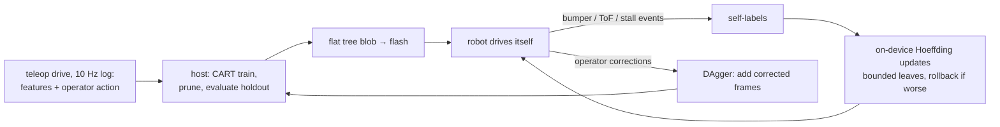

# On-device learning and native Go inference (W9, W5, W6)

**Builds on the EasyRobot catalog:** [[W9-go-nn-framework]], [[W4-k230-feature-stream]], [[W5-feature-tensor-experiments]] and [[W6-decision-trees]]. Their arithmetic and repo findings are **not repeated**: Qwen2.5-0.5B ≈ 494 M parameters, ≈ 0.99 GFLOP per token, the feature-map bandwidth table, and the tree code state. This note adds outside evidence, answers their research questions where it can, and recommends.

> **Revision 2 (2026-11-09): the target is a K210, not a K230.** The brief was corrected: every "K230" was a typo for **K210**. The board is an **M5Stack UnitV**, with board facts, TinyGo state, camera path and KPU route in [[2026-11-09-k210-camera-nn]].
> - The K210 has **8 MiB SRAM in total**: 6 MiB general plus 2 MiB that only the KPU uses while it runs.
> - It has **no DRAM and no Linux**. Its two cores are RV64GC at 400 MHz with no vector unit.
> - This revision makes the **K210 the current target** in Parts 1–3. UnitV exposes only a 2-signal Grove port, so the SPI budget is replaced with a UART + TF-card design.
> - Part 3 (trees) is unchanged apart from wording.
> - **The K230-based material is kept**, moved to **Part 4 — Future: larger Kendryte chip (no board yet)**. The owner: "k530 has more, but i lack the board - it is for the future". "k530" is not a chip name I know, so which chip he means (K230 or K510) is an **owner question** (decision 8), not a guess.

**Status:** hypotheses and recommendations, not decisions. Nothing was flashed or measured on hardware. The only build was the TinyGo smoke in the K210 note.

**Labels:**
- **observed:** read this session;
- **reported:** a page or paper says so, not reproduced;
- **inferred:** my arithmetic or reasoning;
- `#verify`: a guess.

**Network (read-only, allowed by the brief):** 13 web searches and 11 page reads.
- `raw.githubusercontent.com` ×2: esp32-llm README; esp-dl PIE instruction reference
- `www.kendryte.com` ×2: K230 product brief v1.6; Qwen2.5-0.5B on K230 community post
- `fprox.substack.com` ×2: CanMV-K230 unpacking; K230 micro-benchmarks
- `github.com` ×1: golang/go issue 81892, via API
- `tinygo.org` ×1: inline assembly
- `arxiv.org` ×2: 2007.10603, 1803.03893
- `iiot.esp32.tec.br` ×1: llama2.c on ESP32-S3 article

No downloads. The K210 facts used in revision 2 come from the K210 note's own reads: `docs.m5stack.com`, the K210 datasheet on `raw.githubusercontent.com`, `wiki.sipeed.com` and `github.com` loboris/ktool. I made no new network contact for this revision.

**Goals:**
- A small language model (for example Qwen 0.5B) running natively in the Go NN framework rather than through TFLite, ideally on an ESP32 under TinyGo with assembly-optimised kernels and without nncase; face recognition is one example.
- Learn visual odometry without supervision, and depth maps from images under constraints, with feature extraction providing the loss.
- Train decision trees on a practical task and run them on an ESP32: a wheeled robot with a camera that avoids obstacles.
- "maybe decision trees could be used for legged robot gaits?"

## Verdict

1. **W9:** Qwen-0.5B can't run on any board the owner has today. Its shipped GGUFs are **353–676 MB**: Q4_0 353 MB (bartowski) / 429 MB (Qwen official); Q8_0 531 / 676 MB. The K210 has **6 MiB** of general SRAM and 16 MB flash; the ESP32-S3 maps at most 32 MB. **Qwen moves to the host** as a correctness reference now, and to the larger Kendryte chip later (Part 4). Pure-Go LLMs on a laptop already exist (§1.2).
   - The **realistic article demo** is **"camera to recognition on a $30 RISC-V AI camera, all in TinyGo"**. A UnitV does face (or person) detection and recognition.
     - The **KPU** is driven register by register from Go, starting with nncase-compiled kmodel v3 files.
     - The stretch goal is EasyRobot generating the KPU layer programs itself, so **no nncase at all**: the owner's "purely in tinygo without nncase".
     - TinyGo int8 kernels run the heads and the matching.
   - **Earlier and cheaper:** a **TinyStories-class transformer in TinyGo on the K210's RV64 CPU**. `stories260K` (≈ 1 MB) fits easily, and an int8 model up to ≈ 4 M parameters fits in SRAM.
     - Estimate: ~5–7 tok/s for a 4 M int8 model on one core (≈ 14 tok/s before KV-cache and attention overhead, at ~55 M MAC/s); `stories260K` is compute-trivial (inferred).
     - The ESP32-S3 C reference is 19 tok/s for `stories260K` (reported).
   - First EasyRobot step (unchanged in kind): an int8 group-quantised GEMV kernel with benchmarks, now cross-built with **TinyGo for the K210**.
2. **W5:** what the owner describes matches a known family of methods: self-supervised depth + pose by view synthesis (SfMLearner/Monodepth2), with a **deep-feature reconstruction loss** where a feature space is the "arbiter". Zhan et al. (CVPR 2018) use **frozen pretrained features**; Shu et al. (ECCV 2020) use a **self-supervised learned** feature space.
   - The work can start before the notebooks arrive.
   - A last map of 7×7 is too coarse for depth. **Record** a stride-16 map plus a small grayscale image **to UnitV's TF card** for training. Over the 2-wire Grove UART, stream only compact outputs: detections, pose, a 128-byte descriptor, or the last map at a few fps (§2.2).
3. **W6:** decision trees fit **discrete choices**: obstacle-avoidance actions, gait mode selection. Rhythm stays with CPG/phase oscillators.
   - Start with **offline CART from teleoperation logs**, then online Hoeffding updates labelled by bumper/ToF events.
   - Inference costs microseconds, so the ESP32's budget goes to features, not to the tree.

---

## Part 1 — W9: native Go inference

### 1.1 Hardware facts

| Target | Fact | Evidence |
|---|---|---|
| ESP32-S3 | ~512 KB internal SRAM; external PSRAM mapped through "up to 32 MB of virtual addresses" in current ESP-IDF docs (v6.1, v5.4); older pages (v4.4, v5.1.1) say 16 MB; the first version with 32 MB isn't pinned | reported, ESP-IDF external RAM guide (search excerpts); SRAM per slvDev/esp32-ai README ("512KB SRAM") |
| ESP32-S3 SIMD (PIE) | 8 × 128-bit QR registers; ALU with **16 × 8-bit** and 8 × 16-bit multipliers; QACC accumulators; aligned loads (`EE.VLD.128.IP`) plus an unaligned path (`UA_STATE`, `EE.LD.128.USAR.*`) | reported, Espressif esp-dl `pie_instruction_set.md` |
| ESP32-S3 peak int8 | 16 MAC/cycle × 240 MHz = **3.84 GMAC/s per core**, before load and accumulator overhead | inferred from the line above |
| K210 CPUs | 2 × RV64IMAFDC (RV64GC) at **400 MHz** nominal (TinyGo assumes 390 MHz), double-precision FPU per core, 32 KiB I$ + 32 KiB D$ per core; **no vector unit**; bare metal or FreeRTOS, **no MMU-backed Linux distribution in practice** `#verify` | reported, K210 datasheet; TinyGo `machine_k210.go` (observed, K210 note §2) |
| K210 memory | **8 MiB on-chip SRAM, no DRAM**: 6 MiB general + 2 MiB AI SRAM (CPU-usable only when the KPU is idle); UnitV: 16 MB SPI flash, TF slot | reported, datasheet; M5 UnitV page |
| K210 KPU | conv + BN + activation + pooling; 1×1/3×3 kernels, stride 1/2; input ≤ 320×240; feature maps must fit the 2 MiB AI SRAM; model ≤ 5–5.9 MiB (datasheet) / 5.5–5.9 MiB (M5); **conv nets only** (no attention or matmul engine) | reported, datasheet `003.md`; M5 UnitV page; Sipeed nncase FAQ |
| K210 KPU programming | per layer, 12 × 64-bit argument words pushed into `KPU.LAYER_ARGUMENT_FIFO`; TinyGo already has the register struct | observed, TinyGo `device/kendryte/k210.go`; format reported via community docs (K210 note §4b) |
| TinyGo on K210 | `maixbit` target builds; FPU code generated; one hart only; no DVP/DMA/KPU drivers | observed, K210 note §2 and §6 |
| TinyGo on ESP32-S3 | an active target: interrupts, USB, flash block device; "the cores scheduler now supports the ESP32-S3" | reported, TinyGo changelog/releases (search excerpts) |
| TinyGo assembly | TinyGo's own inline asm is "unstable" and integer-operand only; the docs recommend **CGo with C inline asm**, inlined at no call cost | reported, tinygo.org inline-assembly page |

### 1.2 Which LLM fits where (inferred unless labelled)

| Target | Model | Weight bytes | Fits? | Compute per token | Expected |
|---|---|---|---|---|---|
| ESP32-S3 | Qwen2.5-0.5B Q4_0 | 353–429 MB | **no** (> 32 MB address space) | — | impossible (W9) |
| K210 | Qwen2.5-0.5B, any precision | ≥ 278 MB | **no** (6 MiB SRAM, 16 MB flash) | — | impossible |
| K210 | `stories260K` (float32) | ≈ 1 MB | yes | ≈ 0.3 M MAC | compute-trivial; bounded by UART output, not inference |
| K210 | custom TinyStories-class model, **≈ 2–4 M params int8** | 2–4 MB | yes (SRAM, beside ~1 MB code and buffers) | 2–4 M MAC | at ~55 M int8 MAC/s per core (scalar TinyGo, K210 note §4a): **~14–28 tok/s**; with KV-cache and attention overhead, ~5–13 tok/s `#verify` |
| K210 | `stories15M` int8 / int4 | 15 / 7.5 MB | **no** in SRAM; streaming from flash needs a fast SPI3 flash path (XIP/QSPI rate `#verify`) | 15 M MAC | ~1–4 tok/s if flash streaming works |
| Host (Apple M-series) | Qwen2.5-0.5B fp32 → int8 | 2 GB → 0.53 GB | yes | 0.5 G MAC | W9: eager 1.3 GFLOP/s → 0.8 s/token; gonum path 17 GFLOP/s → 0.06 s/token; **1–15 tok/s** |

The KPU can't help with transformers: it only runs convolutional nets, and its outputs must be at least 4×4. LLM decoding on the K210 is CPU-only.

**Shipped sizes vs theory**: 494 M × 4.5 bit (Q4_0: 32 × 4 bit + an fp16 scale) = 277.9 MB is a lower bound. Shipped Q4 files keep the embeddings and output at higher precision. Qwen's official repo also stores an **untied** output matrix (its fp16 file is 1,266 MB ≈ 630 M params × 2 B), which is why its files are larger. Even the lower bound is about 44× the K210's 6 MiB of general SRAM.

**Why tiny models are compute-bound here** (inferred): on the K210 the weights sit in on-chip SRAM, so reading them is cheap compared with the 7 scalar instructions per int8 MAC (observed codegen, K210 note §4a). Unrolling and using both harts are the levers; the K210 has no SIMD.

**Prior art in pure Go** (reported, search results only): `computerex/dlgo` ("LLM inference engine in pure Go – 48 tok/s zero dependencies", Show HN; model and host not stated) and `townsendmerino/goinfer` ("Pure-Go, no-cgo … Gemma, Qwen, Llama … from safetensors or GGUF"). `goccy/go-llama` describes itself as "llama.cpp in pure Go". **So "an LLM in pure Go" on a host is not novel.** What is new:
- (a) EasyRobot's own tensor stack;
- (b) a K210's KPU programmed from TinyGo, with no vendor SDK or runtime on the device;
- (c) a transformer under TinyGo on an MCU-class RISC-V chip.

**Prior art on ESP32-S3** (reported):
- `DaveBben/esp32-llm` (llama2.c, 260 K-parameter `stories260K`, ~1 MB RAM, ESP32-S3FH4R2 with 2 MB PSRAM): **19.13 tok/s** using both cores, ESP-DSP float dot products (`dsps_dotprod_f32_aes3`), 240 MHz CPU and 80 MHz PSRAM.
- `slvDev/esp32-ai`: **28.9 M parameters, 4-bit (14.9 MB), 9.88 tok/s end to end, 94.9 ms/token** on ESP32-S3 with 512 KB SRAM, 8 MB PSRAM and 16 MB flash. Gemma-3n-style per-layer embeddings (a 25 M-parameter table) stay in flash, and about 6 rows (~450 B) are read per token (reported, project README; I first saw it in a secondary article on iiot.esp32.tec.br).

### 1.3 Demo options, ranked

| # | Demo | Why it's article-worthy | Needs | Effort | Risk |
|---|---|---|---|---|---|
| **D1** | **Face detection + recognition on the UnitV in TinyGo.** Camera (DVP) → KPU detector (YOLOv2-tiny-class kmodel v3) → crop → KPU embedding net (MobileFaceNet-class, 112×112) → TinyGo cosine match against enrolled faces. Stage 2: EasyRobot emits the KPU layer arguments itself (**no nncase**) | "face recognition on a $30 RISC-V camera, Go down to the NPU registers": the owner's face-recognition wish, on the board he plugged in | K210 note milestones M3–M6: camera driver, Go kmodel v3 runner; then a Go KPU layer generator (conv/BN/act/pool → argument words + quantised weights) | large | KPU argument semantics only documented through the SDK sources and community notes; detector and embedding models need host training or downloads (approval) |
| **D2** | **A transformer under TinyGo on the K210 CPU**: `stories260K` first, then a 2–4 M int8 TinyStories model; later both harts | "Go writes stories on a RISC-V camera"; a C reference on ESP32-S3 (19 tok/s) makes it measurable | a llama2.c-style forward in plain float32/int8 Go (~700 lines in C), a loader, a TinyGo build; a second-hart runtime patch later | small–medium | the 2 KB default stack (fix with a custom linker script); a custom 2–4 M model needs host training on TinyStories (download approval) |
| D3 | Native-only vision under TinyGo (no KPU): tiny CNN person/obstacle classifier at 96×96 | the "purely TinyGo" fallback; doubles as the KPU correctness reference | int8 conv kernels (K210 note M5) | small–medium | slow: ~10–20 M MAC per frame → ~3–6 fps (inferred) |
| D4 | Qwen on the host in EasyRobot's eager backend | a correctness reference for the decoder code that D2 shares; **not an article** (prior art exists) | tokenizer, RoPE, GQA, KV cache, SwiGLU, sampler, int8 GEMV | medium | eager view-offset bugs (W9 TODO #p1) |

**Recommendation:**
- **D2 first**: smallest, proves the TinyGo-on-K210 path and the int8 kernels.
- **D1 as the headline**, staged as the K210 note's plan: camera, then the Go kmodel runner with nncase kmodels, then the nncase-free layer generator.
- D3 rides along as the reference for D1's layers.
- D4 only if decoder bugs need a big-model cross-check.

### 1.4 Answers to W9's research questions

| W9 question | Answer (labels) |
|---|---|
| 1. TinyGo and ESP32-S3 PIE: inline asm or must go through ESP-DSP/ESP-NN C? | TinyGo inline asm is integer-only and unstable; its docs point to **CGo + C inline asm**, which TinyGo compiles with its own clang, so no ESP-IDF is needed (reported). Whether TinyGo's bundled LLVM accepts the `EE.*` PIE mnemonics is **open** `#verify`: Espressif's LLVM fork has them, and a third-party toolchain matrix lists TinyGo 0.41 on a bundled LLVM 20. First probe: compile one `EE.VMULAS.S8.ACCX` loop in a C file under `tinygo build -target=esp32s3`. Fallback: `.byte`-encoded instructions. Calling ESP-NN's C/asm through TinyGo CGo would work but is "not purely TinyGo" (owner decision 2) |
| 2. ESP32-S3 int8 GOPS (ESP-NN vs C vs TinyGo) | Peak 3.84 GMAC/s per core (inferred from 16 × 8-bit multipliers). ESP-NN's published speed-ups were not read this session `#verify`. Expect TinyGo scalar code at about 0.1–0.2 GMAC/s (one MAC per 1–2 cycles) and PIE at 1–3 GMAC/s (inferred) |
| 3. Which tiny model makes a meaningful demo? | **K210:** `stories260K` (1 MB) → a custom 2–4 M int8 TinyStories model (SRAM-resident). `stories15M` only if flash streaming proves fast `#verify`. **ESP32-S3** (if wanted later): `stories260K` → `stories15M` int4 (~7.5 MB PSRAM) → the 28.9 M 4-bit design with embeddings in flash (9.9 tok/s in C, reported). SmolLM-135M at int4 (~68 MB) fits neither |
| 4. KPU from Go without CGo? | **Yes on the K210.** The KPU is a memory-mapped register block, and TinyGo has its struct. A Go runner writes the per-layer argument words, places input in AI SRAM and waits for the interrupt: no CGo, no vendor runtime (inferred; K210 note §4b). The owner's "no nncase" is reachable in stage 2, where EasyRobot generates the argument words. There is no vector unit, so CPU kernels stay scalar Go, unrolled |
| 5. safetensors vs GGUF | **GGUF Q8_0 for Qwen**: the quantised weights *and the tokenizer vocabulary and merges* in one file (inferred from GGUF's purpose), so it is one loader instead of two. **llama2.c `.bin`** for tiny models (TinyGo-friendly: flat float32 arrays). safetensors (bf16) only if a model has no GGUF |
| 6. Float32-only embedded API vs generics `Tensor[T]` | A separate **flat, float32/int8 "embedded" kernel layer** (slices in, slices out, no `any`, no float64) that the general tensor API calls (inferred from W9 findings 2–4). Migrating the whole API to generics is a larger change and not needed for D1/D2 |

### 1.5 Smallest first step in EasyRobot

**Q8_0 group-quantised GEMV in `x/math/primitive/qi8`** (the package exists as a stub, per W9):
- **Format:** blocks of 32 int8 weights + one float16 (or float32) scale. Activations are quantised per block on the fly, or kept in float32 for the first version.
- **API:** `GemvQ8(dst []float32, w []byte /* blocks */, x []float32, rows, cols int)`, zero allocations, plus a row-parallel variant behind `use_mt`.
- **Tests:**
  - against a float32 reference on random matrices, within quantisation error;
  - exact against a hand-computed 2×32 case.
- **Benchmarks:** stories-class shapes (64×64, 288×288, 288×768) on the host; report GMAC/s and `b.ReportAllocs()`.
- **Cross-build with TinyGo** for the K210 (`maixbit`, later the `unitv` target from the K210 note). Running it on the board falls under the owner's K210 flashing approval (K210 note M5).
- **Done when:** the host test and benchmark are green and the TinyGo K210 build succeeds. The on-board MAC/s figure comes from K210 note M5.

---

## Part 2 — W5: learned features on the K210 (UnitV)

### 2.1 What the owner's notebooks most likely contain (inferred)

The owner's description maps onto three published pieces:

| Owner's words | Method | Source |
|---|---|---|
| "unsupervised odometry learning … learn depth map too … just from images" | **View synthesis:** a DepthNet predicts depth for frame *t*, a PoseNet predicts the 6-DoF motion *t → t±1*; warp the neighbour into *t* with depth + pose + intrinsics; minimise the reconstruction error | SfMLearner (Zhou et al., CVPR 2017) and Monodepth2 (Godard et al., ICCV 2019) (known papers, not re-read this session) |
| "given certain constraints to the depth map" | **Edge-aware smoothness** on mean-normalised inverse depth; **per-pixel minimum reprojection** across neighbours (occlusions); **auto-masking** of static pixels; optionally stereo pairs or known camera height for metric scale | Monodepth2 (not re-read); Zhan et al. use stereo to fix "a common, real-world scale" (reported, abstract) |
| "use feature extraction to provide loss function as an arbitrer or teacher" | **Deep-feature reconstruction:** warp *feature maps* instead of (or besides) pixels, and compare. Zhan et al. show "deep feature-based warping loss improves upon simple photometric warp loss for both single view depth estimation and visual odometry". Shu et al. learn the feature space with derivative regularisers because photometric losses have "plateau landscapes … in textureless regions" | Zhan et al., CVPR 2018, arXiv 1803.03893 (reported, abstract); Shu et al., ECCV 2020, arXiv 2007.10603 (reported, abstract) |

The likely notebook, reconstructed:
- PyTorch;
- a DepthNet U-Net and a PoseNet (frame pairs → 6-DoF);
- a loss of 0.85·SSIM + 0.15·L1 photometric, plus λ_feat·‖F(I_t) − warp(F(I_s))‖₁ with **F = a frozen pretrained backbone** (the "teacher"), plus edge-aware smoothness;
- trained on short video clips;
- evaluated by trajectory plots.

That is enough to start without the notebooks (inferred).

### 2.2 Fit to the K210 (UnitV) pipeline

**The UnitV link changes the design** (reported, M5 PinMap; inferred consequences):
- The only external port is **Grove HY2.0-4P: 5 V, GND, G34, G35**. That is 2 signals, so a 4-wire SPI link to an ESP32 doesn't fit.
- The live link is a **UART over Grove**, at 115200 to ~2–3 Mbaud (K210 UART limit and cable quality `#verify`). At 2 Mbaud 8N1 that is about **200 KB/s**.
- Bulk data for training goes to the **TF card** on the UnitV.

| Experiment | Input it needs | Runs where | Note |
|---|---|---|---|
| **Feature-metric VO (pose only)** | two consecutive last maps (7×7) | train on the host from TF recordings; PoseNet inference on the **K210** (KPU 1×1/3×3 convs on stacked maps, or a TinyGo MLP on pooled maps) | coarse but workable for rotation and forward motion (inferred); feature-metric loss helps in low texture (Shu et al.) |
| **Depth** | **higher resolution than 7×7** | train and evaluate on the **host** from TF recordings (stride-16 map + 160×120 grayscale); an on-device depth summary (20×15) only if the decoder's upsampling maps onto KPU ops `#verify` | KPU input ≤ 320×240 and conv-only ops limit decoders |
| **Detector head on frozen features** | P4/P5-class maps | **K210 KPU** (YOLOv2-tiny-class kmodel); stream boxes (a few bytes each) | P3–P5 streaming is impossible over a UART |
| **Place recognition** | last map → 128-d descriptor | **K210** (TinyGo, PCA matrix from the host) or the ESP32 receiving 128 B per keyframe | see §2.3 |

**Payloads** (int8, one backbone: **MobileNetV1 @224**, KPU-friendly):

| Stream | α = 0.25 | α = 0.5 |
|---|---|---|
| 7×7×C last map | 12,544 B | 25,088 B |
| 14×14×C stride-16 map | 25,088 B | 50,176 B |
| 160×120 grayscale | 19,200 B | 19,200 B |
| **Full set** | **56,832 B** | **94,464 B** |
| Full set over 2 Mbaud UART | 3.5 fps | 2.1 fps |
| Last map only over 2 Mbaud UART | 15.9 fps | 8.0 fps |
| 128-byte descriptor + boxes | > 100 fps (link no longer the limit) | same |

- The largest MobileNetV1-0.5 activation (112×112×32 int8 = 401 KB) fits the 2 MiB AI SRAM (inferred).
- **Recommendation:**
  - Record the full set (α = 0.5) to the TF card for training; SD write speed `#verify`.
  - Over Grove UART, stream descriptor + boxes + pose live, and the last map at up to ~8 fps when an ESP32 or the host needs it.
  - Run detection on the KPU and stream boxes only.
- The old 4-wire SPI budget (MobileNetV2 @224 at 10–30 fps) is kept in Part 4 for the larger chip. It also applies if a K210 board with free SPI pins replaces the UnitV.

### 2.3 Place recognition on CNN features

| Option | How | Memory on ESP32 | Verdict |
|---|---|---|---|
| **Global descriptor** | GeM or average pooling of the last map → C-dim → PCA-whitened to 128-d (host-trained matrix) → int8 → cosine kNN over keyframes | 128 B per keyframe; 1,000 keyframes = 128 KB | **baseline first**: trivial, and NetVLAD is its learned form (Arandjelović et al., CVPR 2016; known, not re-read) |
| **BoW over cell descriptors** | each of the 49 or 100 cells' C-vectors is a local descriptor → k-means vocabulary (256–1k words, host) → TF-IDF + inverted index (DBoW2-style) → candidates → geometric check on the cell grid | vocabulary 1k × 64-d (after PCA) int8 = 64 KB, plus the index | **experiment 2**: matches the owner's "BoW style" |

Both are **vector retrieval**. The [[2026-11-09-knowledge-engine|knowledge engine]]'s flat `VectorStore` (exact top-k, int8) is the same primitive, and an embedded variant can be shared (inferred).

### 2.4 Evaluating without ground truth

- Loop-closure consistency (place recognition + pose-graph residual).
- Wheel odometry on the wheeled robot (W6).
- Lidar scan matching from [[W8-lidar]] as weak ground truth.
- AprilTag/ChArUco boards on a test track for absolute checks.
- For sanity before the owner's data exists, public sequences (KITTI odometry, TUM RGB-D) need a **download approval**.

### 2.5 Answers to W5's research questions

| W5 question | Answer |
|---|---|
| 1. YOLO head on a frozen backbone: P5 enough? | Not for small or far objects. Run the head **on the K210 KPU** and stream boxes; P5-only works for large near obstacles (inferred) |
| 2. BoW vs global descriptors | Global first (§2.3); BoW over cell descriptors as the second experiment |
| 3. Feature-metric loss at 7×7–10×10? | Fine for pose, too coarse for depth. Stream a stride-16 map and a low-res image too (§2.2) |
| 4. Teacher/student split | Teacher = frozen backbone (K210 kmodel; the same weights in PyTorch on the host for training). Students = PoseNet (K210 KPU or TinyGo, or ESP32), DepthNet (host, from TF recordings) |
| 5. Evaluation | §2.4 |
| 6. Notebook → Go interop | Training stays in Python (W5 proposal; Go training is unproven). Export the small heads as int8 weights into a flat EasyRobot format for TinyGo (K210 or ESP32), and as kmodel v3 for the KPU (later as Go-generated KPU layer programs, §1.3 D1 stage 2). TFLite import stays a host tool (CGo) |

---

## Part 3 — W6: decision trees on ESP32

### 3.1 What trees are good for here

| Use | Fit | Why |
|---|---|---|
| Obstacle avoidance: choose {forward, left, right, stop} from ~16–64 features | **good** | small, fast, interpretable; trains from a few thousand labelled frames (inferred) |
| Gait **mode** and parameter choice (tripod, ripple or wave; stride class; recovery) from IMU + foot-contact features | **good** | discrete decisions at 1–10 Hz |
| Gait **generation** (phase, timing, trajectories) | **poor** | continuous, rhythmic: CPG/phase oscillators + IK do this (W6 note agrees). Trees select CPG parameters, they don't replace the CPG |
| Learned policy distillation | good, later | a policy trained in simulation (RL or MLP) distilled into a tree for the MCU: VIPER (Bastani et al., NeurIPS 2018; known, not re-read `#verify`) |

### 3.2 Learning algorithms

| Algorithm | Where | Memory (inferred) | Use |
|---|---|---|---|
| **CART** (Gini/entropy, depth ≤ 8–10, min-samples, cost-complexity pruning) | host (Go) | model: ≤ 1,023 nodes × 8 B (feature u8, threshold i16/f32, children u16) ≈ 8 KB | first milestone |
| **Hoeffding tree / VFDT** (Domingos & Hulten 2000) | ESP32 online | per leaf: features × classes × bins × counter. E.g. 32 × 4 × 16 × 2 B = **4 KB per leaf** → 30–50 growing leaves in ~200 KB SRAM | "self-learning" stage; Hoeffding trees have been run on constrained devices (Polimi occupancy thesis; FPGA HLS implementations, reported, search excerpts) |
| Hoeffding Adaptive Tree (Bifet & Gavaldà 2009) | ESP32 online | + drift detectors per node | if the environment changes (lighting, floors) |
| Small random forest or boosted stumps | host-trained | ×N trees | only if one tree's accuracy is short on the benchmark |

**Inference cost:** a depth-10 tree means 10 compares on int16 features, i.e. microseconds on ESP32. Integer-only tree inference is an established technique (emlearn: "Train in Python, then do inference on any device with a C99 compiler"; InTreeger 2025: integer-only decision tree inference) (reported). EasyRobot needs the **flat-array executor** from W6's first TODO, not closures or reflection.

### 3.3 The wheeled camera obstacle-avoidance demo

- **Features**, 16–32 per frame, computed on the ESP32-S3:
  - from a 64×48 grayscale frame: per-column vertical-edge density in 8 bands, floor-likeness ratio in the lower third per band, mean brightness gradient, frame-difference energy (motion);
  - from a ToF/ultrasonic sensor, if fitted: the minimum distance.
  - With the UnitV attached (Grove UART): global-average-pooled feature channels reduced by PCA to 16–32, computed on the K210.
  - Cost: a few ms per frame (inferred).
- **Labels:**
  1. operator actions (behaviour cloning);
  2. corrections where the robot was about to fail (DAgger, Ross et al. 2011; known, not re-read);
  3. self-supervised: "bump or stall within 1 s" as negative for the action taken, "progress without event for N s" as positive. Self-supervised collision data for navigation has precedent (e.g. "learning to fly by crashing", Gandhi et al. 2017; known, not re-read `#verify`).
- **Metrics:** collision-free laps per 10 minutes, mean distance between interventions, tree size and latency.
- **Safety:** a speed cap; the bumper/ToF stop overrides the tree in firmware. **Driving the robot is actuation: each session needs approval of that scope**.

### 3.4 Answers to W6's research questions

| W6 question | Answer |
|---|---|
| 1. Best online learner per KB at 20–64 features, 10 Hz | Hoeffding tree with binned numeric stats (≈ 4 KB per leaf at 32 features × 4 classes × 16 bins), then HAT if drift appears. Mondrian forests cost more memory (inferred) |
| 2. Reliable self-supervised labels | bumper and motor-stall current (high precision); ToF near-range (good indoors); optical-flow expansion (noisy). Combine with a short time window (inferred) |
| 3. Forests/boosting vs one tree | measure on the logged dataset; start with one tree |
| 4. Compact K210 features for free space | GAP channels + PCA to 16–32; better, a per-column pooled map (W columns × a few channels) keeps left/right information that GAP loses (inferred). Both fit the Grove UART easily |
| 5. Trees for gait modes | yes, as selectors over CPG parameters, from IMU stability and foot-contact features; data from logged walking trials |
| 6. Tree vs tiny MLP | the tree first (interpretable, trains on little data, no float training stack needed); an int8 MLP once `x/math/learn` passes its gradient checks (W9 baseline) |

---

## Part 4 — Future: larger Kendryte chip (no board yet)

> **Not a current target.** This is the material from revision 1, written when the brief said "K230". The owner says the bigger chip "has more, but i lack the board - it is for the future". **Which chip that is (K230 or K510, his "k530") is owner decision 8.** The figures below are for the **K230** as read in revision 1. If he means the K510, they need a fresh read `#verify`.

### 4.1 Hardware facts (K230)

| Target | Fact | Evidence |
|---|---|---|
| K230 CPUs | CPU1: 64-bit RISC-V, **1.6 GHz, RVV 1.0, 128-bit vector unit**, "runs RTOS system" in the reference SDK. CPU0: 800 MHz RV64GCB, runs Linux | reported, K230 product brief v1.6 |
| K230 Linux on the big core | The official CanMV **Debian image** shows `isa: rv64imafdcvxthead` on hart 0 (vector present), i.e. Linux on the RVV core | reported, FPRox "Unpacking the CanMV K230" (2024) |
| K230 memory | DDR3L/LPDDR3/LPDDR4, **max 2 GB**; SiP variant 128 MB; 2 MB + 2 MB SRAM (KPU default) | reported, product brief |
| K230 memory throughput | memcpy "never actually get[s] close to just even 8 Bytes per cycle" at 1.6 GHz | reported, FPRox micro-benchmarks (2025). So < 12.8 GB/s; I assume **3–5 GB/s** effective `#verify` |
| K230 KPU | INT8/INT16; MobileNetV2 ≥ 670 fps, ResNet-50 ≥ 85 fps, YOLOv5s ≥ 38 fps @INT8 | reported, product brief |
| Vendor LLM on K230 | Canaan runs **Qwen2.5-0.5B** as a kmodel (nncase) on a 2 GB board, with CMA raised to 90 % (1.8 GB) and a 512-token limit | reported, kendryte.com community post (Nov 2025). Speed not in the text (screenshots only) |
| Go on RVV | Go's riscv64 assembler has RVV mnemonics (`cmd/internal/obj/riscv`: `AVADDVV` etc., in the go1.24.6+ docs), so hand-written `.s` kernels work under gc. **No autovectorisation**; RVV SIMD intrinsics are only a proposal (golang/go#81892, open, 2026-09) | reported, pkg.go.dev listing (search excerpt); issue read |

### 4.2 Qwen-0.5B on the K230 (inferred from W9's parameter count)

| Target | Precision | Weights read per token | Fits? | Memory-bound ceiling | Compute (Go) | Expected |
|---|---|---|---|---|---|---|
| K230 512 MB board | Q4_0 | bartowski 353 MB / official 429 MB | official file: **does not fit** (Linux + KV cache + runtime); bartowski: **very tight** `#verify` | 3–5 GB/s → 8.5–14 tok/s (353 MB), 7–12 tok/s (429 MB) | scalar Go dequant + MAC: ~0.3–0.6 GMAC/s → 1–2 s/token | **~0.5–1 tok/s** pure Go if it fits; more with RVV asm |
| K230 1–2 GB board | Q8_0 | bartowski 531 MB / official 676 MB | yes | 5.6–9.4 tok/s (531 MB), 4.4–7.4 tok/s (676 MB) | scalar Go ~1–2 s/token; RVV asm (16 int8 lanes per op, ~0.5 GMAC/token) → memory-bound | **0.5–1 tok/s scalar, 3–5 tok/s with Go-asm RVV** `#verify` |
| K230 2 GB board | fp32 | ~1.98 GB (official fp16 file 1.27 GB, untied output) | no (Linux needs room) | — | — | not viable |

**Why it is memory-bound** (inferred): decode is a GEMV per weight matrix, so every weight byte is read once per token, including the tied 136 M-parameter logits matrix. At about 1 MAC per weight, the RVV unit is idle most of the time. Weight bytes, int4 or int8, decide the ceiling once the kernel is vectorised.

### 4.3 Future demo: Qwen2.5-0.5B in pure Go on the K230 RVV core

| Demo | Why it's article-worthy | Needs (from W9 gap list) | Effort | Risk |
|---|---|---|---|---|
| **Qwen2.5-0.5B in pure Go on the K230 RVV core** (Debian Linux on hart 0), Q8_0 or Q4 weights, Go-asm RVV GEMV, compared with Canaan's nncase/KPU demo | "a 0.5 B LLM in Go on a $40 RISC-V board without the vendor NPU stack"; directly the owner's original wish | weight loader, BPE tokenizer, RoPE, GQA, KV cache, SwiGLU, sampler, int8 GEMV, RVV asm | large (decoder stack + kernels) | memory bandwidth (#verify); board RAM size; Go GC pauses under 0.5 GB of heap (keep weights in one `[]byte` or mmap) |

- **Prerequisite:** D4 (Qwen on the host in EasyRobot's eager backend).
- **Kernel path:** the `qi8` GEMV from §1.5, cross-compiled for `linux/riscv64`, then a Go-asm RVV variant on the board.
- **KPU from Go on the K230:** KPU access is through the nncase C++ runtime, so Go needs a CGo shim (inferred; the vendor SDK is C/C++). The owner's "no nncase" points to the CPU path there. The RVV GEMM rate is unmeasured; camel-cdr's rvv-bench pages for the K230 are the place to calibrate `#verify`.
- **Weights:** GGUF from `bartowski/Qwen2.5-0.5B-Instruct-GGUF` (tied output, smaller): Q8_0 531 MB for 1–2 GB boards, Q4_0 353 MB only on a 512 MB board. Qwen's official GGUFs are 676 / 429 MB (untied). Downloads need approval when the board exists.

### 4.4 Future W5 link: K230 → 4-wire SPI → ESP32 (W4 arithmetic)

| Stream (one backbone: **MobileNetV2 @224**) | Per frame (int8) |
|---|---|
| 7×7×320 last map (before the final 1×1 conv) | 15,680 B |
| 14×14×96 stride-16 map | 18,816 B |
| 160×120 grayscale | 19,200 B |
| **Total** | **53,696 B** |

- At **10 fps:** 4.30 Mbit/s, 22 % of a 20 MHz single-lane SPI link. At **30 fps:** 12.9 Mbit/s, still within 20 MHz.
- With the 7×7×1280 map (after the final 1×1 conv) instead: 100,736 B → 8.06 Mbit/s at 10 fps, 24.2 Mbit/s at 30 fps, which exceeds 20 MHz.
- **Alternative backbone, YOLOv8n @320** (P5 10×10×256 + P4 20×20×128 + gray): 96,000 B → 7.68 Mbit/s at 10 fps, 23.0 Mbit/s at 30 fps (exceeds 20 MHz).
- **Recommendation for that board:** stream MobileNetV2 @224 (7×7×320 + 14×14×96 + gray). Run YOLOv8n detection and DepthNet as **separate kmodels on the K230** and stream only boxes or a depth summary. The KPU has the headroom (MobileNetV2 ≥ 670 fps, YOLOv5s ≥ 38 fps, product brief).
- Board-specific details for the link (CanMV SPI API, ESP32-S3 slave limits, framing, SD recording) are in [[2026-11-09-k230-spi-w4]].

---

## Knowledge map

| Quadrant | Item | Next step, owner |
|---|---|---|
| Known knowns | Qwen-0.5B ≈ 494 M params (W9) and ≥ 278 MB in any shipped form; K210: 2 × RV64GC at 400 MHz, no vector unit, 6 + 2 MiB SRAM, conv-only KPU programmed through a register FIFO, no Linux; UnitV: Grove 2-signal port, TF slot, 16 MB flash; TinyGo builds for K210 with FPU codegen, one hart; C ports reach 19 tok/s (260 K) on ESP32-S3; pure-Go LLM engines exist | — |
| Known unknowns | Real MAC/s per K210 hart; KPU ms per layer | K210 note M5/M6 |
| Known unknowns | SPI3 flash streaming rate (decides `stories15M` on the K210) | a board probe under the K210 approval |
| Known unknowns | Max reliable UART baud over Grove to an ESP32 or USB adapter; TF card write rate under TinyGo | after M4 |
| Known unknowns | KPU argument-word semantics for a nncase-free generator (SDK sources + community docs) | after the M6 runner works |
| Unknown knowns | The owner's notebooks: §2.1 is a reconstruction; the owner may have used a specific loss or teacher (e.g. VGG features, or the backbone itself) | owner: upload the notebooks, or confirm §2.1 |
| Unknown knowns | Which robot carries the UnitV for W5/W6 (wheeled ESP32-S3 + UnitV over Grove, or the UnitV alone) | owner |
| Unknown unknowns | TinyGo GC and stack behaviour with multi-MB weight slices in 6 MiB SRAM | D2: weights in one static byte array, a custom linker script |
| Unknown unknowns | Whether face-recognition accuracy survives KPU quantisation of a MobileFaceNet-class net | D1, against host float |
| Known unknowns | Which larger Kendryte chip the owner means by "k530" (K230 or K510), and its board RAM (512 MB / 1 GB / 2 GB) | owner (decision 8) |
| Known unknowns | Effective DRAM bandwidth and Go-asm RVV GEMV rate on the larger chip | when a board exists |

## Owner decisions

| # | Decision | Recommendation |
|---|---|---|
| 1 | Headline W9 demo: **face detection + recognition on the UnitV in TinyGo**, with the KPU driven from Go (nncase kmodels first, then EasyRobot-generated KPU programs with no nncase). The **TinyGo transformer on the K210 CPU** (`stories260K`, then a 2–4 M int8 model) is the earlier, cheaper article. Qwen-0.5B leaves the embedded plan (host reference only) | Yes |
| 2 | "Purely in TinyGo" allows **assembly inside C files that TinyGo compiles** (CGo inline asm, no vendor SDK or runtime on the device). nncase as a **host-side compiler** is acceptable for stage 1 of D1, and removed in stage 2 | Yes |
| 3 | Weight and data inputs: **llama2.c `stories260K`** (≈ 1 MB) first; TinyStories data to train a 2–4 M model on the host; face detector and embedding models (pretrained or trained on the host). **Qwen GGUF downloads are no longer needed** unless D4 runs. Each download needs your approval when the work starts | Yes |
| 4 | First EasyRobot step: **Q8_0 GEMV kernel + benchmarks** in `x/math/primitive/qi8`, on the host with a TinyGo K210 cross-build | Yes |
| 5 | W5: train in Python from **TF-card recordings** on the UnitV (§2.1 reconstruction until the notebooks arrive). Record the stride-16 map + 160×120 grayscale with the last map. Over the Grove UART, stream descriptor, boxes, pose and (≤ 8 fps) the last map. Detection on the KPU; depth on the host | Yes |
| 6 | W6: offline CART from teleop logs first, then on-device Hoeffding updates with bumper/stall labels; trees select gait modes only | Yes |
| 7 | Board work: K210 flashing is covered by your UnitV approval (decisions.md, back up the firmware first). ESP32-S3 TinyGo flashing and driving the wheeled robot still need per-scope approval | (rule) |
| 8 | **Which "bigger" chip is meant by "k530"**: K230 (Part 4 figures apply) or K510 (Part 4 needs a fresh read)? Part 4 stays parked until a board exists | owner question |
