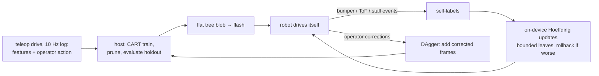

# On-device learning and native Go inference (W9, W5, W6)

**Brief:** `~/src/docs/tasks/ER-research-1.md` (objective O-005).

**Builds on easyrobot's catalog:** [[W9-go-nn-framework]], [[W4-k230-feature-stream]], [[W5-feature-tensor-experiments]] and [[W6-decision-trees]]. Their arithmetic and repo findings are **not repeated**: Qwen2.5-0.5B ≈ 494 M parameters, ≈ 0.99 GFLOP per token, the feature-map bandwidth table, and the tree code state. This note adds outside evidence, answers their research questions where it can, and recommends.

**Status:** hypotheses and recommendations, not decisions. Nothing was built, flashed or measured.

**Labels:**
- **observed:** read this session;
- **reported:** a page or paper says so, not reproduced;
- **inferred:** my arithmetic or reasoning;
- `#verify`: a guess.

**Network (read-only, allowed by the brief):** 13 web searches and 11 page reads.
- `raw.githubusercontent.com` ×2: esp32-llm README; esp-dl PIE instruction reference
- `www.kendryte.com` ×2: K230 product brief v1.6; Qwen2.5-0.5B on K230 community post
- `fprox.substack.com` ×2: CanMV-K230 unpacking; K230 micro-benchmarks
- `github.com` ×1: golang/go issue 81892, via API
- `tinygo.org` ×1: inline assembly
- `arxiv.org` ×2: 2007.10603, 1803.03893
- `iiot.esp32.tec.br` ×1: llama2.c on ESP32-S3 article

No downloads.

**Owner (verbatim, O-005):**
- "i wish my nn framework would run a simple llm - e.g. loaded from qwen .5B 🙂 not just tflight, but really in go natively - would be a huge deal for an article! especially if it would run on esp32 and do some face recognition for example in tinygo! albeit asm optimised but purely in tinygo without nncase or smth like that!"
- "teach a small network to do visual odometry … unsupervised odometry learning. also not only odometry, but one can learn depth map too - given certain constraints to the depth map the network can learn it just from images. and the odometry one can learn by itself if we use feature extraction to provide loss function as an arbitrer or teacher."
- "would be awesome to train decsion trees on something practical and run it on esp32! plug some wheels to it, add a camera and it would avoid obstacles via camera!"
- "maybe decision trees could be used for legged robot gaits?"

## Verdict

1. **W9:** Qwen-0.5B can't fit on an ESP32-S3, and nothing near it can. A uniform Q4_0 file has a theoretical lower bound of ≈ 278 MB; the **shipped** GGUFs are larger: Q4_0 **353 MB** (bartowski) / **429 MB** (Qwen official); Q8_0 **531 MB** / **676 MB** (verify `docs/verification/ER-research-1.md`). The S3 maps at most 32 MB of external RAM. On the K230 it fits in Q8_0 on a 1–2 GB board; on a 512 MB board only bartowski's Q4_0 might fit, very tightly.
   - The **article-grade demo**: **Qwen2.5-0.5B decoding in pure Go on the K230's 1.6 GHz RVV core, with Go-assembly int8 kernels and no nncase**. Expect about 1–5 tokens/s (inferred), against Canaan's own nncase/KPU demo of the same model.
   - The ESP32-S3 demo: a **TinyStories-class transformer in TinyGo** (260 K–15 M parameters). C ports already reach 19 tok/s (260 K) and 9.9 tok/s (28.9 M, 4-bit) (reported).
   - First EasyRobot step: an int8 group-quantised GEMV kernel with benchmarks.
2. **W5:** what the owner describes matches a known family of methods: self-supervised depth + pose by view synthesis (SfMLearner/Monodepth2), with a **deep-feature reconstruction loss** where a feature space is the "arbiter". Zhan et al. (CVPR 2018) use **frozen pretrained features**; Shu et al. (ECCV 2020) use a **self-supervised learned** feature space.
   - The work can start before the notebooks arrive.
   - The K230's last map (7×7 or 10×10) is too coarse for depth. Stream a stride-16 map plus a small grayscale image as well.
3. **W6:** decision trees fit **discrete choices**: obstacle-avoidance actions, gait mode selection. Rhythm stays with CPG/phase oscillators.
   - Start with **offline CART from teleoperation logs**, then online Hoeffding updates labelled by bumper/ToF events.
   - Inference costs microseconds, so the ESP32's budget goes to features, not to the tree.

---

## Part 1 — W9: native Go inference

### 1.1 Hardware facts

| Target | Fact | Evidence |
|---|---|---|
| ESP32-S3 | ~512 KB internal SRAM; external PSRAM mapped through "up to 32 MB of virtual addresses" in current ESP-IDF docs (v6.1, v5.4); older pages (v4.4, v5.1.1) say 16 MB; the first version with 32 MB isn't pinned | reported, ESP-IDF external RAM guide (search excerpts; versions per verify); SRAM per slvDev/esp32-ai README ("512KB SRAM") via verify |
| ESP32-S3 SIMD (PIE) | 8 × 128-bit QR registers; ALU with **16 × 8-bit** and 8 × 16-bit multipliers; QACC accumulators; aligned loads (`EE.VLD.128.IP`) plus an unaligned path (`UA_STATE`, `EE.LD.128.USAR.*`) | reported, Espressif esp-dl `pie_instruction_set.md` |
| ESP32-S3 peak int8 | 16 MAC/cycle × 240 MHz = **3.84 GMAC/s per core**, before load and accumulator overhead | inferred from the line above |
| K230 CPUs | CPU1: 64-bit RISC-V, **1.6 GHz, RVV 1.0, 128-bit vector unit**, "runs RTOS system" in the reference SDK. CPU0: 800 MHz RV64GCB, runs Linux | reported, K230 product brief v1.6 |
| K230 Linux on the big core | The official CanMV **Debian image** shows `isa: rv64imafdcvxthead` on hart 0 (vector present), i.e. Linux on the RVV core | reported, FPRox "Unpacking the CanMV K230" (2024) |
| K230 memory | DDR3L/LPDDR3/LPDDR4, **max 2 GB**; SiP variant 128 MB; 2 MB + 2 MB SRAM (KPU default) | reported, product brief |
| K230 memory throughput | memcpy "never actually get[s] close to just even 8 Bytes per cycle" at 1.6 GHz | reported, FPRox micro-benchmarks (2025). So < 12.8 GB/s; I assume **3–5 GB/s** effective `#verify` |
| K230 KPU | INT8/INT16; MobileNetV2 ≥ 670 fps, ResNet-50 ≥ 85 fps, YOLOv5s ≥ 38 fps @INT8 | reported, product brief |
| Vendor LLM on K230 | Canaan runs **Qwen2.5-0.5B** as a kmodel (nncase) on a 2 GB board, with CMA raised to 90 % (1.8 GB) and a 512-token limit | reported, kendryte.com community post (Nov 2025). Speed not in the text (screenshots only) |
| Go on RVV | Go's riscv64 assembler has RVV mnemonics (`cmd/internal/obj/riscv`: `AVADDVV` etc., in the go1.24.6+ docs), so hand-written `.s` kernels work under gc. **No autovectorisation**; RVV SIMD intrinsics are only a proposal (golang/go#81892, open, 2026-09) | reported, pkg.go.dev listing (search excerpt); issue read |
| TinyGo on ESP32-S3 | an active target: interrupts, USB, flash block device; "the cores scheduler now supports the ESP32-S3" | reported, TinyGo changelog/releases (search excerpts) |
| TinyGo assembly | TinyGo's own inline asm is "unstable" and integer-operand only; the docs recommend **CGo with C inline asm**, inlined at no call cost | reported, tinygo.org inline-assembly page |

### 1.2 Will Qwen-0.5B fit and how fast? (inferred from W9's parameter count)

| Target | Precision | Weights read per token | Fits? | Memory-bound ceiling | Compute (Go) | Expected |
|---|---|---|---|---|---|---|
| ESP32-S3 | Q4_0 | 353–429 MB shipped (≥ 278 MB in theory) | **no** (> 32 MB address space) | — | — | impossible; streaming from flash or SD costs minutes per token (W9) |
| K230 512 MB board | Q4_0 | bartowski 353 MB / official 429 MB | official file: **does not fit** (Linux + KV cache + runtime); bartowski: **very tight** `#verify` | 3–5 GB/s → 8.5–14 tok/s (353 MB), 7–12 tok/s (429 MB) | scalar Go dequant + MAC: ~0.3–0.6 GMAC/s → 1–2 s/token | **~0.5–1 tok/s** pure Go if it fits; more with RVV asm |
| K230 1–2 GB board | Q8_0 | bartowski 531 MB / official 676 MB | yes | 5.6–9.4 tok/s (531 MB), 4.4–7.4 tok/s (676 MB) | scalar Go ~1–2 s/token; RVV asm (16 int8 lanes per op, ~0.5 GMAC/token) → memory-bound | **0.5–1 tok/s scalar, 3–5 tok/s with Go-asm RVV** `#verify` |
| K230 2 GB board | fp32 | ~1.98 GB (official fp16 file 1.27 GB, untied output) | no (Linux needs room) | — | — | not viable |
| Host (Apple M-series) | fp32 → int8 | 2 GB → 0.53 GB | yes | tens of tok/s | W9: eager 1.3 GFLOP/s → 0.8 s/token; gonum path 17 GFLOP/s → 0.06 s/token | **1–15 tok/s** depending on the kernel |

**Shipped sizes vs theory** (verify): 494 M × 4.5 bit (Q4_0: 32 × 4 bit + an fp16 scale) = 277.9 MB is a lower bound. Shipped Q4 files keep the embeddings and output at higher precision. Qwen's official repo also stores an **untied** output matrix (its fp16 file is 1,266 MB ≈ 630 M params × 2 B), which is why its files are larger. The ceilings above use the shipped sizes.

**Why it is memory-bound** (inferred): decode is a GEMV per weight matrix, so every weight byte is read once per token, including the tied 136 M-parameter logits matrix. At about 1 MAC per weight, the RVV unit is idle most of the time. Weight bytes, int4 or int8, decide the ceiling once the kernel is vectorised.

**Prior art in pure Go** (reported, search results only): `computerex/dlgo` ("LLM inference engine in pure Go – 48 tok/s zero dependencies", Show HN; model and host not stated) and `townsendmerino/goinfer` ("Pure-Go, no-cgo … Gemma, Qwen, Llama … from safetensors or GGUF"). `goccy/go-llama` describes itself as "llama.cpp in pure Go". **So "an LLM in pure Go" alone is not novel.** What is new:
- (a) EasyRobot's own tensor stack;
- (b) RISC-V RVV kernels in Go assembly on a $40 board, with no vendor NPU toolchain;
- (c) a transformer under TinyGo on an MCU.

**Prior art on ESP32-S3** (reported):
- `DaveBben/esp32-llm` (llama2.c, 260 K-parameter `stories260K`, ~1 MB RAM, ESP32-S3FH4R2 with 2 MB PSRAM): **19.13 tok/s** using both cores, ESP-DSP float dot products (`dsps_dotprod_f32_aes3`), 240 MHz CPU and 80 MHz PSRAM.
- `slvDev/esp32-ai`: **28.9 M parameters, 4-bit (14.9 MB), 9.88 tok/s end to end, 94.9 ms/token** on ESP32-S3 with 512 KB SRAM, 8 MB PSRAM and 16 MB flash. Gemma-3n-style per-layer embeddings (a 25 M-parameter table) stay in flash, and about 6 rows (~450 B) are read per token (reported, project README, read by verify; I first saw it in a secondary article on iiot.esp32.tec.br).

### 1.3 Demo options, ranked

| # | Demo | Why it's article-worthy | Needs (from W9 gap list) | Effort | Risk |
|---|---|---|---|---|---|
| **D1** | **Qwen2.5-0.5B in pure Go on the K230 RVV core** (Debian Linux on hart 0), Q8_0 or Q4 weights, Go-asm RVV GEMV, compared with Canaan's nncase/KPU demo | "a 0.5 B LLM in Go on a $40 RISC-V board without the vendor NPU stack"; directly the owner's wish | weight loader, BPE tokenizer, RoPE, GQA, KV cache, SwiGLU, sampler, int8 GEMV, RVV asm | large (decoder stack + kernels) | memory bandwidth (#verify); board RAM size; Go GC pauses under 0.5 GB of heap (keep weights in one `[]byte` or mmap) |
| **D2** | **A transformer under TinyGo on ESP32-S3** (`stories260K` first, then a 1–15 M int8 model), dual-core, PIE kernel | "Go on a $5 MCU writing stories"; a C reference exists (19 tok/s), so success is measurable | a tiny llama2.c-style forward in plain float32 Go (~700 lines in C), loader, TinyGo build of a minimal core, PIE dot product | small–medium | TinyGo/Xtensa codegen quality; assembling PIE mnemonics in TinyGo's toolchain (#verify) |
| D3 | **Face recognition under TinyGo on ESP32-S3** (detector + MobileFaceNet-class embedding, int8) | the owner names it; a strong vision demo | camera driver under TinyGo (none exists), detector, int8 conv kernels, BN folding, weight format | large | camera and kernels both missing; Espressif's own C stack is the comparison `#verify` |
| D4 | Qwen on host in EasyRobot's eager backend (correctness reference) | not an article; the **prerequisite** for D1 | same as D1, minus RVV | medium | eager view-offset bugs (W9 TODO #p1) |

**Recommendation:**
- **D4 → D1** as the headline track.
- **D2** in parallel as the earlier, cheaper article. It also proves the TinyGo build path that D3 needs later.
- D3 after W4's camera path exists.

### 1.4 Answers to W9's research questions

| W9 question | Answer (labels) |
|---|---|
| 1. TinyGo and ESP32-S3 PIE: inline asm or must go through ESP-DSP/ESP-NN C? | TinyGo inline asm is integer-only and unstable; its docs point to **CGo + C inline asm**, which TinyGo compiles with its own clang, so no ESP-IDF is needed (reported). Whether TinyGo's bundled LLVM accepts the `EE.*` PIE mnemonics is **open** `#verify`: Espressif's LLVM fork has them, and a third-party toolchain matrix lists TinyGo 0.41 on a bundled LLVM 20. First probe: compile one `EE.VMULAS.S8.ACCX` loop in a C file under `tinygo build -target=esp32s3`. Fallback: `.byte`-encoded instructions. Calling ESP-NN's C/asm through TinyGo CGo would work but is "not purely TinyGo" (owner decision 2) |
| 2. ESP32-S3 int8 GOPS (ESP-NN vs C vs TinyGo) | Peak 3.84 GMAC/s per core (inferred from 16 × 8-bit multipliers). ESP-NN's published speed-ups were not read this session `#verify`. Expect TinyGo scalar code at about 0.1–0.2 GMAC/s (one MAC per 1–2 cycles) and PIE at 1–3 GMAC/s (inferred) |
| 3. Which tiny model makes a meaningful demo inside 8 MB PSRAM + 16 MB flash? | `stories260K` (1 MB, proven at 19 tok/s in C) → `stories15M` at int4 (~7.5 MB, tight) → a 28.9 M 4-bit model with embeddings in flash (proven at 9.9 tok/s in C, reported). SmolLM-135M at int4 is ~68 MB: no |
| 4. K230: KPU from Go without CGo? RVV GEMM rate in Go? | KPU access is through the nncase C++ runtime, so Go needs a CGo shim (inferred; the vendor SDK is C/C++). The owner's "no nncase" points to the **CPU path** anyway. Go has no RVV autovectorisation; use Go-asm RVV (the assembler supports it, reported). The rate is unmeasured; camel-cdr's rvv-bench pages for the K230 are the place to calibrate `#verify` |
| 5. safetensors vs GGUF | **GGUF Q8_0 for Qwen**: the quantised weights *and the tokenizer vocabulary and merges* in one file (inferred from GGUF's purpose), so it is one loader instead of two. **llama2.c `.bin`** for tiny models (TinyGo-friendly: flat float32 arrays). safetensors (bf16) only if a model has no GGUF |
| 6. Float32-only embedded API vs generics `Tensor[T]` | A separate **flat, float32/int8 "embedded" kernel layer** (slices in, slices out, no `any`, no float64) that the general tensor API calls (inferred from W9 findings 2–4). Migrating the whole API to generics is a larger change and not needed for D1/D2 |

### 1.5 Smallest first step in EasyRobot

**Q8_0 group-quantised GEMV in `x/math/primitive/qi8`** (the package exists as a stub, per W9):
- **Format:** blocks of 32 int8 weights + one float16 (or float32) scale. Activations are quantised per block on the fly, or kept in float32 for the first version.
- **API:** `GemvQ8(dst []float32, w []byte /* blocks */, x []float32, rows, cols int)`, zero allocations, plus a row-parallel variant behind `use_mt`.
- **Tests:**
  - against a float32 reference on random matrices, within quantisation error;
  - exact against a hand-computed 2×32 case.
- **Benchmarks:** 896×896, 896×4864 and 151 936×896 (Qwen shapes); report GB/s of weight bytes and GMAC/s, `b.ReportAllocs()`.
- **Cross-compile** for `linux/riscv64`. Running it on the K230 needs the board (owner approval).
- **Done when:** the host benchmark shows ≥ 2× the fp32 eager GEMV at the same shape, and the riscv64 build is green. Then a Go-asm RVV variant is the second step, on the board.

---

## Part 2 — W5: learned features on the K230 → ESP32 link

### 2.1 What the owner's notebooks most likely contain (inferred)

The owner's description maps onto three published pieces:

| Owner's words | Method | Source |
|---|---|---|
| "unsupervised odometry learning … learn depth map too … just from images" | **View synthesis:** a DepthNet predicts depth for frame *t*, a PoseNet predicts the 6-DoF motion *t → t±1*; warp the neighbour into *t* with depth + pose + intrinsics; minimise the reconstruction error | SfMLearner (Zhou et al., CVPR 2017) and Monodepth2 (Godard et al., ICCV 2019) (known papers, not re-read this session) |
| "given certain constraints to the depth map" | **Edge-aware smoothness** on mean-normalised inverse depth; **per-pixel minimum reprojection** across neighbours (occlusions); **auto-masking** of static pixels; optionally stereo pairs or known camera height for metric scale | Monodepth2 (not re-read); Zhan et al. use stereo to fix "a common, real-world scale" (reported, abstract) |
| "use feature extraction to provide loss function as an arbitrer or teacher" | **Deep-feature reconstruction:** warp *feature maps* instead of (or besides) pixels, and compare. Zhan et al. show "deep feature-based warping loss improves upon simple photometric warp loss for both single view depth estimation and visual odometry". Shu et al. learn the feature space with derivative regularisers because photometric losses have "plateau landscapes … in textureless regions" | Zhan et al., CVPR 2018, arXiv 1803.03893 (reported, abstract); Shu et al., ECCV 2020, arXiv 2007.10603 (reported, abstract) |

The likely notebook, reconstructed:
- PyTorch;
- a DepthNet U-Net and a PoseNet (frame pairs → 6-DoF);
- a loss of 0.85·SSIM + 0.15·L1 photometric, plus λ_feat·‖F(I_t) − warp(F(I_s))‖₁ with **F = a frozen pretrained backbone** (the "teacher"), plus edge-aware smoothness;
- trained on short video clips;
- evaluated by trajectory plots.

That is enough to start without the notebooks (inferred).

### 2.2 Fit to the K230 → SPI → ESP32 pipeline

| Experiment | Input it needs | Runs where | Note |
|---|---|---|---|
| **Feature-metric VO (pose only)** | two consecutive feature maps (7×7 or 10×10) | train on host from recordings; PoseNet inference on the **K230** (small conv/MLP on the stacked maps) or ESP32-S3 (tiny MLP on pooled + flattened maps, int8) | pose from 7×7 maps is coarse but workable for rotation and forward motion (inferred); low-texture scenes benefit from feature-metric over photometric loss (Shu et al.) |
| **Depth** | **higher resolution than 7×7** | DepthNet on the **K230** (KPU) | at stride 32, a 224 px input has 7×7 depth cells: useless for obstacles. **Stream a stride-16 map (14×14×C) and a 160×120 grayscale image (19.2 KB)** besides the last map, or compute depth on the K230 and stream only a 20×15 depth summary (inferred) |
| **YOLO head on frozen features** | P3–P5 for small objects (179 KB/frame, W4 table), P5 only for large ones | **K230** (KPU); stream detections (a few bytes per box), not P3–P5 | training on host with the backbone frozen; ESP32 can't afford P3–P5 bandwidth at 30 fps (W4: 43 Mbit/s) |
| **Place recognition (BoW)** | last map | **ESP32** for retrieval; host for the vocabulary | see §2.3 |

**SPI budget with the recommended set** (W4 arithmetic):

| Stream (one backbone: **MobileNetV2 @224**) | Per frame (int8) |
|---|---|
| 7×7×320 last map (before the final 1×1 conv) | 15,680 B |
| 14×14×96 stride-16 map | 18,816 B |
| 160×120 grayscale | 19,200 B |
| **Total** | **53,696 B** |

- At **10 fps:** 4.30 Mbit/s, 22 % of a 20 MHz single-lane SPI link. At **30 fps:** 12.9 Mbit/s, still within 20 MHz.
- With the 7×7×1280 map (after the final 1×1 conv) instead: 100,736 B → 8.06 Mbit/s at 10 fps, 24.2 Mbit/s at 30 fps, which exceeds 20 MHz.
- **Alternative backbone, YOLOv8n @320** (P5 10×10×256 + P4 20×20×128 + gray): 96,000 B → 7.68 Mbit/s at 10 fps, 23.0 Mbit/s at 30 fps (exceeds 20 MHz) (verify arithmetic).
- **Recommendation:** stream MobileNetV2 @224 (7×7×320 + 14×14×96 + gray). Run YOLOv8n detection as a **separate kmodel on the K230** and stream only its boxes. The KPU has the headroom (MobileNetV2 ≥ 670 fps, YOLOv5s ≥ 38 fps, product brief).

### 2.3 Place recognition on CNN features

| Option | How | Memory on ESP32 | Verdict |
|---|---|---|---|
| **Global descriptor** | GeM or average pooling of the last map → C-dim → PCA-whitened to 128-d (host-trained matrix) → int8 → cosine kNN over keyframes | 128 B per keyframe; 1,000 keyframes = 128 KB | **baseline first**: trivial, and NetVLAD is its learned form (Arandjelović et al., CVPR 2016; known, not re-read) |
| **BoW over cell descriptors** | each of the 49 or 100 cells' C-vectors is a local descriptor → k-means vocabulary (256–1k words, host) → TF-IDF + inverted index (DBoW2-style) → candidates → geometric check on the cell grid | vocabulary 1k × 64-d (after PCA) int8 = 64 KB, plus the index | **experiment 2**: matches the owner's "BoW style" |

Both are **vector retrieval**. The [[2026-11-09-knowledge-engine|knowledge engine]]'s flat `VectorStore` (exact top-k, int8) is the same primitive, and an embedded variant can be shared (inferred).

### 2.4 Evaluating without ground truth

- Loop-closure consistency (place recognition + pose-graph residual).
- Wheel odometry on the wheeled robot (W6).
- Lidar scan matching from [[W8-lidar]] as weak ground truth.
- AprilTag/ChArUco boards on a test track for absolute checks.
- For sanity before the owner's data exists, public sequences (KITTI odometry, TUM RGB-D) need a **download approval**.

### 2.5 Answers to W5's research questions

| W5 question | Answer |
|---|---|
| 1. YOLO head on a frozen backbone: P5 enough? | Not for small or far objects. Run the head **on the K230** and stream boxes; P5-only works for large near obstacles (inferred) |
| 2. BoW vs global descriptors | Global first (§2.3); BoW over cell descriptors as the second experiment |
| 3. Feature-metric loss at 7×7–10×10? | Fine for pose, too coarse for depth. Stream a stride-16 map and a low-res image too (§2.2) |
| 4. Teacher/student split | Teacher = frozen backbone (K230 kmodel; the same weights in PyTorch on the host for training). Students = PoseNet (K230 or ESP32), DepthNet (K230) |
| 5. Evaluation | §2.4 |
| 6. Notebook → Go interop | Training stays in Python (W5 proposal; Go training is unproven). Export the small heads as int8 weights into a flat EasyRobot format for the ESP32 and as kmodel for the K230. TFLite import stays a host tool (CGo) |

---

## Part 3 — W6: decision trees on ESP32

### 3.1 What trees are good for here

| Use | Fit | Why |
|---|---|---|
| Obstacle avoidance: choose {forward, left, right, stop} from ~16–64 features | **good** | small, fast, interpretable; trains from a few thousand labelled frames (inferred) |
| Gait **mode** and parameter choice (tripod, ripple or wave; stride class; recovery) from IMU + foot-contact features | **good** | discrete decisions at 1–10 Hz |
| Gait **generation** (phase, timing, trajectories) | **poor** | continuous, rhythmic: CPG/phase oscillators + IK do this (W6 note agrees). Trees select CPG parameters, they don't replace the CPG |
| Learned policy distillation | good, later | a policy trained in simulation (RL or MLP) distilled into a tree for the MCU: VIPER (Bastani et al., NeurIPS 2018; known, not re-read `#verify`) |

### 3.2 Learning algorithms

| Algorithm | Where | Memory (inferred) | Use |
|---|---|---|---|
| **CART** (Gini/entropy, depth ≤ 8–10, min-samples, cost-complexity pruning) | host (Go) | model: ≤ 1,023 nodes × 8 B (feature u8, threshold i16/f32, children u16) ≈ 8 KB | first milestone |
| **Hoeffding tree / VFDT** (Domingos & Hulten 2000) | ESP32 online | per leaf: features × classes × bins × counter. E.g. 32 × 4 × 16 × 2 B = **4 KB per leaf** → 30–50 growing leaves in ~200 KB SRAM | "self-learning" stage; Hoeffding trees have been run on constrained devices (Polimi occupancy thesis; FPGA HLS implementations, reported, search excerpts) |
| Hoeffding Adaptive Tree (Bifet & Gavaldà 2009) | ESP32 online | + drift detectors per node | if the environment changes (lighting, floors) |
| Small random forest or boosted stumps | host-trained | ×N trees | only if one tree's accuracy is short on the benchmark |

**Inference cost:** a depth-10 tree means 10 compares on int16 features, i.e. microseconds on ESP32. Integer-only tree inference is an established technique (emlearn: "Train in Python, then do inference on any device with a C99 compiler"; InTreeger 2025: integer-only decision tree inference) (reported). EasyRobot needs the **flat-array executor** from W6's first TODO, not closures or reflection.

### 3.3 The wheeled camera obstacle-avoidance demo

- **Features**, 16–32 per frame, computed on the ESP32-S3:
  - from a 64×48 grayscale frame: per-column vertical-edge density in 8 bands, floor-likeness ratio in the lower third per band, mean brightness gradient, frame-difference energy (motion);
  - from a ToF/ultrasonic sensor, if fitted: the minimum distance.
  - With the K230 attached: global-average-pooled feature channels reduced by PCA to 16–32.
  - Cost: a few ms per frame (inferred).
- **Labels:**
  1. operator actions (behaviour cloning);
  2. corrections where the robot was about to fail (DAgger, Ross et al. 2011; known, not re-read);
  3. self-supervised: "bump or stall within 1 s" as negative for the action taken, "progress without event for N s" as positive. Self-supervised collision data for navigation has precedent (e.g. "learning to fly by crashing", Gandhi et al. 2017; known, not re-read `#verify`).
- **Metrics:** collision-free laps per 10 minutes, mean distance between interventions, tree size and latency.
- **Safety:** a speed cap; the bumper/ToF stop overrides the tree in firmware. **Driving the robot is actuation: each session needs the owner's approval of that scope** (roster rule 3).

### 3.4 Answers to W6's research questions

| W6 question | Answer |
|---|---|
| 1. Best online learner per KB at 20–64 features, 10 Hz | Hoeffding tree with binned numeric stats (≈ 4 KB per leaf at 32 features × 4 classes × 16 bins), then HAT if drift appears. Mondrian forests cost more memory (inferred) |
| 2. Reliable self-supervised labels | bumper and motor-stall current (high precision); ToF near-range (good indoors); optical-flow expansion (noisy). Combine with a short time window (inferred) |
| 3. Forests/boosting vs one tree | measure on the logged dataset; start with one tree |
| 4. Compact K230 features for free space | GAP channels + PCA to 16–32; better, a per-column pooled map (W columns × a few channels) keeps left/right information that GAP loses (inferred) |
| 5. Trees for gait modes | yes, as selectors over CPG parameters, from IMU stability and foot-contact features; data from logged walking trials |
| 6. Tree vs tiny MLP | the tree first (interpretable, trains on little data, no float training stack needed); an int8 MLP once `x/math/learn` passes its gradient checks (W9 baseline) |

---

## Knowledge map

| Quadrant | Item | Next step, owner |
|---|---|---|
| Known knowns | Qwen-0.5B ≈ 494 M params (W9); K230: RVV 1.0 core at 1.6 GHz, ≤ 2 GB DRAM, KPU, Debian image runs Linux on the RVV core; ESP32-S3: ≤ 32 MB external address space, PIE with 16 × 8-bit multipliers; C ports reach 19 tok/s (260 K) and 9.9 tok/s (28.9 M, 4-bit) on ESP32-S3; Go's assembler has RVV mnemonics; pure-Go LLM engines exist | — |
| Known unknowns | Owner's K230 board RAM (512 MB / 1 GB / 2 GB) and OS image | owner (ER-007) |
| Known unknowns | Effective K230 DRAM bandwidth and Go-asm RVV GEMV rate | easyrobot, a board probe after approval |
| Known unknowns | Whether TinyGo's toolchain assembles ESP32-S3 PIE instructions | easyrobot, a TinyGo build probe (TinyGo install needs approval) |
| Known unknowns | ESP32-S3 SPI slave maximum clock | easyrobot (W4) |
| Unknown knowns | The owner's notebooks: §2.1 is a reconstruction; the owner may have used a specific loss or teacher (e.g. VGG features, or the backbone itself) | owner: upload the notebooks, or confirm §2.1 |
| Unknown knowns | Which robot carries the camera for W5/W6 (wheeled ESP32-S3 vs K230 + ESP32) | owner |
| Unknown unknowns | Go GC behaviour with a 0.5 GB weight heap on a 1 GB K230 board | D4/D1: keep weights in one byte slice or mmap |
| Unknown unknowns | TinyGo Xtensa code quality for float loops (register-window spills) | D2 benchmark against the C reference |

## Owner decisions

| # | Decision | Recommendation |
|---|---|---|
| 1 | Headline W9 demo: **Qwen2.5-0.5B in pure Go on the K230 RVV core** (host correctness first), with a **TinyGo transformer on ESP32-S3** as the earlier, cheaper article; face recognition after W4's camera path | Yes |
| 2 | "Purely in TinyGo" allows **assembly inside C files that TinyGo compiles** (CGo inline asm, no ESP-IDF, no nncase, no ESP-NN) | Yes. Otherwise PIE kernels depend on TinyGo's unstable inline asm |
| 3 | Weight inputs: **GGUF from `bartowski/Qwen2.5-0.5B-Instruct-GGUF`** (tied output, smaller): Q8_0 **531 MB** for 1–2 GB boards and the host, Q4_0 **353 MB** only if the board has 512 MB. Qwen's official GGUFs are 676 / 429 MB (untied output). Plus **llama2.c `.bin`** for tiny models (`stories260K` ≈ 1 MB). Downloads need your approval when the work starts | Yes |
| 4 | First EasyRobot step: **Q8_0 GEMV kernel + benchmarks** in `x/math/primitive/qi8`, host and riscv64 cross-compile | Yes |
| 5 | W5: train in Python from recordings (§2.1 reconstruction until the notebooks arrive); stream a stride-16 map + 160×120 grayscale besides the last map; YOLO head and DepthNet on the K230; ESP32 = recorder + global-descriptor place recognition | Yes |
| 6 | W6: offline CART from teleop logs first, then on-device Hoeffding updates with bumper/stall labels; trees select gait modes only | Yes |
| 7 | Board work (K230 probes, ESP32-S3 TinyGo flashing, driving the wheeled robot) only under your per-scope approval | (rule) |
