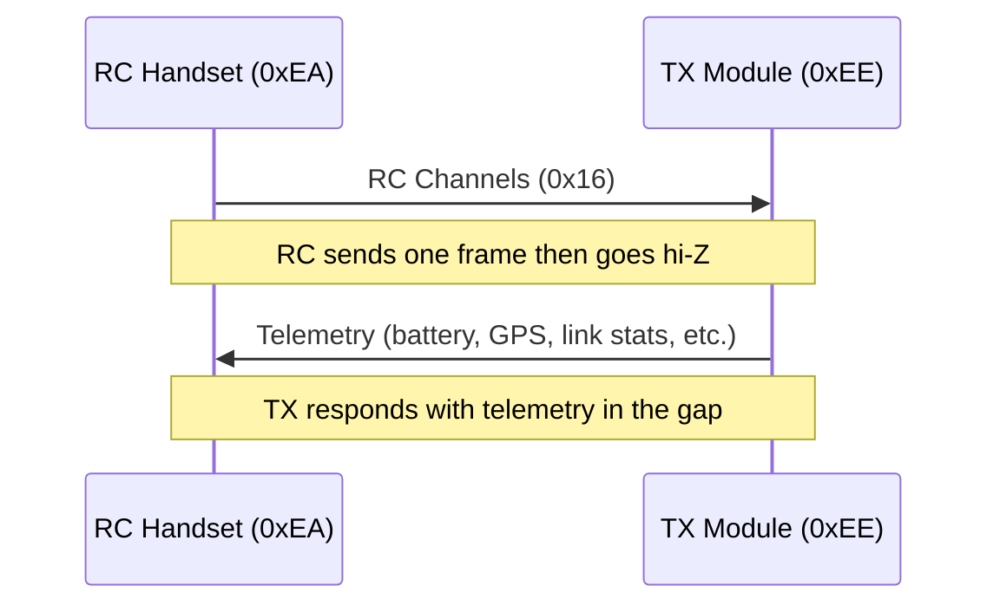
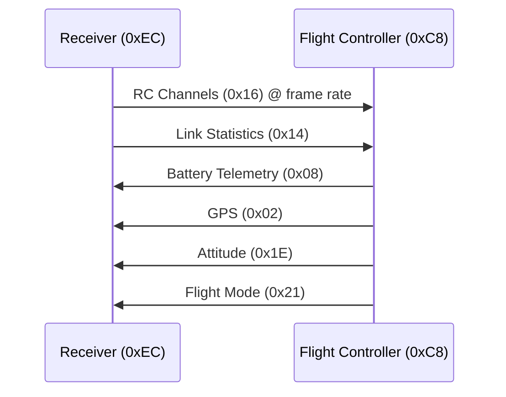
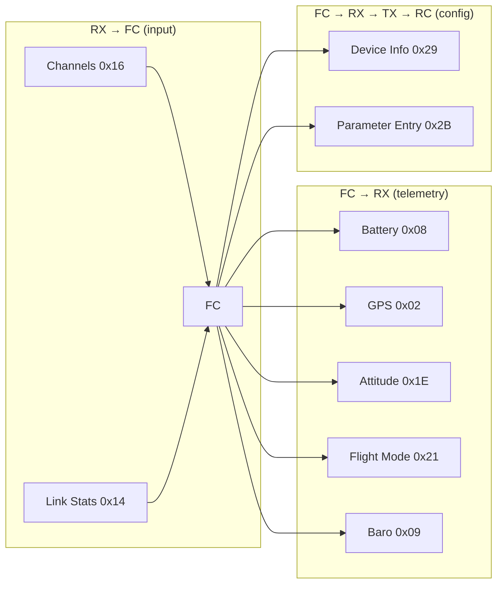
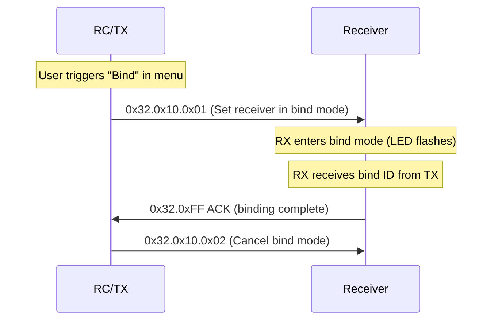
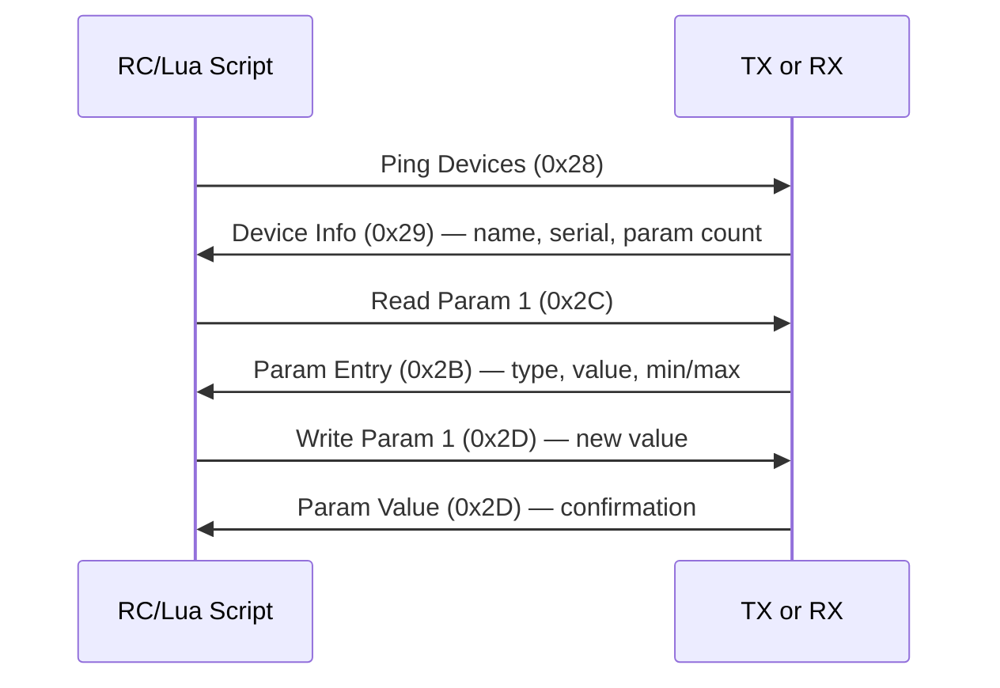
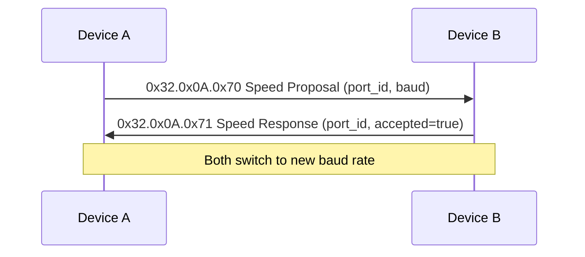
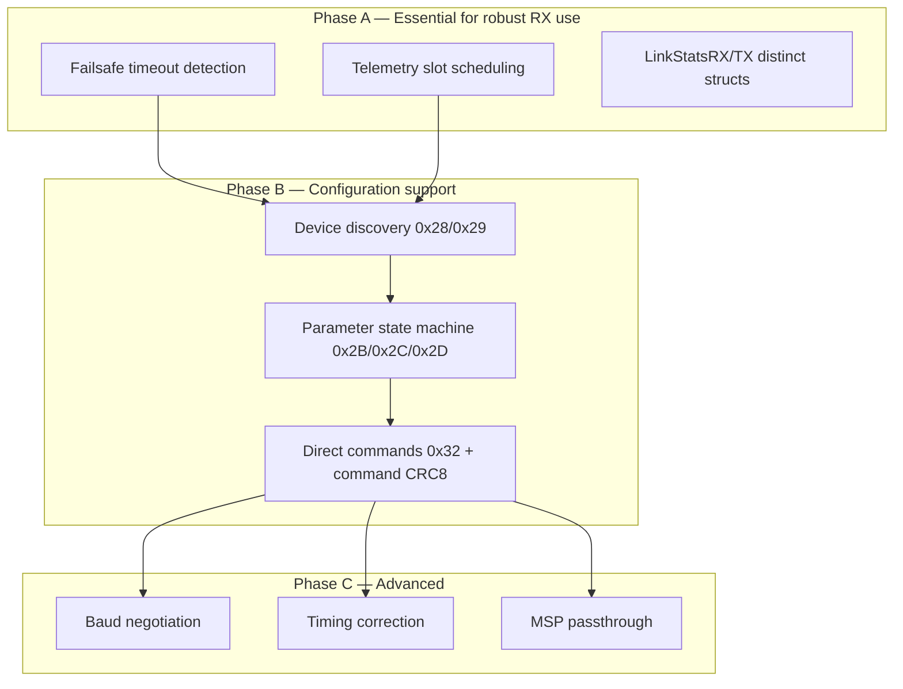

# CRSF Low-Level Protocol Details

How the protocol works in practice between real hardware (RC handsets, TX modules,
receivers, flight controllers) and what our library supports vs what it needs.

## Physical Layer

### Half-Duplex (RC ↔ TX Module)



- **Baud**: 400000 (default), 8N1, 3.3V
- **Master/slave**: RC is master — it sends one frame per slot, then releases the line
- **Timing**: Frame rate is pre-configured or negotiated (50Hz–500Hz depending on RF profile)
- **Inverted/non-inverted** both supported (hardware-dependent)

### Full-Duplex (RX ↔ FC)



- **Baud**: 416666 (default), 8N1, 3.3V, non-inverted
- **Both directions independent** — RX streams channels, FC streams telemetry
- **Higher bauds** negotiable via CRSFv3 (1Mbaud, 2Mbaud)

## Typical Flight Controller Integration

A flight controller (Betaflight, ArduPilot, INAV) uses CRSF like this:



**Telemetry scheduling**: The FC typically sends one telemetry frame per RC frame received
(interleaved). At 150Hz link rate that's ~6.6ms per slot. Betaflight rotates through
telemetry types (battery → GPS → attitude → flight mode → repeat).

## Binding

Binding pairs a TX module with a specific receiver. It uses the Direct Command system:



This requires the **Extended Frame** + **Direct Command** subsystem (Type 0x32).

## Parameter Configuration (Lua Scripts)

EdgeTX/OpenTX Lua scripts configure the TX/RX through CRSF parameter frames:



Parameter types: FLOAT, TEXT_SELECTION, STRING, FOLDER, INFO, COMMAND.
Parameters can be chunked across multiple frames (max 56 bytes payload per chunk).

## Baud Rate Negotiation (CRSFv3)



## Timing Synchronization (CRSF Shot)

The TX module sends timing correction frames (0x3A.0x10) to the RC:

```
update_interval: uint32 (LSB = 100ns) — frame period
offset: int32 (LSB = 100ns) — positive = data came early, negative = late
```

This allows the RC to synchronize its internal loop to the RF link timing.

## MSP Passthrough

Flight controllers (Betaflight) expose their MSP protocol through CRSF:

- **0x7A**: MSP Request (CRSF wraps `$M<` or `$X<`)
- **0x7B**: MSP Response (CRSF wraps `$M>` or `$X>`)
- MSP frames are chunked (max 57 bytes per CRSF frame)
- Used for: OSD configuration, PID tuning, motor testing, firmware flashing

---

## Gap Analysis: What Our Library Supports vs What's Needed

### Currently Implemented

| Feature | Status | Package |
|---------|--------|---------|
| Frame encode/decode + CRC8 | ✅ | `crsf` |
| RC Channels (0x16) | ✅ | `crsf` |
| Link Statistics (0x14) | ✅ | `crsf` |
| Battery Telemetry (0x08) | ✅ | `crsf` |
| GPS (0x02) | ✅ | `crsf` |
| Attitude (0x1E) | ✅ | `crsf` |
| Baro Altitude (0x09) | ✅ | `crsf` |
| Flight Mode (0x21) | ✅ | `crsf` |
| Heartbeat (0x0B) | ✅ | `crsf` |
| Receiver device (read channels, send telemetry) | ✅ | `crsf/rx` |
| Transmitter device (send channels, read telemetry) | ✅ | `crsf/tx` |

### Gaps for Full FC-like Usage

| Feature | Priority | What's Needed |
|---------|----------|---------------|
| **Extended frame routing** (dest/origin) | High | Already parsed in `Frame.Dest()`/`Frame.Origin()` but `rx`/`tx` don't route by address |
| **Device discovery** (0x28/0x29) | Medium | Encode/decode Ping + DeviceInfo; `rx`/`tx` should dispatch or forward these |
| **Parameter system** (0x2B/0x2C/0x2D) | Medium | Chunked param read/write state machine; needed for Lua script compat |
| **Direct Commands** (0x32) | Medium | Command CRC8 (poly 0xBA), bind, model select, VTX control |
| **Baud negotiation** (0x32.0x0A.0x70) | Low | Only needed for CRSFv3 high-speed links |
| **Timing correction** (0x3A.0x10) | Low | Only relevant if acting as TX module to RC handset |
| **MSP passthrough** (0x7A/0x7B) | Low | Only needed if bridging to Betaflight MSP |
| **Link Stats RX/TX** (0x1C/0x1D) | Low | Different struct from 0x14; currently decoded as generic LinkStats |
| **Failsafe detection** | High | `rx` should detect channel frame timeout (>1s) and signal failsafe |
| **Telemetry scheduling** | Medium | `rx` should pace telemetry responses (one per received frame) |

### Recommendations for Library Expansion



**Phase A** — ✅ Implemented in `crsf/rx`:

1. **Failsafe**: `rx.Device` tracks last channel frame timestamp; exposes `IsFailsafe() bool`
   and `OnFailsafe(func(bool))` callback.
2. **Telemetry scheduling**: `rx.Scheduler` round-robins telemetry providers, sending one frame
   per received channel frame. Wired into `rx.Device.Telemetry`.
3. **LinkStatsRX/TX**: Separate `LinkStatsRX` and `LinkStatsTX` structs with encode/decode.

**Phase B** — ✅ Implemented in `crsf` core package:

- `discovery.go`: `EncodePing`, `DecodePing`, `EncodeDeviceInfo`, `DecodeDeviceInfo`
- `param.go`: Full parameter entry/read/write encode/decode with chunking support
- `command.go`: Direct commands with `CommandCRC8` (polynomial 0xBA) validation

**Phase C** — ✅ Implemented in `crsf` core package:

- `baud.go`: Baud rate proposal/confirm helpers
- `timing.go`: Timing correction (CRSF Shot) encode/decode
- `msp.go`: MSP passthrough with chunking, reassembly, request/response frames

### Extension Points

- `rx.Device.OnFrame` and `tx.Device.OnFrame` callbacks forward unhandled frame types
  (discovery, params, commands, MSP, timing) to the application layer.
- `rx.Device.SendFrame` and `tx.Device.SendFrame` allow sending arbitrary frames (parameter
  responses, command confirmations, MSP replies, etc.).
- All protocol primitives are available in the core `crsf` package for direct use without
  requiring the rx/tx device wrappers.
