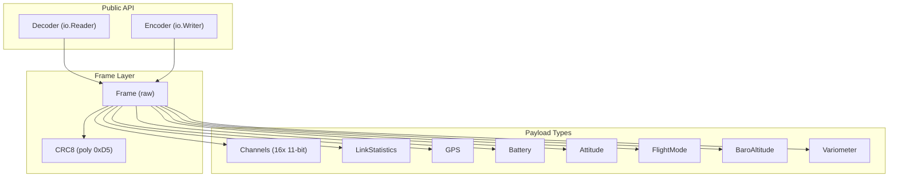

# CRSF Protocol Package

Binary frame-based protocol for radio-controlled devices (TBS Crossfire / ExpressLRS).

Reference: [TBS CRSF Specification](https://github.com/tbs-fpv/tbs-crsf-spec)

## Goals

- Stream-based: accepts `io.Reader` / `io.Writer` (UART, recording, network, etc.)
- Two operational roles:
  - **Receiver mode**: receive RC channel commands, send telemetry back
  - **Controller mode**: send RC channel commands, receive telemetry
- Human-readable typed structs for all payloads
- Type-safe frame construction and parsing
- Zero-copy where practical on hot paths

## Architecture



## Protocol Summary

### Frame Format

**Broadcast frame** (type < 0x28):

```
[Sync] [Length] [Type] [Payload...] [CRC8]
```

**Extended frame** (type >= 0x28):

```
[Sync] [Length] [Type] [Dest] [Origin] [Payload...] [CRC8]
```

- **Sync**: 0xC8 (serial), or device address
- **Length**: payload size + type + CRC (frame size - 2). Valid range: 2..62
- **Max frame**: 64 bytes total
- **CRC8**: polynomial 0xD5, covers Type + Payload (excludes Sync and Length)
- **Endianness**: Big-endian unless noted otherwise

### Hardware

| Link | Baud | Notes |
|------|------|-------|
| RC ↔ TX (half-duplex) | 400000 | Inverted or non-inverted, 8N1, 3.3V |
| RX ↔ FC (full-duplex) | 416666 | Non-inverted, 8N1, 3.3V |

### Device Addresses

| Address | Device |
|---------|--------|
| 0x00 | Broadcast |
| 0xC8 | Flight Controller |
| 0xEA | Remote Control (RC handset) |
| 0xEC | Receiver (RX) |
| 0xEE | Transmitter Module (TX) |
| 0xCE | VTX |
| 0xC0 | Current Sensor |
| 0xC2 | GPS |
| 0x80 | OSD |

### Key Frame Types

| Type | Name | Direction |
|------|------|-----------|
| 0x02 | GPS | FC → TX |
| 0x08 | Battery Sensor | FC → TX |
| 0x09 | Baro Altitude | FC → TX |
| 0x0B | Heartbeat | any |
| 0x14 | Link Statistics | RX → FC |
| 0x16 | RC Channels Packed | TX/RX → FC |
| 0x1C | Link Statistics RX | RX → FC |
| 0x1D | Link Statistics TX | TX → RC |
| 0x1E | Attitude | FC → TX |
| 0x21 | Flight Mode | FC → TX |
| 0x28 | Ping Devices | extended |
| 0x29 | Device Info | extended |
| 0x2B | Parameter Entry | extended |
| 0x2C | Parameter Read | extended |
| 0x2D | Parameter Write | extended |
| 0x32 | Direct Command | extended |
| 0x3A | Timing Correction | extended |
| 0x7A | MSP Request | extended |
| 0x7B | MSP Response | extended |

### RC Channels (0x16)

16 channels × 11 bits = 176 bits = 22 bytes, little-endian packed.

```
Value range: 0..1984
Center (1500µs) = 992
TICKS_TO_US(x) = (x - 992) * 5 / 8 + 1500
US_TO_TICKS(x) = (x - 1500) * 8 / 5 + 992
```

## Package Layout

```
x/devices/crsf/
├── SPEC.md            # This file
├── LOW-LEVEL.md       # Protocol mechanics & gap analysis
├── frame.go           # Frame, Address, Type constants, CRC8, CommandCRC8
├── decoder.go         # Decoder: stream → typed frames
├── encoder.go         # Encoder: typed frames → stream
├── channels.go        # Channels struct, 11-bit pack/unpack
├── telemetry.go       # GPS, Battery, Attitude, Baro, FlightMode, LinkStats, LinkStatsRX/TX
├── discovery.go       # Ping (0x28), DeviceInfo (0x29)
├── param.go           # Parameter system (0x2B/0x2C/0x2D)
├── command.go         # Direct commands (0x32) + command CRC8
├── baud.go            # Baud negotiation helpers (0x70/0x71)
├── timing.go          # Timing correction / CRSF Shot (0x3A)
├── msp.go             # MSP passthrough (0x7A/0x7B) with chunking
├── crsf_test.go       # Core tests
├── advanced_test.go   # Tests for discovery, params, commands, MSP, timing
├── rx/
│   ├── device.go      # Receiver Device: reads channels, sends telemetry
│   ├── scheduler.go   # Telemetry slot scheduler (round-robin)
│   └── scheduler_test.go
└── tx/
    └── device.go      # Transmitter Device: sends channels, reads telemetry
```

## Public API Design

### Types

```go
type Address byte

const (
    AddrBroadcast        Address = 0x00
    AddrFlightController Address = 0xC8
    AddrRemoteControl    Address = 0xEA
    AddrReceiver         Address = 0xEC
    AddrTransmitter      Address = 0xEE
    // ...
)

type FrameType byte

const (
    TypeGPS              FrameType = 0x02
    TypeBattery          FrameType = 0x08
    TypeBaroAltitude     FrameType = 0x09
    TypeHeartbeat        FrameType = 0x0B
    TypeLinkStats        FrameType = 0x14
    TypeChannelsPacked   FrameType = 0x16
    TypeLinkStatsRX      FrameType = 0x1C
    TypeLinkStatsTX      FrameType = 0x1D
    TypeAttitude         FrameType = 0x1E
    TypeFlightMode       FrameType = 0x21
    TypePingDevices      FrameType = 0x28
    TypeDeviceInfo       FrameType = 0x29
    // ...
)
```

### Payload Structs

```go
type Channels struct {
    Ch [16]uint16  // Raw 11-bit values (0..1984)
}

func (c *Channels) Microseconds(ch int) uint16  // Convert to µs
func (c *Channels) SetMicroseconds(ch int, us uint16)

type LinkStatistics struct {
    UplinkRSSI1    int8   // dBm (stored as positive, negate for dBm)
    UplinkRSSI2    int8
    UplinkQuality  uint8  // 0..100%
    UplinkSNR      int8   // dB
    ActiveAntenna  uint8
    RFProfile      uint8
    UplinkPower    uint8  // enum → dBm via lookup
    DownlinkRSSI   int8
    DownlinkQuality uint8
    DownlinkSNR    int8
}

type GPS struct {
    Latitude   float64  // degrees
    Longitude  float64  // degrees
    Speed      float64  // km/h
    Heading    float64  // degrees
    Altitude   float64  // meters (above sea level)
    Satellites uint8
}

type Battery struct {
    Voltage     float64  // Volts
    Current     float64  // Amps
    CapacityUsed uint32  // mAh
    Remaining   uint8   // percent
}

type Attitude struct {
    Pitch float64  // radians
    Roll  float64  // radians
    Yaw   float64  // radians
}

type FlightMode struct {
    Mode string
}
```

### Frame

```go
type Frame struct {
    Sync    Address
    Type    FrameType
    Dest    Address    // extended frames only
    Origin  Address    // extended frames only
    Payload []byte
}

func (f *Frame) IsExtended() bool
```

### Decoder / Encoder (low-level, in base `crsf` package)

```go
dec := crsf.NewDecoder(r)       // reads raw frames from io.Reader
enc := crsf.NewEncoder(w)       // writes raw frames to io.Writer
```

### rx.Device (receiver side)

```go
dev := rx.New(ctx, reader, writer, handler)
dev.Start()
dev.Channels()    // latest snapshot
dev.LinkStats()   // latest snapshot
dev.SendBattery(&crsf.Battery{...})
dev.Close()
```

### tx.Device (transmitter/controller side)

```go
dev := tx.New(ctx, reader, writer, handler)
dev.Start()
dev.SendChannels(&crsf.Channels{...})
dev.Battery()     // latest received telemetry
dev.GPS()
dev.Close()
```

## Acceptance Criteria

- [ ] `Decoder` reads frames from any `io.Reader`, validates CRC, returns typed payloads
- [ ] `Encoder` writes frames to any `io.Writer` with correct CRC
- [ ] RC channels pack/unpack matches spec (16 × 11-bit, little-endian)
- [ ] Telemetry structs use human-friendly units (degrees, volts, percent)
- [ ] Works with TinyGo (no unsupported stdlib; fixed buffers)
- [ ] Example driver: ELRS receiver → 5-6 PWM channels + battery/link telemetry
- [ ] Driver compiles for rp2040 and esp32 targets

## Non-Goals

- Full CRSFv3 negotiation (baud switching)
- Extended parameter settings (0x2B/0x2C/0x2D)
- MSP passthrough (0x7A/0x7B)
- Over-the-air update frames

## Implementation Plan

### Phase 1: Core framing

1. CRC8 (polynomial 0xD5, lookup table)
2. Frame struct, constants (addresses, frame types)
3. Frame encoding/decoding (sync detection, length validation, CRC check)

### Phase 2: RC Channels

4. 11-bit channel pack/unpack (little-endian bitfield)
5. Channels struct with µs conversion helpers

### Phase 3: Telemetry payloads

6. LinkStatistics (0x14, 0x1C, 0x1D)
7. GPS (0x02)
8. Battery (0x08)
9. Attitude (0x1E)
10. BaroAltitude (0x09)
11. FlightMode (0x21)

### Phase 4: Stream API

12. Decoder (sync-byte scanning, frame reassembly from io.Reader)
13. Encoder (frame serialization to io.Writer)

### Phase 5: Extended frames (future)

14. Ping/DeviceInfo (0x28/0x29)
15. Parameter read/write (0x2B/0x2C/0x2D)

## Usage Examples

### Receiving RC commands (flight controller / rx side)

```go
type myHandler struct{}
func (h *myHandler) OnChannels(ch *crsf.Channels) {
    throttle := ch.Microseconds(2)
    // drive servos / ESC
}
func (h *myHandler) OnLinkStats(ls *crsf.LinkStatistics) {}

dev := rx.New(ctx, uart, uart, &myHandler{})
dev.Start()
// periodically send telemetry
dev.SendBattery(&crsf.Battery{Voltage: 11.4, Remaining: 72})
```

### Acting as RC controller (tx side)

```go
type myTelemetry struct{}
func (t *myTelemetry) OnBattery(b *crsf.Battery) { fmt.Println("Batt:", b.Voltage) }
func (t *myTelemetry) OnGPS(*crsf.GPS) {}
func (t *myTelemetry) OnAttitude(*crsf.Attitude) {}
func (t *myTelemetry) OnFlightMode(*crsf.FlightMode) {}
func (t *myTelemetry) OnLinkStats(*crsf.LinkStatistics) {}

dev := tx.New(ctx, uart, uart, &myTelemetry{})
dev.Start()
ch := &crsf.Channels{}
ch.SetMicroseconds(0, 1500) // Roll center
ch.SetMicroseconds(2, 1000) // Throttle low
dev.SendChannels(ch)
```
